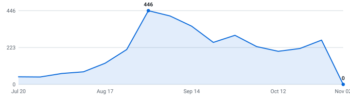

# 🎓 Summer 2027 Tech Internships

**A self-updating engine that tracks tech internships so you don't have to.**

&nbsp;&nbsp;&nbsp;

### 1608 open roles (621 listed below) · 199 new this week

5,002 employers tracked · updated Nov 13, 2026 at 21:31 UTC

_1133 have a cycle the employer stated · 475 are recent postings whose cycle isn't stated (listed separately, never mixed in)._

**[🖥️ Live dashboard](https://heyinihere.github.io/Automated-List-Of-Summer-2027-and-Fall-2026-MechEng-Internships/)** · **[📡 RSS](https://heyinihere.github.io/Automated-List-Of-Summer-2027-and-Fall-2026-MechEng-Internships/feed.xml)** · **[⚙️ JSON API](https://heyinihere.github.io/Automated-List-Of-Summer-2027-and-Fall-2026-MechEng-Internships/api/jobs.json)** · **[✉️ Email alerts](https://heyinihere.github.io/Automated-List-Of-Summer-2027-and-Fall-2026-MechEng-Internships/#subscribe)**

> [!TIP]
> **⭐ Star this repo** to save it and get updates when new roles are added.

Instead of refreshing a dozen career pages by hand, it reads company hiring feeds directly and keeps one live list, newest roles on top, refreshed automatically throughout the day.

**🔔 New roles in your inbox:** [subscribe by email](https://heyinihere.github.io/Automated-List-Of-Summer-2027-and-Fall-2026-MechEng-Internships/#subscribe) - one email a day, only when new internships actually appeared, unsubscribe from any email in two clicks. (Prefer RSS-to-email? [Feedrabbit works too](https://feedrabbit.com/subscriptions/new?url=https%3A%2F%2Fraw.githubusercontent.com%2FHeyIniHere%2FAutomated-List-Of-Summer-2027-and-Fall-2026-MechEng-Internships%2Fmain%2Fdocs%2Ffeed.xml).)

---

## What this is

This is an engine, not a hand-kept list. It polls company career feeds several times a day, finds the internships, removes duplicates, and rebuilds this page on its own. Every link comes straight from the source, so it's real and current, not a stale list someone forgot to update (speed matters).

## What makes this different

- **📅 [Drop Radar](#drop-radar)** - a forecast of **what's coming**: each marquee company's typical opening window, replaced by the real drop date the moment the engine catches it live. Windows are estimates and labelled as such; only dates the engine observed itself are marked verified.
- **Visa intel, computed** - 🇺🇸 / 🛂 flags detected automatically from every job description, plus ✓ for employers with a real H-1B track record (official USCIS data, FY2022-23 - a history, not a promise). The big lists crowdsource this by hand; here it's code. Most postings say nothing either way, and those are shown as unknown rather than guessed.
- **A date on nearly every role** - taken from the job portal itself where the portal states one, so newest-first actually means newest. The exact coverage figure is printed at the bottom of this page every run.
- **Skill tags + pay, extracted** - every posting's text is scanned for the stack it wants (Python, C++, PyTorch, ...) and the pay it states - searchable on the [dashboard](https://heyinihere.github.io/Automated-List-Of-Summer-2027-and-Fall-2026-MechEng-Internships/), included in the CSV and API.
- **Alerts your way** - [email digests](https://heyinihere.github.io/Automated-List-Of-Summer-2027-and-Fall-2026-MechEng-Internships/#subscribe) or [RSS](https://heyinihere.github.io/Automated-List-Of-Summer-2027-and-Fall-2026-MechEng-Internships/feed.xml) (point any reader, or a Slack/Discord RSS integration, at it) - plus a [live dashboard](https://heyinihere.github.io/Automated-List-Of-Summer-2027-and-Fall-2026-MechEng-Internships/) with search, filters, and a saved-roles list that never leaves your browser.
- **An engine, not a spreadsheet** - 5,174 job-board endpoints (5,002 distinct employers; some run more than one board) polled every hour across 12 ATS platforms, full source and tests in this repo.

## Scope

| | |
|---|---|
| **Roles** | Software Engineering, Data Science & Machine Learning (and closely related technical internships) |
| **Region** | United States |
| **Cycles** | Summer 2027 and Fall 2026 |

## About

I'm an international student studying in the United States, so I built this for the search I'm doing myself. The list is US roles only for now - that's where I'm searching. Use it to spot roles early and apply before they fill up - being first genuinely helps.

## Where this is going

I'm building this in the open and adding to it as it grows. Recently shipped: **email alerts**, the **Drop Radar**, **auto-detected sponsorship flags**, and the **live dashboard**. Next up: personalized alerts (pick your categories), per-company hiring pages, and a ghost-posting detector. If it helps you, a star means a lot and tells me to keep going.

## How to use

<b>Reading the table — flags, dates, and the cycle split</b> (click to expand)

- Roles are grouped by cycle below - **newest posting on top, oldest at the bottom.**
- A cycle section holds only roles whose **employer stated that cycle** - in the title, or in the posting's own text. Postings that name no cycle anywhere are in *Recently posted — cycle not stated* further down, with **no cycle guessed for them**. Same quality bar, different amount of evidence.
- The **Posted** column is the date the company published the role.
- **Flags:** 🇺🇸 = requires U.S. citizenship or a security clearance · 🛂 = the posting says it won't sponsor a work visa · 🏠 = the location says remote · 🆕 = spotted in the last 48 hours. Sponsorship flags are detected automatically from each job description - treat them as a strong hint and confirm on the posting.
- **✓ after a company name** = a real H-1B track record: USCIS approved 10+ petitions for that employer in FY2022–2023 (matched automatically against the official [H-1B Employer Data Hub](https://www.uscis.gov/tools/reports-and-studies/h-1b-employer-data-hub)). No ✓ doesn't mean they won't sponsor - it means we can't prove they have.
- Track your applications with [`data/internships.csv`](data/internships.csv) (opens in Excel / Google Sheets).
- Missing a company? Adding one takes a single line, see [CONTRIBUTING.md](CONTRIBUTING.md).

---

## Summer 2027  (300 employer-stated)

| Company | Role | Category | Location | Posted | Apply |
|---|---|---|---|---|---|
| Amazon ✓ | 2027 Applied Science Internship - Robotics - United States 🆕 | Hardware | North Reading, Massachusetts, USA | Nov 13, 2026 | [Apply](https://www.amazon.jobs/en/jobs/10604778/2027-applied-science-internship-robotics-united-states) |
| Entegris ✓ | Mechanical Engineering Intern 🆕 | Hardware | Bloomington, MN | Nov 13, 2026 | [Apply](https://entegris.wd1.myworkdayjobs.com/entegriscareers/job/Bloomington-MN/Mechanical-Engineering-Intern_REQ-15847) |
| Jabil ✓ | Industrial Engineering Intern 🆕 | Hardware | St. Petersburg/Tampa, FL | Nov 13, 2026 | [Apply](https://jabil.wd5.myworkdayjobs.com/Jabil_Careers/job/St-PetersburgTampa-FL/Industrial-Engineering-Intern_J2470894) |
| Northrop Grumman | 2027 Manufacturing Engineering Intern - Sunnyvale CA 🇺🇸 🆕 | Hardware | United States-California-Sunnyvale | Nov 13, 2026 | [Apply](https://ngc.wd1.myworkdayjobs.com/Northrop_Grumman_External_Site/job/United-States-California-Sunnyvale/XMLNAME-2027-Manufacturing-Engineering-Intern---Sunnyvale-CA_R10260394) |
| Reliable Robotics | Mechanical Engineering Intern (Summer 2027) 🆕 | Hardware | Mountain View, CA | Nov 13, 2026 | [Apply](https://jobs.ashbyhq.com/reliable-robotics/4aa17839-d94c-478f-9ce9-9974df00314b) |
| Reliable Robotics | Manufacturing Engineering Intern (Summer 2027) 🆕 | Hardware | Mountain View, CA | Nov 13, 2026 | [Apply](https://jobs.ashbyhq.com/reliable-robotics/1085bdf8-f023-4cf6-90ed-93a2f4f6ded8) |
| Reliable Robotics | Flight Software Engineer Intern (Summer 2027) 🆕 | Software | Mountain View, CA | Nov 13, 2026 | [Apply](https://jobs.ashbyhq.com/reliable-robotics/cbd31c94-5a83-4d1e-8252-de67a5e594ed) |
| Rocket Companies | Data Analyst Intern - Summer 2027 🆕 | Data & ML/AI | Detroit, MI | Nov 13, 2026 | [Apply](https://quickenloans.wd5.myworkdayjobs.com/rocket_careers/job/Detroit-MI/Data-Analyst-Intern---Summer-2027_R-083832) |
| SharkNinja ✓ | Summer 2027: Mechanical Engineering Intern, Ninja (May to August) 🆕 | Hardware | Needham, MA, United States | Nov 13, 2026 | [Apply](https://job-boards.greenhouse.io/sharkninjaoperatingllc/jobs/4719580006) |
| Verisk | Data Science/AI Intern / 2027 Summer Internship Program 🆕 | Data & ML/AI | Lehi, UT, United States | Nov 13, 2026 | [Apply](https://fa-ewmy-saasfaprod1.fa.ocs.oraclecloud.com/hcmUI/CandidateExperience/en/sites/CX_1/job/5184) |
| State Street ✓ | Cyber Security Operations Center Analyst, Full-time Internship (Jan - June 2027) 🆕 | Security | Quincy, Massachusetts | Nov 13, 2026 | [Apply](https://statestreet.wd1.myworkdayjobs.com/Global/job/Quincy-Massachusetts/Cyber-Security-Operations-Center-Analyst--Full-time-Internship--Jan---June-2027-_R-801091) |
| Aurora Innovation ✓ | Software Engineer Intern, Vehicle Platforms 🆕 | Software | Mountain View, CA | Nov 13, 2026 | [Apply](https://jobs.ashbyhq.com/aurora-operations-inc/06daa269-c02b-43a4-88b8-b57a3ba335ef) |
| Zoox ✓ | Data Scientist Intern [Summer 2027] 🆕 | Data & ML/AI | Foster City, CA | Nov 12, 2026 | [Apply](https://jobs.lever.co/zoox/0f42ac76-3821-4805-8b59-446477d1e1db) |
| ASML ✓ | Internship - Data Scientist 🆕 | Data & ML/AI | Wilton, CT, USA | Nov 12, 2026 | [Apply](https://asml.wd3.myworkdayjobs.com/asmlext1/job/Wilton-CT-USA/Internship---Data-Scientist_J-00356462) |
| Philips | Intern - AI & Analytics Analyst - Nashville, TN - Summer 2027 🆕 | Data & ML/AI | Nashville, Tennessee, United States | Nov 12, 2026 | [Apply](https://philips.wd3.myworkdayjobs.com/jobs-and-careers/job/Nashville-Tennessee-United-States/Intern---AI---Analytics-Analyst---Nashville--TN---Spring-2027_593012) |
| Muon Space | Software Engineering Intern-Information Systems (Summer 2027) 🇺🇸 🆕 | Software | San Jose, CA | Nov 12, 2026 | [Apply](https://job-boards.greenhouse.io/muonspace/jobs/5293973007) |
| American Electric Power ✓ | Cybersecurity Intern - Summer 2027 🛂 🆕 | Security | Columbus, OH | Nov 12, 2026 | [Apply](https://aep.wd1.myworkdayjobs.com/AEPCareerSite/job/Columbus-OH/Cybersecurity-Intern---Summer-2027_R21158) |
| AstraZeneca ✓ | Summer 2027 Innovation and AI Transformation Intern 🆕 | Data & ML/AI | US - Boston - MA | Nov 12, 2026 | [Apply](https://astrazeneca.wd3.myworkdayjobs.com/Careers/job/US---Boston---MA/Summer-2027-Innovation-and-AI-Transformation-Intern_R-264282-1) |
| CACI | Embedded Software Development Intern - Summer 2027 🇺🇸 🆕 | Software | Denver, CO, US | Nov 12, 2026 | [Apply](https://caci.wd1.myworkdayjobs.com/external/job/Denver-CO-US/Embedded-Software-Development-Intern---Summer-2027_333147) |
| Entegris ✓ | Power Platform / Copilot Studio Intern – AI - Summer Intern 🆕 | Data & ML/AI | Aurora, IL | Nov 12, 2026 | [Apply](https://entegris.wd1.myworkdayjobs.com/entegriscareers/job/Aurora-IL/Power-Platform---Copilot-Studio-Intern---AI---Summer-Intern_REQ-15841) |
| Entegris ✓ | Product Management Intern 🆕 | Software | Rockrimmon, Colorado Springs, CO | Nov 12, 2026 | [Apply](https://entegris.wd1.myworkdayjobs.com/entegriscareers/job/Rockrimmon-Colorado-Springs-CO/Product-Management-Intern_REQ-15838) |
| Jabil ✓ | Manufacturing Engineering Intern - Medical Device Manufacturing 🆕 | Hardware | Monument, CO | Nov 12, 2026 | [Apply](https://jabil.wd5.myworkdayjobs.com/Jabil_Careers/job/Monument-CO/Manufacturing-Engineering-Intern---Medical-Device-Manufacturing_J2469027) |
| Northrop Grumman | 2027 Aeronautical Engineering Intern - Sunnyvale CA 🇺🇸 🆕 | Hardware | United States-California-Sunnyvale | Nov 12, 2026 | [Apply](https://ngc.wd1.myworkdayjobs.com/Northrop_Grumman_External_Site/job/United-States-California-Sunnyvale/XMLNAME-2027-Aeronautical-Engineering-Intern---Sunnyvale-CA_R10260488) |
| Stanley Black & Decker ✓ | Intern, Data Analyst & BI, Summer 2027 🛂 🆕 | Data & ML/AI | Towson, MD, United States | Nov 12, 2026 | [Apply](https://sbdinc.wd1.myworkdayjobs.com/Stanley_Black_Decker_Career_Site/job/Towson-MD-United-States/Intern--Data-Analyst---BI--Summer-2027_REQ-1000052481) |
| The Toro Company | Mechanical Engineering Intern - HammerHead 🛂 🆕 | Hardware | Lake Mills, WI | Nov 12, 2026 | [Apply](https://ttc.wd1.myworkdayjobs.com/Toro_External_Careers/job/Lake-Mills-WI/Mechanical-Engineering-Intern---HammerHead_JR17392) |
| SharkNinja ✓ | Summer 2027: Data Science Intern (May to August) 🆕 | Data & ML/AI | Needham, MA, United States | Nov 12, 2026 | [Apply](https://job-boards.greenhouse.io/sharkninjaoperatingllc/jobs/4727539006) |
| Johnson Controls ✓ | Computer Science/CAD Intern 🆕 | Software | Waynesboro-Pennsylvania-United States o… | Nov 12, 2026 | [Apply](https://jci.wd5.myworkdayjobs.com/JCI/job/Waynesboro-Pennsylvania-United-States-of-America/Computer-Science-CAD-Intern_WD30285046) |
| Northrop Grumman | 2027 Manufacturing Engineering Intern - Annapolis MD 🇺🇸 🆕 | Hardware | United States-Maryland-Annapolis | Nov 12, 2026 | [Apply](https://ngc.wd1.myworkdayjobs.com/Northrop_Grumman_External_Site/job/United-States-Maryland-Annapolis/XMLNAME-2027-Manufacturing-Engineering-Intern---Annapolis-MD_R10260385) |
| PTC ✓ | Onshape Site Reliability Engineering Intern (Summer 2027) 🆕 | Software | Boston, MA, USA | Nov 12, 2026 | [Apply](https://ptc.wd1.myworkdayjobs.com/ptc/job/Boston-MA-USA/Onshape-Site-Reliability-Engineering-Intern--Summer-2027-_JR112926) |
| Martin Marietta | Intern, IS Infrastructure (Summer 2027) 🆕 | Software | Raleigh, NC | Nov 11, 2026 | [Apply](https://martinmarietta.wd5.myworkdayjobs.com/Martin_Marietta_Careers/job/Raleigh-NC/Intern--IS-Infrastructure_JR023723) |
| Formlabsinternships | Manufacturing Engineering Intern (Summer 2027) 🆕 | Hardware | Somerville, MA | Nov 11, 2026 | [Apply](https://job-boards.greenhouse.io/formlabsinternships/jobs/8161818) |
| Lightmatter | Packaging Thermal and Mechanical Analysis Internship - Summer 2027 🆕 | Hardware | Mountain View, CA | Nov 11, 2026 | [Apply](https://boards.greenhouse.io/lightmatter/jobs/5473871008?gh_jid=5473871008) |
| Lightmatter | Laser Firmware Intern - Summer 2027 🆕 | Hardware | Boston, MA | Nov 11, 2026 | [Apply](https://boards.greenhouse.io/lightmatter/jobs/5479596008?gh_jid=5479596008) |
| Lightmatter | Packaging Mechanical Design Internship - Summer 2027 🆕 | Hardware | Mountain View, CA | Nov 11, 2026 | [Apply](https://boards.greenhouse.io/lightmatter/jobs/5479684008?gh_jid=5479684008) |
| RTX | Software Engineering Intern (Summer 2027) 🇺🇸 🆕 | Software | US-IA-CEDAR RAPIDS-143 ~ 855 35Th St NE… | Nov 11, 2026 | [Apply](https://globalhr.wd5.myworkdayjobs.com/rec_rtx_ext_gateway/job/US-IA-CEDAR-RAPIDS-143--855-35Th-St-NE--BLDG-143/Software-Engineering-Intern--Summer-2027-_01888055) |
| Mars | Summer 2027 Mars Snacking Manufacturing Internship - Muncy, PA 🆕 | Hardware | USA-Pennsylvania-Elizabethtown | Nov 11, 2026 | [Apply](https://mars.wd3.myworkdayjobs.com/external/job/USA-Pennsylvania-Elizabethtown/Summer-2027-Mars-Snacking-Manufacturing-Internship---Muncy--PA_R172446-1) |
| MKS Instruments | 2027 Summer Software Engineer Co-op 🇺🇸 🆕 | Software | Andover, MA | Nov 11, 2026 | [Apply](https://mksinst.wd1.myworkdayjobs.com/MKSCareersUniversity/job/Andover-MA/XMLNAME-2027-Summer-Software-Engineer-Co-op_R20610) |
| Formlabsinternships | Manufacturing Test Software Intern (Summer 2027) | Hardware | Somerville, MA | Nov 11, 2026 | [Apply](https://job-boards.greenhouse.io/formlabsinternships/jobs/8256076) |
| AstraZeneca ✓ | Manufacturing Sciences, Validation Engineer Intern | Hardware | US - Gaithersburg - MD | Nov 11, 2026 | [Apply](https://astrazeneca.wd3.myworkdayjobs.com/Careers/job/US---Gaithersburg---MD/Manufacturing-Sciences--Validation-Engineer-Intern_R-264093) |
| AstraZeneca ✓ | Manufacturing Analyst Intern | Hardware | US - Rockville - MD | Nov 11, 2026 | [Apply](https://astrazeneca.wd3.myworkdayjobs.com/Careers/job/US---Rockville---MD/Manufacturing-Analyst-Intern_R-264060) |
| Huron ✓ | Internal Audit and Risk Management - Data Analytics & AI (Summer 2027 Internship - Washington, D.C.) | Data & ML/AI | Washington DC - 1800 M Street, NW | Nov 11, 2026 | [Apply](https://huron.wd1.myworkdayjobs.com/huroncareers/job/Washington-DC---1800-M-Street-NW/Internal-Audit-and-Risk-Management---Data-Analytics---AI--Summer-2027-Internship-_JR-0017165) |
| Mars | Summer 2027 Mars Snacking Manufacturing Internship - Jackson, TN | Hardware | USA-Tennessee-Franklin | Nov 11, 2026 | [Apply](https://mars.wd3.myworkdayjobs.com/external/job/USA-Tennessee-Franklin/Summer-2027-Mars-Snacking-Manufacturing-Internship---Jackson--TN_R172450-1) |
| AtkinsRéalis | Structural Engineering Intern - Summer 2027 | Hardware | US.MI.Lansing.3100 West Road | Nov 11, 2026 | [Apply](https://slihrms.wd3.myworkdayjobs.com/careers/job/USMILansing3100-West-Road/Structural-Engineering-Intern---Summer-2027_R-171365) |
| STV ✓ | Structural Engineering Intern - Summer 2027 🛂 | Hardware | Frisco, Texas | Nov 11, 2026 | [Apply](https://stvinc.wd5.myworkdayjobs.com/stv/job/Frisco-Texas/Structural-Engineering-Intern---Summer-2027_JR6490) |
| Skydio ✓ | Middleware Software Engineer Intern - Summer 2027 | Software | San Mateo, California, United States | Nov 10, 2026 | [Apply](https://jobs.ashbyhq.com/skydio/c85af510-9fe4-4167-a914-c3ab344bef03) |
| Shield AI | Summer 2027 - Software Engineer Intern | Software | San Diego, California | Nov 10, 2026 | [Apply](https://jobs.ashbyhq.com/shield/db04c516-d21a-449c-8bfd-1cf830eafb5a) |
| Minitab | Cybersecurity Intern (Summer 2027) | Security | State College +2 more | Nov 10, 2026 | [Apply](https://job-boards.greenhouse.io/minitab/jobs/8200356003) |
| Western Digital ✓ | Summer 2027 Intern - Software Engineering | Software | San Jose, CA, United States | Nov 10, 2026 | [Apply](https://jobs.smartrecruiters.com/WesternDigital/744000160975819) |
| Addepar ✓ | Software Engineering Intern - Summer 2027 | Software | New York, NY | Nov 10, 2026 | [Apply](https://job-boards.greenhouse.io/addepar1/jobs/8927531002) |
| Addepar ✓ | AI Engineering Intern - Summer 2027 | Data & ML/AI | New York, NY | Nov 10, 2026 | [Apply](https://job-boards.greenhouse.io/addepar1/jobs/8927543002) |
| Toyota Research Institute ✓ | Human-Centered AI Research Intern, Causal Reasoning Models (Summer 2027) | Data & ML/AI | Los Altos, CA | Nov 10, 2026 | [Apply](https://jobs.lever.co/tri/be41a03c-460e-4ff7-b817-f012aa1c4b37) |
| Clean Harbors ✓ | Mechanical Engineering Intern Industrial Services / Summer 2027 | Hardware | Canal Fulton, OH, United States | Nov 10, 2026 | [Apply](https://epyc.fa.us2.oraclecloud.com/hcmUI/CandidateExperience/en/sites/CX_1001/job/168741) |
| Hunt Oil Company | Application Developer Intern - Summer 2027 | Software | Dallas, TX, United States | Nov 10, 2026 | [Apply](https://fa-eqcd-saasfaprod1.fa.ocs.oraclecloud.com/hcmUI/CandidateExperience/en/sites/CX_1/job/1104) |
| Legrand | Product Management Intern | Software | Syracuse, NY, United States | Nov 10, 2026 | [Apply](https://iadugs.fa.ocs.oraclecloud.com/hcmUI/CandidateExperience/en/sites/CX_1001/job/1837) |
| Momentive ✓ | 2027 Co-Op - Electronics & Aerospace | Hardware | US NY Waterford | Nov 10, 2026 | [Apply](https://momentive.wd1.myworkdayjobs.com/MC/job/US-NY-Waterford/XMLNAME-2027-Co-Op---Electronics---Aerospace_R10058) |
| T-Mobile ✓ | Summer 2027 T-Ads Software Engineering Internship | Software | Philadelphia, Pennsylvania | Nov 10, 2026 | [Apply](https://tmobile.wd1.myworkdayjobs.com/External/job/Philadelphia-Pennsylvania/Summer-2027-T-Ads-Software-Engineering-Internship_REQ381219) |
| T-Mobile ✓ | Summer 2027 T-Ads Software Engineering Internship | Software | Philadelphia, Pennsylvania | Nov 10, 2026 | [Apply](https://tmobile.wd1.myworkdayjobs.com/External/job/Philadelphia-Pennsylvania/Summer-2027-T-Ads-Software-Engineering-Internship_REQ381225) |
| The Toro Company | Advanced Manufacturing Engineering Intern - The Toro Company 🛂 | Hardware | Bloomington, MN | Nov 10, 2026 | [Apply](https://ttc.wd1.myworkdayjobs.com/Toro_External_Careers/job/Bloomington-MN/Advanced-Manufacturing-Engineering-Intern---The-Toro-Company_JR17845) |
| Shield AI | Summer 2027 - Mechanical Engineering Intern | Hardware | Seattle, Washington | Nov 09, 2026 | [Apply](https://jobs.ashbyhq.com/shield/38ba128e-815b-4a14-b4d2-446ffc190a33) |
| Illumio ✓ | Engineering Intern, SRE 🛂 | Software | Sunnyvale, California - HQ | Nov 09, 2026 | [Apply](https://jobs.ashbyhq.com/illumio/2bcba5c3-c6e7-407c-92b2-73027594789e) |
| The New York Times ✓ | ML Scientist Intern | Data & ML/AI | New York, NY | Nov 09, 2026 | [Apply](https://job-boards.greenhouse.io/thenewyorktimes/jobs/4752926005) |
| The New York Times ✓ | Data Analyst Intern | Data & ML/AI | New York, NY | Nov 09, 2026 | [Apply](https://job-boards.greenhouse.io/thenewyorktimes/jobs/4752930005) |
| Pivotal Software ✓ | Internship, Software Engineering (Summer 2027) 🇺🇸 | Software | Palo Alto, CA | Nov 09, 2026 | [Apply](https://jobs.lever.co/pivotal/3a80913d-886a-4d22-bf5e-9a011b157ec4) |
| Pivotal Software ✓ | Manufacturing Engineering Internship (Summer 2027) 🇺🇸 | Hardware | Palo Alto, CA | Nov 09, 2026 | [Apply](https://jobs.lever.co/pivotal/9aeda482-373d-4916-82a6-180748708ac2) |
| Pivotal Software ✓ | Internship, Mechanical Engineering (Summer 2027) 🇺🇸 | Hardware | Palo Alto, CA | Nov 09, 2026 | [Apply](https://jobs.lever.co/pivotal/b7f01112-1ca4-47c4-bd34-c291206bd506) |
| ABB ✓ | Mechanical Engineering Co-op- Summer 2027 🛂 | Hardware | USA, NC, Mebane | Nov 09, 2026 | [Apply](https://abb.wd3.myworkdayjobs.com/external_career_page/job/USA-NC-Mebane/Mechanical-Engineering-Co-op--Summer-2027_JR00051089) |
| CACI | Cyber Security Intern - Summer 2027 🇺🇸 | Security | Sterling, VA, US | Nov 09, 2026 | [Apply](https://caci.wd1.myworkdayjobs.com/external/job/Sterling-VA-US/Cyber-Security-Intern---Summer-2027_334812) |
| RTX | Industrial Engineering Co-op (Summer/Fall 2027) 🇺🇸 | Hardware | US-IA-CEDAR RAPIDS-121 ~ 350 Collins Rd… | Nov 09, 2026 | [Apply](https://globalhr.wd5.myworkdayjobs.com/rec_rtx_ext_gateway/job/US-IA-CEDAR-RAPIDS-121--350-Collins-Rd-NE--BLDG-121/Industrial-Engineering-Co-op--Summer-Fall-2027-_01874945) |
| NBCUniversal ✓ | Advertising & Partnerships: Data Science Internship – Summer 2027 | Data & ML/AI | New York, NY, United States | Nov 09, 2026 | [Apply](https://jobs.smartrecruiters.com/NBCUniversal3/744000160689930) |
| Pyrotek | Intern - Product Management | Software | Spokane, WA, United States | Nov 09, 2026 | [Apply](https://jobs.smartrecruiters.com/Pyrotek3/744000160635163) |
| Badger Meter | Product Management Intern | Software | US - WI - Milwaukee HQ | Nov 09, 2026 | [Apply](https://badgermeter.wd5.myworkdayjobs.com/US_CareerSite/job/US---WI---Milwaukee-HQ/Product-Management-Intern_4676) |
| Moog | Intern, Mechanical Design Engineering | Hardware | Buffalo, NY | Nov 09, 2026 | [Apply](https://moog.wd5.myworkdayjobs.com/moog_external_career_site/job/Buffalo-NY/Intern--Mechanical-Design-Engineering_R-26-21029) |
| Sierra Nevada Corporation | Functional Structural Engineer Intern (Summer 2027) 🇺🇸 | Hardware | Lone Tree, CO | Nov 09, 2026 | [Apply](https://snc.wd1.myworkdayjobs.com/snc_external_career_site/job/Lone-Tree-CO/Functional-Structural-Engineer-Intern--Summer-2027-_R0031371-1) |
| Warner Bros. ✓ | WB Games Software Engineering Co-op: Needham, MA - January-May 2027 | Software | MA Needham 117 Kendrick St | Nov 09, 2026 | [Apply](https://warnerbros.wd5.myworkdayjobs.com/global/job/MA-Needham-117-Kendrick-St/WB-Games-Engineering-Co-op--Needham--MA---January-May-2027_R000109901) |
| Warner Bros. ✓ | WB Games Product Management Co-op: Needham, MA - January-May 2027 | Software | MA Needham 117 Kendrick St | Nov 09, 2026 | [Apply](https://warnerbros.wd5.myworkdayjobs.com/global/job/MA-Needham-117-Kendrick-St/WB-Games-Product-Management-Co-op--Needham--MA---January-May-2027_R000109850) |
| Formulary Financial | Software Engineering Intern 🛂 | Software | New York City (4 days on-site) | Nov 08, 2026 | [Apply](https://jobs.ashbyhq.com/formulary/bbc4fef5-3cff-4879-89bc-65aba1214b04) |
| Zoox ✓ | AI Workflows Intern [Summer 2027] | Data & ML/AI | Foster City, CA | Nov 07, 2026 | [Apply](https://jobs.lever.co/zoox/0168ad29-2fd8-4c91-865c-b9fff8aa30c1) |
| Notion ✓ | Software Engineering Intern, iOS (Summer 2027) | Software | New York, New York | Nov 06, 2026 | [Apply](https://jobs.ashbyhq.com/notion/27090d0f-07d3-419b-adaa-837b5e22f947) |
| Notion ✓ | Software Engineering Intern, Frontend (Summer 2027) | Software | New York, New York | Nov 06, 2026 | [Apply](https://jobs.ashbyhq.com/notion/43ffba97-b64a-4c6a-ac13-c803253c9413) |
| Waymo ✓ | 2027 Summer Intern, BS/MS, Software Engineer, Multiverse | Software | San Francisco, California, USA | Nov 06, 2026 | [Apply](https://careers.withwaymo.com/jobs?gh_jid=8350832) |
| Varda Space | Site Reliability Internship - Summer 2027 🇺🇸 | Other | El Segundo, California, United States | Nov 06, 2026 | [Apply](https://job-boards.greenhouse.io/vardaspace/jobs/8198267003) |
| Zoox ✓ | Data Science Intern [Summer 2027] | Data & ML/AI | Foster City, CA | Nov 06, 2026 | [Apply](https://jobs.lever.co/zoox/85c6aec7-8da2-445d-9c4d-812365dbce97) |
| Invesco ✓ | Early Career Intern - Real Estate (Data Science) | Data & ML/AI | Dallas, Texas | Nov 06, 2026 | [Apply](https://invesco.wd1.myworkdayjobs.com/IVZ/job/Dallas-Texas/Early-Career-Intern---Real-Estate--Data-Science-_R-15091-1) |
| The New York Times ✓ | Full-Stack Engineering Intern | Software | New York, NY | Nov 06, 2026 | [Apply](https://job-boards.greenhouse.io/thenewyorktimes/jobs/4751907005) |
| AECOM ✓ | Mechanical Intern 🇺🇸 | Hardware | Dallas, TX, United States | Nov 06, 2026 | [Apply](https://jobs.smartrecruiters.com/AECOM2/744000160245149) |
| RTX | Mechanical Engineering Co-op (Summer/Fall 2027) 🇺🇸 | Hardware | US-IA-CEDAR RAPIDS-131 ~ 5450 C Ave NE… | Nov 06, 2026 | [Apply](https://globalhr.wd5.myworkdayjobs.com/rec_rtx_ext_gateway/job/US-IA-CEDAR-RAPIDS-131--5450-C-Ave-NE--BLDG-131/Mechanical-Engineering-Co-op--Summer-Fall-2027-_01887850) |
| L.L.Bean | Business/ Data Analyst Intern (Summer 2027) | Data & ML/AI | Freeport, ME | Nov 06, 2026 | [Apply](https://llbean.wd1.myworkdayjobs.com/LLBean_Careers/job/Freeport-ME/Business--Data-Analyst-Intern--Summer-2027-_JR11275) |
| L.L.Bean | Industrial Engineer Intern (Summer 2027) | Hardware | Freeport, ME | Nov 06, 2026 | [Apply](https://llbean.wd1.myworkdayjobs.com/LLBean_Careers/job/Freeport-ME/Industrial-Engineer-Intern--Summer-2027-_JR11264) |
| L.L.Bean | Software Developer Intern (Summer 2027) | Software | Freeport, ME | Nov 06, 2026 | [Apply](https://llbean.wd1.myworkdayjobs.com/LLBean_Careers/job/Freeport-ME/Software-Developer-Intern--Summer-2027-_JR11274-1) |
| Galaxy | 2027 Digital Infrastructure Intern - NYC | Software | New York | Nov 06, 2026 | [Apply](https://job-boards.greenhouse.io/galaxydigitalservices/jobs/6250002004) |
| Match Group ✓ | Backend Engineer Intern | Software | Palo Alto, California | Nov 06, 2026 | [Apply](https://jobs.lever.co/matchgroup/54a814d1-9a73-43d7-a266-c933ffd99ce3) |
| Match Group ✓ | Data Scientist Intern | Data & ML/AI | San Francisco, California | Nov 06, 2026 | [Apply](https://jobs.lever.co/matchgroup/573621f6-9931-4e39-840a-1d04171be2ff) |
| Match Group ✓ | Machine Learning Engineer Intern | Data & ML/AI | Palo Alto, California | Nov 06, 2026 | [Apply](https://jobs.lever.co/matchgroup/860a839a-5be3-44dc-916f-eb2e71d67d72) |
| Shield AI | June 2027 Co-Op - Software Engineer Intern | Software | Dallas, TX, US | Nov 05, 2026 | [Apply](https://jobs.ashbyhq.com/shield/a28e047a-ee12-452c-883b-ecd995d1b6b2) |
| Lumbermen's | Software Developer Internship | Software | Grand Rapids, MI | Nov 05, 2026 | [Apply](https://job-boards.greenhouse.io/lumbermens/jobs/5474346008) |
| Lumbermen's | Industrial Engineer Internship | Hardware | Byron Center, MI | Nov 05, 2026 | [Apply](https://job-boards.greenhouse.io/lumbermens/jobs/5474347008) |
| Invesco ✓ | Early Career Intern - Digital Product Management | Software | Atlanta, Georgia | Nov 05, 2026 | [Apply](https://invesco.wd1.myworkdayjobs.com/IVZ/job/Atlanta-Georgia/Early-Career-Intern---Digital-Product-Management_R-15876-1) |
| Western Alliance ✓ | Summer 2027 Internship - Columbus, OH - Platform Engineering | Software | Columbus, OH | Nov 05, 2026 | [Apply](https://wd5.myworkdaysite.com/recruiting/westernalliancebank/WAB/job/Columbus-OH/Summer-2027-Internship---Columbus--OH---Platform-Engineering_R14024) |
| Western Alliance ✓ | Summer 2027 Internship - Dallas, TX - Platform Engineering | Software | Dallas, TX | Nov 05, 2026 | [Apply](https://wd5.myworkdaysite.com/recruiting/westernalliancebank/WAB/job/Dallas-TX/Summer-2027-Internship---Dallas--TX---Platform-Engineering_R14019) |
| Western Alliance ✓ | Summer 2027 Internship - Dallas, TX - Platform Engineering | Software | Dallas, TX | Nov 05, 2026 | [Apply](https://wd5.myworkdaysite.com/recruiting/westernalliancebank/WAB/job/Dallas-TX/Summer-2027-Internship---Dallas--TX---Platform-Engineering_R14020) |
| Michael Baker International ✓ | Structural Intern, Summer 2027 | Hardware | Harrisburg, PA, United States | Nov 05, 2026 | [Apply](https://ebxs.fa.us2.oraclecloud.com/hcmUI/CandidateExperience/en/sites/CX_2/job/310162) |
| NBCUniversal ✓ | NBC Sports Bay Area & California - Programming Intern - Summer 2027 | Software | San Francisco, CALIFORNIA, United States | Nov 05, 2026 | [Apply](https://jobs.smartrecruiters.com/NBCUniversal3/744000159947792) |
| JM Family | Software Engineer Intern | Software | Florida - Deerfield Beach | Nov 05, 2026 | [Apply](https://jmfamily.wd1.myworkdayjobs.com/jmfamily_external/job/Florida---Deerfield-Beach/Software-Engineer-Intern_JR105199) |
| The Federal Reserve System | 2027 Summer Internship Program - Information Security Intern 🛂 | Security | Atlanta, GA | Nov 05, 2026 | [Apply](https://rb.wd5.myworkdayjobs.com/FRS/job/Atlanta-GA/XMLNAME-2027-Summer-Internship-Program---Information-Security-Intern_R-0000033910) |
| Sierra Nevada Corporation | Firmware Engineer Intern (Summer 2027) 🇺🇸 | Hardware | Sparks, NV | Nov 05, 2026 | [Apply](https://snc.wd1.myworkdayjobs.com/snc_external_career_site/job/Sparks-NV/Firmware-Engineer-Intern--Summer-2027-_R0031233) |
| PayPal ✓ | Data Scientist Intern - Summer 2027 🛂 | Data & ML/AI | San Jose +2 more | Nov 05, 2026 | [Apply](https://paypal.wd1.myworkdayjobs.com/jobs/job/San-Jose-California-United-States-of-America/Data-Scientist-Intern---Summer-2027_R0138582) |
| PayPal ✓ | Machine Learning Engineer Intern - Summer 2027 🛂 | Data & ML/AI | San Jose +2 more | Nov 05, 2026 | [Apply](https://paypal.wd1.myworkdayjobs.com/jobs/job/San-Jose-California-United-States-of-America/Machine-Learning-Engineer-Intern---Summer-2027_R0138581) |
| Toyota Research Institute ✓ | Human-Centered AI Research Intern, Human Language Models | Data & ML/AI | Los Altos, CA | Nov 04, 2026 | [Apply](https://jobs.lever.co/tri/d4184c04-b963-489a-9a0b-91bc57d6267e) |
| MetOx International | Mechanical Engineering Co-Op/Intern (Summer & Fall 2027) | Hardware | Houston, TX | Nov 04, 2026 | [Apply](https://job-boards.greenhouse.io/metoxinternationalinc/jobs/5471476008) |
| Clean Harbors ✓ | Mechanical Engineer Intern - Summer 2027 | Hardware | Wichita, KS, United States | Nov 04, 2026 | [Apply](https://epyc.fa.us2.oraclecloud.com/hcmUI/CandidateExperience/en/sites/CX_1001/job/168312) |
| Bose ✓ | DSP/ML Research Engineer Intern / Summer 2027 | Data & ML/AI | US, MA - Framingham | Nov 04, 2026 | [Apply](https://boseallaboutme.wd503.myworkdayjobs.com/Bose_Careers/job/US-MA---Framingham/DSP-ML-Research-Engineer-Intern---Summer-2027_R29371) |
| CACI | Software Engineering Co-op/Intern - Summer 2027 🇺🇸 | Software | Rochester, NY, US | Nov 04, 2026 | [Apply](https://caci.wd1.myworkdayjobs.com/external/job/Rochester-NY-US/Software-Engineering-Co-op-Intern---Spring-2027_334160) |
| Draper | Electro-Mechanical Instrument Intern (Summer 2027) 🛂 | Hardware | Cambridge, MA | Nov 04, 2026 | [Apply](https://draper.wd5.myworkdayjobs.com/Draper_Careers/job/Cambridge-MA/Electro-Mechanical-Instrument-Intern--Summer-2027-_JR003093) |
| Saab | Co-Op, Information Security (Spring - Summer 2027) 🇺🇸 | Security | East Syracuse, NY (Collamer) | Nov 04, 2026 | [Apply](https://saabusa.wd1.myworkdayjobs.com/saab_careers/job/East-Syracuse-NY-Collamer/Co-Op--Information-Security--Spring---Summer-2027-_R-03409-1) |
| Lawrence Livermore National Laboratory (LLNL) | Cybersecurity Graduate Intern - Cyber and Critical Infrastructure Summer Institute - Summer 2027 🇺🇸 | Security | Livermore, CA, United States | Nov 04, 2026 | [Apply](https://jobs.smartrecruiters.com/LLNL/3743990016610101) |
| Lawrence Livermore National Laboratory (LLNL) | Cybersecurity Undergraduate Intern - Cyber and Critical Infrastructure Summer Institute - Summer 2027 🇺🇸 | Security | Livermore, CA, United States | Nov 04, 2026 | [Apply](https://jobs.smartrecruiters.com/LLNL/3743990016610186) |
| Lawrence Livermore National Laboratory (LLNL) | Critical Infrastructure Analysis Graduate Intern - Cyber and Critical Infrastructure Summer Institute - Summer 2027 🇺🇸 | Security | Livermore, CA, United States | Nov 04, 2026 | [Apply](https://jobs.smartrecruiters.com/LLNL/3743990016610216) |
| LLNL | Cybersecurity Graduate Intern - Cyber and Critical Infrastructure Summer Institute - Summer 2027 🇺🇸 | Security | Livermore, CA, United States | Nov 04, 2026 | [Apply](https://jobs.smartrecruiters.com/llnl/3743990016610101) |
| LLNL | Cybersecurity Undergraduate Intern - Cyber and Critical Infrastructure Summer Institute - Summer 2027 🇺🇸 | Security | Livermore, CA, United States | Nov 04, 2026 | [Apply](https://jobs.smartrecruiters.com/llnl/3743990016610186) |
| LLNL | Critical Infrastructure Analysis Graduate Intern - Cyber and Critical Infrastructure Summer Institute - Summer 2027 🇺🇸 | Security | Livermore, CA, United States | Nov 04, 2026 | [Apply](https://jobs.smartrecruiters.com/llnl/3743990016610216) |
| Zurn Elkay Water Solutions | Mechanical & HVAC Refrigeration Intern (Summer 2027) | Hardware | Downers Grove, IL | Nov 03, 2026 | [Apply](https://elkay.wd1.myworkdayjobs.com/Elkay_External/job/Downers-Grove-IL/CY27-Intern---Mechanical---HVAC-Refrigeration-Engineer_REQ-020096) |
| Samsung Research America ✓ | 2027 Summer Intern, Generative AI based Imaging and Video R&D | Data & ML/AI | 6105 Tennyson Pkwy +2 more | Nov 03, 2026 | [Apply](https://job-boards.greenhouse.io/samsungresearchamericainternship/jobs/8927216002) |
| TruStage | IT - Innovation & AI Technology Internship (Hybrid) | Data & ML/AI | Madison, WI | Nov 03, 2026 | [Apply](https://trustage.wd1.myworkdayjobs.com/TruStage/job/Madison-WI/IT---Innovation---AI-Technology-Internship--Hybrid-_R-012293) |
| Nex | Summer 2027 / Software Engineer Intern (Sports & Fitness) | Software | San Jose, California (Hybrid) | Nov 03, 2026 | [Apply](https://job-boards.greenhouse.io/nex/jobs/5421056008) |
| Bristol Myers Squibb ✓ | Manufacturing Science and Technology Process Engineering Co-Op | Hardware | Summit West - NJ - US | Nov 03, 2026 | [Apply](https://bristolmyerssquibb.wd5.myworkdayjobs.com/bms/job/Summit-West---NJ---US/Manufacturing-Science-and-Technology-Process-Engineering-Co-Op_R1608131) |
| Mosaic | Artificial Intelligence Co-Op/Intern - Summer 2027 | Data & ML/AI | US - Tampa, FL (Lithia area) | Nov 03, 2026 | [Apply](https://mosaic.wd5.myworkdayjobs.com/mosaic/job/US---Tampa-FL-Lithia-area/Artificial-Intelligence-Co-Op-Intern---Summer-2027_65420) |
| Adient ✓ | Manufacturing Intern | Hardware | Plymouth, MI | Nov 02, 2026 | [Apply](https://adient.wd3.myworkdayjobs.com/External/job/Plymouth-MI/Manufacturing-Intern_R-29532) |
| KLA ✓ | Software Engineering Intern | Software | Austin, TX | Nov 02, 2026 | [Apply](https://kla.wd1.myworkdayjobs.com/Search/job/Austin-TX/Software-Engineering-Intern_2642004-1) |
| Intuitive Surgical ✓ | AI/ML Engineer Intern | Data & ML/AI | Sunnyvale, CA, United States | Nov 02, 2026 | [Apply](https://jobs.smartrecruiters.com/Intuitive/744000159218439) |
| United Parcel Service (UPS) | 2027 Industrial Engineering Summer Internship - Phoenix, AZ 🇺🇸 | Hardware | US - PHOENIX HUB (AZPHO) | Nov 02, 2026 | [Apply](https://hcmportal.wd5.myworkdayjobs.com/Search/job/US---PHOENIX-HUB-AZPHO/XMLNAME-2027-Industrial-Engineering-Summer-Internship---Phoenix--AZ_R26039747) |
| KLA ✓ | Mechatronics Summer Intern | Hardware | Ann Arbor, MI | Nov 02, 2026 | [Apply](https://kla.wd1.myworkdayjobs.com/Search/job/Ann-Arbor-MI/Mechatronics-Summer-Intern_2641557-3) |
| Sierra Nevada Corporation | DevOps Engineer Intern (Summer 2027) 🇺🇸 | Software | Southern Pines, NC | Nov 02, 2026 | [Apply](https://snc.wd1.myworkdayjobs.com/snc_external_career_site/job/Southern-Pines-NC/DevOps-Engineer-Intern--Summer-2027-_R0031238-1) |
| Tevora | Cybersecurity Internship Summer 2027 - Systems and Organizations Controls (SOC) | Security | Irvine, CA | Oct 31, 2026 | [Apply](https://jobs.lever.co/tevora/4e3b7ae3-cb18-4c76-815c-0014e3c7598c) |
| Tevora | Cybersecurity Internship Summer 2027 - Threat | Security | Irvine, CA | Oct 31, 2026 | [Apply](https://jobs.lever.co/tevora/5acd8859-ba7f-4996-9503-13a231376758) |
| Tevora | Cybersecurity Internship Summer 2027 - International Organization for Standardization (ISO) | Security | Irvine, CA | Oct 31, 2026 | [Apply](https://jobs.lever.co/tevora/648630ae-0dce-4b80-af2b-911c2c8f159c) |
| Amazon ✓ | Software Development Engineer Intern, Machine Learning/Automated Reasoning- Summer 2027 | Data & ML/AI | Seattle, Washington, USA | Oct 30, 2026 | [Apply](https://www.amazon.jobs/en/jobs/10593521/software-development-engineer-intern-machine-learning-automated-reasoning-summer-2027) |
| Stripe ✓ | Master's Machine Learning Engineer, Intern | Data & ML/AI | San Francisco, New York City, Seattle | Oct 30, 2026 | [Apply](https://stripe.com/jobs/search?gh_jid=8333074) |
| Garda Capital Partners | Infrastructure Engineer Intern | Software | Wayzata, Minnesota, United States | Oct 30, 2026 | [Apply](https://job-boards.greenhouse.io/gardacp/jobs/6239821004) |
| Commonwealth Fusion Systems | Intern - Mechanical and Magnet Engineer - Spring or Summer 2027 | Hardware | Devens, MA | Oct 30, 2026 | [Apply](https://jobs.lever.co/cfsenergy/2edaad6a-3def-479e-992e-b0c333b9022f) |
| Molina Healthcare ✓ | Cybersecurity Internship (Remote) – Summer 2027 (Undergraduate) 🏠 | Security | United States | Oct 30, 2026 | [Apply](https://hckd.fa.us2.oraclecloud.com/hcmUI/CandidateExperience/en/sites/CX_1/job/2040172) |
| United Parcel Service (UPS) | 2027 Industrial Engineering Summer Internship - Denver, CO 🇺🇸 | Hardware | US - COMMERCE CITY (CODEN) | Oct 30, 2026 | [Apply](https://hcmportal.wd5.myworkdayjobs.com/Search/job/US---COMMERCE-CITY-CODEN/XMLNAME-2027-Industrial-Engineering-Summer-Internship---Denver--CO_R26039749) |
| GCM Grosvenor | 2027 Cybersecurity Summer Intern | Security | Chicago, Illinois, United States | Oct 30, 2026 | [Apply](https://job-boards.greenhouse.io/gcmgrosvenor/jobs/8035929003) |
| Commonwealth Fusion Systems | Intern - Structural Engineer - Summer 2027 | Hardware | Devens, MA | Oct 30, 2026 | [Apply](https://jobs.lever.co/cfsenergy/faa295da-2f67-41af-88aa-516f118e38e3) |
| Loft Orbital | Summer 2027 Internship – Thermal & Manufacturing Engineering | Hardware | Golden, CO | Oct 30, 2026 | [Apply](https://jobs.lever.co/loftorbital/03f948ff-0767-4bb0-a13b-345321d63d71) |
| Bosch | Manufacturing Engineering Intern (Jan 2027) | Hardware | Grand Rapids, MI, United States | Oct 30, 2026 | [Apply](https://jobs.smartrecruiters.com/BoschGroup/744000158774229) |
| The Toro Company | Manufacturing Engineer Intern - Exmark 🛂 | Hardware | Beatrice, NE | Oct 30, 2026 | [Apply](https://ttc.wd1.myworkdayjobs.com/Toro_External_Careers/job/Beatrice-NE/Manufacturing-Engineer-Intern---Exmark_JR17707) |
| Stratolaunch | Manufacturing (Systems) Engineering Intern Summer 2027 🇺🇸 | Hardware | Mojave, California, United States | Oct 30, 2026 | [Apply](https://job-boards.greenhouse.io/stratolaunch/jobs/5467824008) |
| Stratolaunch | Manufacturing Engineering Intern Summer 2027 🇺🇸 | Hardware | Mojave, California, United States | Oct 30, 2026 | [Apply](https://job-boards.greenhouse.io/stratolaunch/jobs/5467828008) |
| Stratolaunch | Manufacturing (Electrical) Engineering Intern Summer 2027 🇺🇸 | Hardware | Mojave, California, United States | Oct 30, 2026 | [Apply](https://job-boards.greenhouse.io/stratolaunch/jobs/5467832008) |
| Amazon ✓ | Data Center Infrastructure Engineer Intern, Summer 2027 - Midwest / Southeast | Data & ML/AI | Austin, Texas, USA | Oct 29, 2026 | [Apply](https://www.amazon.jobs/en/jobs/10593054/data-center-infrastructure-engineer-intern-summer-2027-midwest-southeast) |
| General Motors ✓ | 2027 Summer Intern - AI/ML Engineer - Autonomous Vehicles | Data & ML/AI | Sunnyvale +2 more | Oct 29, 2026 | [Apply](https://generalmotors.wd5.myworkdayjobs.com/Careers_GM/job/Sunnyvale-California-United-States-of-America/XMLNAME-2027-Summer-Intern---AI-ML-Engineer---Autonomous-Vehicles_JR-202623439) |
| GM financial | Intern - Data Engineer | Data & ML/AI | Arlington, TX, United States | Oct 29, 2026 | [Apply](https://fa-exvu-saasfaprod1.fa.ocs.oraclecloud.com/hcmUI/CandidateExperience/en/sites/CX_1/job/261197) |
| Great American Insurance Company ✓ | DevOps Developer Intern - Summer 2027 | Software | Cincinnati, OH (USA) | Oct 29, 2026 | [Apply](https://gaig.wd1.myworkdayjobs.com/GAIG_External/job/Cincinnati-OH-USA/DevOps-Developer-Intern---Summer-2027_R9826) |
| Philips | Co-op – Data Engineer (Biocompatibility) – Murrysville, PA – January to June 2027 | Data & ML/AI | Murrysville, Pennsylvania, United States | Oct 29, 2026 | [Apply](https://philips.wd3.myworkdayjobs.com/jobs-and-careers/job/Murrysville-Pennsylvania-United-States/Co-op---Data-Engineer--Biocompatibility----Murrysville--PA---January-to-June-2027_591730) |
| Rendezvous Robotics | Manufacturing and Test Engineering Intern (Summer 2027) 🇺🇸 | Hardware | Golden, CO | Oct 29, 2026 | [Apply](https://job-boards.greenhouse.io/rendezvousrobotics/jobs/4408588009) |
| Great American Insurance Company ✓ | Content Publishing Developer Intern - Summer 2027 | Software | Cincinnati, OH (USA) | Oct 29, 2026 | [Apply](https://gaig.wd1.myworkdayjobs.com/GAIG_External/job/Cincinnati-OH-USA/Content-Publishing-Developer-Intern---Summer-2027_R9813) |
| Great American Insurance Company ✓ | Extreme Programming Engineer Intern - Summer 2027 | Software | Cincinnati, OH (USA) | Oct 29, 2026 | [Apply](https://gaig.wd1.myworkdayjobs.com/GAIG_External/job/Cincinnati-OH-USA/Extreme-Programming-Engineer-Intern---Summer-2027_R9821) |
| Sonos ✓ | Software Product Management Intern (Seattle) 🛂 | Software | Seattle, WA | Oct 29, 2026 | [Apply](https://sonos.wd1.myworkdayjobs.com/Sonos/job/Seattle-WA/Software-Product-Management-Intern--Seattle-_R2888-1) |
| Arc | Manufacturing Engineering Intern | Hardware | Torrance, CA | Oct 28, 2026 | [Apply](https://job-boards.greenhouse.io/arcboatcompany/jobs/5466630008) |
| LinkedIn ✓ | Software Engineer Intern (First Play)  - Summer 2027 (Mountain View, CA) | Software | Mountain View, CA, United States | Oct 28, 2026 | [Apply](https://jobs.smartrecruiters.com/LinkedIn3/744000158394370) |
| Infleqtion | Summer 2027 Internship - Quantum Software (QSW) | Software | Chicago, Illinois, United States | Oct 28, 2026 | [Apply](https://apply.workable.com/coldquanta/j/EB77DE8198/) |
| Moog | Intern, Mechanical Engineering | Hardware | Buffalo, NY | Oct 28, 2026 | [Apply](https://moog.wd5.myworkdayjobs.com/moog_external_career_site/job/Buffalo-NY/Intern--Mechanical-Engineering_R-26-20902) |
| Greystone | Full Stack Engineer Intern - Summer 2027 🆕 | Software | Warrenton, VA | Oct 27, 2026 | [Apply](https://greyco.wd108.myworkdayjobs.com/GTI/job/Warrenton-VA/Summer-2027---Full-Stack-Engineer-Internship_JR0000145) |
| Loft Orbital | Summer 2027 Internship – Mechanical Engineering | Hardware | Golden, CO | Oct 27, 2026 | [Apply](https://jobs.lever.co/loftorbital/34edd0b7-2a5b-4efa-a379-860097784534) |
| Castelion | Mechanical Engineering Intern (Summer 2027) 🇺🇸 | Hardware | Allen, TX | Oct 27, 2026 | [Apply](https://job-boards.greenhouse.io/castelioncorporation/jobs/4468205009) |
| AECOM ✓ | Structural Engineering Intern - Bridge & Transportation Structures - Hiring Event with AECOM - Arlington, VA | Hardware | Arlington, VA, United States | Oct 27, 2026 | [Apply](https://jobs.smartrecruiters.com/AECOM2/744000158171520) |
| Scout AI | Mechanical Engineer Intern (Summer 2027) | Hardware | Sunnyvale, CA | Oct 27, 2026 | [Apply](https://jobs.ashbyhq.com/scout-ai/fba467c4-30e8-4ee1-8ac9-20b48e132076) |
| Olsson | Mechanical Engineering Internship - Data Center Facilities | Data & ML/AI | North Kansas City, MO | Oct 27, 2026 | [Apply](https://job-boards.greenhouse.io/olsson/jobs/5465496008) |
| Assurant | Summer 2027: AI and Data Science Internship | Data & ML/AI | Georgia Virtual | Oct 27, 2026 | [Apply](https://assurant.wd1.myworkdayjobs.com/External_Limited_Posting/job/Georgia-Virtual/Summer-2027--AI-and-Data-Science-Internship_R-116105) |
| Nissan ✓ | Industrial Engineering Intern - Summer 2027 - Canton, MS | Hardware | Canton +1 more | Oct 27, 2026 | [Apply](https://alliance.wd3.myworkdayjobs.com/nissanjobs/job/Canton-Mississippi---United-States-of-America/Industrial-Engineering-Intern---Summer-2027---Canton--MS_R00214256) |
| Moog | Intern, Additive Manufacturing Engineering | Hardware | Buffalo, NY | Oct 27, 2026 | [Apply](https://moog.wd5.myworkdayjobs.com/moog_external_career_site/job/Buffalo-NY/Intern--Additive-Manufacturing-Engineering_R-26-20786) |
| Clean Harbors ✓ | Mechanical Engineer Intern - Summer 2027 | Hardware | El Dorado, AR, United States | Oct 27, 2026 | [Apply](https://epyc.fa.us2.oraclecloud.com/hcmUI/CandidateExperience/en/sites/CX_1001/job/167555) |
| Skydio ✓ | Manufacturing Intern - Summer 2027 | Hardware | Hayward, California, United States | Oct 26, 2026 | [Apply](https://jobs.ashbyhq.com/skydio/8f4f62b0-a2ea-498d-b78f-6f661b724a3c) |
| Skydio ✓ | Autonomy Engineer Intern, Simulation & Robotics, 2027 (HQ) | Hardware | San Mateo, California, United States | Oct 26, 2026 | [Apply](https://jobs.ashbyhq.com/skydio/6f5caf41-fa1d-4208-9bdc-82c72e5d3f17) |
| Applied Materials ✓ | 2027 Manufacturing Engineer Summer Internship (Bachelors Austin, TX) | Hardware | Austin,TX | Oct 26, 2026 | [Apply](https://amat.wd1.myworkdayjobs.com/External/job/AustinTX/XMLNAME-2027-Manufacturing-Engineer-Summer-Internship--Bachelors-Austin--TX-_R2626242) |
| GIPathfinder | Manufacturing Engineering Co-op Jan - June 2027 | Hardware | Burlingame, California, United States | Oct 26, 2026 | [Apply](https://job-boards.greenhouse.io/gipathfinder/jobs/4747868005) |
| Global Infrastructure | Intern, Mechanical Designer | Hardware | CA / AB / Calgary - 685 Centre Street S… | Oct 26, 2026 | [Apply](https://gi.wd1.myworkdayjobs.com/Global_Infrastructure/job/CA--AB--Calgary---685-Centre-Street-Southwest/Intern--Mechanical-Designer_6605) |
| Global Infrastructure | Intern, Mechanical Designer | Hardware | CA / BC / Vancouver - 200 Granville Str… | Oct 26, 2026 | [Apply](https://gi.wd1.myworkdayjobs.com/Global_Infrastructure/job/CA--BC--Vancouver---200-Granville-Street/Intern--Mechanical-Designer_6607) |
| Global Infrastructure | Intern, Mechanical Designer | Hardware | CA / BC / Victoria - 1515 Douglas Street | Oct 26, 2026 | [Apply](https://gi.wd1.myworkdayjobs.com/Global_Infrastructure/job/CA--BC--Victoria---1515-Douglas-Street/Intern--Mechanical-Designer_6602) |
| Parallel Systems | Hardware Engineering Intern (Mechanical & Electrical) | Hardware | Los Angeles, CA | Oct 26, 2026 | [Apply](https://boards.greenhouse.io/parallel/jobs/5275660007?gh_jid=5275660007) |
| Toyota Research Institute ✓ | Robotics Intern, World Foundation Models | Hardware | Los Altos, CA | Oct 26, 2026 | [Apply](https://jobs.lever.co/tri/016bbb58-857a-4367-b1aa-0cdc9f818478) |
| AbbVie ✓ | 2027 Business Technology Solutions Intern - Cybersecurity (Undergraduate) | Security | North Chicago, IL, United States | Oct 26, 2026 | [Apply](https://jobs.smartrecruiters.com/AbbVie/3743990016414086) |
| Cohesity ✓ | Software Engineering Intern (Summer 2027) | Software | Santa Clara, CA - USA (Office) | Oct 26, 2026 | [Apply](https://cohesity.wd5.myworkdayjobs.com/Cohesity_Careers/job/Santa-Clara-CA---USA-Office/Software-Engineering-Intern--Summer-2027-_R04791-2) |
| Hive Financial Systems | Software Internship-2027 | Software | Atlanta, Georgia | Oct 26, 2026 | [Apply](https://job-boards.greenhouse.io/hivefinancialsystems/jobs/5274887007) |
| PTC ✓ | Onshape Software Engineer Intern (Summer 2027) | Software | Boston, MA, USA | Oct 26, 2026 | [Apply](https://ptc.wd1.myworkdayjobs.com/ptc/job/Boston-MA-USA/Software-Engineer-Intern--Summer-2027-_JR112943) |
| AECOM ✓ | Structural Engineering Intern - Hiring Event with AECOM - Arlington, VA | Hardware | Hunt Valley, MD, United States | Oct 24, 2026 | [Apply](https://jobs.smartrecruiters.com/AECOM2/744000157611879) |
| MongoDB ✓ | 2027 - Software Engineering Intern, AMER | Software | Austin; New York City; San Francisco | Oct 23, 2026 | [Apply](https://www.mongodb.com/careers/job/?gh_jid=8209134) |
| IMEG ✓ | Structural Engineering Intern / Ontario, CA 🆕 | Hardware | Ontario, California | Oct 23, 2026 | [Apply](https://wd1.myworkdaysite.com/recruiting/imeg/Imeg_Careers/job/Ontario-California/Structural-Engineering-Intern---Ontario--CA_R-16906) |
| Scout AI | AI Engineer Intern - Fury Team (Summer 2027) | Data & ML/AI | Sunnyvale, CA | Oct 23, 2026 | [Apply](https://jobs.ashbyhq.com/scout-ai/3b639e39-abd7-4a0c-9bea-e1cd0a72db99) |
| ID.me | Summer Intern 2027 - Analytics Engineer Intern | Data & ML/AI | Mountain View, CA | Oct 23, 2026 | [Apply](https://job-boards.greenhouse.io/idmeuniversityrecruiting/jobs/8041991003) |
| Auto-Owners Insurance | Business Intelligence Developer Internship - Summer 2027 | Software | Lansing, MI | Oct 23, 2026 | [Apply](https://aoins.wd5.myworkdayjobs.com/AutoOwners/job/Lansing-MI/Business-Intelligence-Developer-Internship---Summer-2027_R_14772) |
| GlobalFoundries ✓ | Industrial Engineering Intern (Summer 2027) | Hardware | USA - Vermont - Essex Junction | Oct 23, 2026 | [Apply](https://globalfoundries.wd1.myworkdayjobs.com/External/job/USA---Vermont---Essex-Junction/Industrial-Engineering-Intern--Summer-2027-_JR-2604630) |
| Merck | 2027 Future Talent Program - AI/ML Biomedical Imaging and Computational Pathology - Intern | Data & ML/AI | USA - Massachusetts - Cambridge (320 Be… | Oct 23, 2026 | [Apply](https://msd.wd5.myworkdayjobs.com/searchjobs/job/USA---Massachusetts---Cambridge-320-Bent-Street/XMLNAME-2027-Future-Talent-Program---AI-ML-Biomedical-Imaging-and-Computational-Pathology---Intern_R423515) |
| Merck | 2027 Future Talent Program - Data, AI, and Genome Sciences - Intern | Data & ML/AI | USA - Massachusetts - Cambridge (320 Be… | Oct 23, 2026 | [Apply](https://msd.wd5.myworkdayjobs.com/searchjobs/job/USA---Massachusetts---Cambridge-320-Bent-Street/XMLNAME-2027-Future-Talent-Program---Data--AI--and-Genome-Sciences---Intern_R423333) |
| Merck | 2027 Future Talent Program - Data, AI, and Genome Sciences, Foundation Models - Intern | Data & ML/AI | USA - Massachusetts - Cambridge (320 Be… | Oct 23, 2026 | [Apply](https://msd.wd5.myworkdayjobs.com/searchjobs/job/USA---Massachusetts---Cambridge-320-Bent-Street/XMLNAME-2027-Future-Talent-Program---Data--AI--and-Genome-Sciences--Foundation-Models---Intern_R423438) |
| Gevernova | GE Vernova Manufacturing Process Engineer Intern - Summer 2027 🛂 | Hardware | Charleroi USA | Oct 23, 2026 | [Apply](https://gevernova.wd5.myworkdayjobs.com/only_confidential_executive_recruiting/job/Charleroi-USA/GE-Vernova-Manufacturing-Process-Engineer-Intern---Summer-2027_R5053285) |
| Verdantas | Mechanical Engineer Summer Intern | Hardware | Holden MA | Oct 23, 2026 | [Apply](https://verdantas.wd108.myworkdayjobs.com/Verdantas/job/Holden-MA/Mechanical-Engineer-Summer-Intern_R-101230) |
| DoorDash ✓ | Mechanical Engineering, Intern - Labs (Summer 2027) | Hardware | Oakland, CA | Oct 22, 2026 | [Apply](https://job-boards.greenhouse.io/doordashusa/jobs/8313401) |
| Martin Marietta | Intern, Continuous  Improvement/Industrial Engineering (Summer 2027) 🆕 | Hardware | Salisbury, NC | Oct 22, 2026 | [Apply](https://martinmarietta.wd5.myworkdayjobs.com/Martin_Marietta_Careers/job/Salisbury-NC/Intern--Continuous--Improvement-Industrial-Engineering--Summer-2027-_JR023610) |
| CVS Health | Innovation & Technology Internship - Data Science - Summer 2027 (Graduate) 🛂 | Data & ML/AI | NY - New York | Oct 22, 2026 | [Apply](https://cvshealth.wd1.myworkdayjobs.com/CVS_Health_Careers/job/NY---New-York/Innovation---Technology-Internship---Data-Science---Summer-2027--Graduate-_R1081038) |
| CVS Health | Innovation & Technology Internship - Data Science - Summer 2027 (Undergraduate) 🛂 | Data & ML/AI | NY - New York | Oct 22, 2026 | [Apply](https://cvshealth.wd1.myworkdayjobs.com/CVS_Health_Careers/job/NY---New-York/Innovation---Technology-Internship---Data-Science---Summer-2027--Undergraduate-_R1081067) |
| CVS Health | Innovation & Technology Internship - Software Engineering: Data & Intelligence Summer 2027 Graduate 🛂 | Data & ML/AI | NY - New York | Oct 22, 2026 | [Apply](https://cvshealth.wd1.myworkdayjobs.com/CVS_Health_Careers/job/NY---New-York/Innovation---Technology-Internship--Software-Engineering--Data---Intelligence-Summer-2027-Graduate_R1081128) |
| Allstate Insurance Company ✓ | Arity - Data Analytics Engineer Intern 🛂 🏠 | Data & ML/AI | USA - IL (Remote) | Oct 22, 2026 | [Apply](https://allstate.wd5.myworkdayjobs.com/sourcing_event/job/USA---IL-Remote/Arity---Data-Analytics-Engineer-Intern_R36286) |
| Allstate Insurance Company ✓ | Arity - Data Science Intern (Core Telematics) 🛂 🏠 | Data & ML/AI | USA - IL (Remote) | Oct 22, 2026 | [Apply](https://allstate.wd5.myworkdayjobs.com/sourcing_event/job/USA---IL-Remote/Arity---Data-Science-Intern--Core-Telematics-_R36285) |
| Amgen ✓ | Undergrad Intern - Manufacturing and Clinical Supply - Process Development (Summer 2027) | Hardware | US - California - Thousand Oaks | Oct 22, 2026 | [Apply](https://amgen.wd1.myworkdayjobs.com/careers/job/US---California---Thousand-Oaks/Undergrad-Intern---Manufacturing-and-Clinical-Supply---Process-Development--Summer-2027-_R-259434) |
| Lowe's | Industrial Engineer Intern – Undergrad Internship – Summer 2027 - Field | Hardware | Mooresville, NC (SSC) 1999 | Oct 22, 2026 | [Apply](https://lowes.wd5.myworkdayjobs.com/LWS_External_CS/job/Mooresville-NC-SSC-1999/Industrial-Engineer-Intern---Undergrad-Internship---Summer-2027---Field_JR-02681866) |
| Motorola ✓ | Mechanical Engineering Intern - Summer 2027 | Hardware | Schaumburg, IL | Oct 22, 2026 | [Apply](https://motorolasolutions.wd5.myworkdayjobs.com/Careers/job/Schaumburg-IL/Mechanical-Engineering-Intern---Summer-2027_R69727) |
| RESPEC | Student Engineering Intern (Structural) | Hardware | Anchorage, AK, United States | Oct 22, 2026 | [Apply](https://jobs.smartrecruiters.com/RESPECInc/744000157189739) |
| Nissan ✓ | Cyber Security Intern - Summer 2027 - Smyrna, TN | Security | Smyrna +1 more | Oct 22, 2026 | [Apply](https://alliance.wd3.myworkdayjobs.com/nissanjobs/job/Smyrna-Tennessee---United-States-of-America/Cyber-Security-Intern---Summer-2027---Smyrna--TN_R00214879) |
| Allstate Insurance Company ✓ | Arity - Software Engineer Intern 🛂 🏠 | Software | USA - NC (Remote) | Oct 22, 2026 | [Apply](https://allstate.wd5.myworkdayjobs.com/sourcing_event/job/USA---NC-Remote/Arity---Software-Engineer-Intern_R36266) |
| Insulet Corporation ✓ | Co-op, Mechanical Engineer: January-June 2027 (Onsite) | Hardware | Acton, Massachusetts | Oct 22, 2026 | [Apply](https://insulet.wd5.myworkdayjobs.com/insuletcareers/job/Acton-Massachusetts/Co-op--Mechanical-Engineer--January-June-2027--Onsite-_REQ-2026-18798) |
| Stryker ✓ | Summer 2027 Internship - Mechanical Engineer | Hardware | Massachusetts, Virtual Address | Oct 22, 2026 | [Apply](https://stryker.wd1.myworkdayjobs.com/StrykerCareers/job/Massachusetts-Virtual-Address/Summer-2027-Internship---Mechanical-Engineer_R573345) |
| The Aerospace Corporation | 2027 Embedded Software Engineering Grad Intern 🇺🇸 | Software | El Segundo, CA | Oct 21, 2026 | [Apply](https://aero.wd5.myworkdayjobs.com/external/job/El-Segundo-CA/XMLNAME-2027-Embedded-Software-Engineering-Grad-Intern_R016950) |
| OneEthos | Product Management Intern (Fall 2026/Spring- Summer 2027) 🏠 _(also open for Fall 2026)_ | Software | United States - Remote | Oct 21, 2026 | [Apply](https://job-boards.greenhouse.io/oneethos/jobs/4459298009) |
| Metalenz | Camera Software Intern Summer 2027 | Software | Boston, MA | Oct 21, 2026 | [Apply](https://jobs.ashbyhq.com/metalenz/979c12dd-e71a-41b5-9c5f-a0d7204a22f6) |
| GlobalFoundries ✓ | Industrial Engineering Intern (Summer 2027) | Hardware | USA - Vermont - Essex Junction | Oct 21, 2026 | [Apply](https://globalfoundries.wd1.myworkdayjobs.com/External/job/USA---Vermont---Essex-Junction/Industrial-Engineering-Intern--Summer-2027-_JR-2604569) |
| Analytic Partners | Data Science Co-Op / January 2027 🛂 | Data & ML/AI | Miami, Florida, United States | Oct 21, 2026 | [Apply](https://jobs.lever.co/analyticpartners/006928a3-9a6d-49a3-be4f-46d77f0bb302) |
| Salesforce ✓ | Summer 2027 Intern - AI Research | Data & ML/AI | California - Palo Alto | Oct 20, 2026 | [Apply](https://salesforce.wd12.myworkdayjobs.com/Futureforce_Internships/job/California---Palo-Alto/Summer-2027-Intern---AI-Research_JR365111) |
| Anduril | 2027 Finance Data Analyst Intern | Data & ML/AI | Costa Mesa, California, United States | Oct 20, 2026 | [Apply](https://boards.greenhouse.io/andurilindustries/jobs/5269977007?gh_jid=5269977007) |
| Greystone | Salesforce Developer Intern - Summer 2027 🆕 | Software | New York, NY | Oct 20, 2026 | [Apply](https://greyco.wd108.myworkdayjobs.com/GTI/job/New-York-NY/Summer-2027---Salesforce-Developer-Intern_JR0000144) |
| Integrate | Software Engineering Intern (Summer 2027) 🇺🇸 | Software | Seattle, WA | Oct 20, 2026 | [Apply](https://jobs.ashbyhq.com/integrate/7681f59b-70c0-414b-96d9-ae8925cc2ed3) |
| GoFundMe ✓ | MBA Product Management Internship, Summer 2027 | Software | San Francisco, CA | Oct 20, 2026 | [Apply](https://job-boards.greenhouse.io/gofundme/jobs/8304644) |
| Toyota | 2027 TFS Data Science Internship | Data & ML/AI | Plano, Texas | Oct 20, 2026 | [Apply](https://toyota.wd503.myworkdayjobs.com/tmna/job/Plano-Texas/XMLNAME-2027-TFS-Data-Science-Internship_10338545-1) |
| TruStage | Information Technology - Development and Infrastructure Internship (hybrid) 🏠 | Software | Wisconsin - Remote | Oct 20, 2026 | [Apply](https://trustage.wd1.myworkdayjobs.com/TruStage/job/Wisconsin---Remote/Enterprise-Information---Technology-Internship--Hybrid-_R-012155) |
| General Motors ✓ | 2027 Summer Intern - Manufacturing Excellence Industrial Engineering | Hardware | Warren +2 more | Oct 20, 2026 | [Apply](https://generalmotors.wd5.myworkdayjobs.com/Careers_GM/job/Warren-Michigan-United-States-of-America/XMLNAME-2027-Summer-Intern---Manufacturing-Excellence-Industrial-Engineering_JR-202622634) |
| IMEG ✓ | Mechanical Engineering Co-op / Philadelphia, PA | Hardware | Philadelphia, PA | Oct 20, 2026 | [Apply](https://wd1.myworkdaysite.com/recruiting/imeg/Imeg_Careers/job/Philadelphia-PA/Mechanical-Engineering-Co-op---Philadelphia--PA_R-16908) |
| Watts Water | Manufacturing Engineer Co-Op, Jan-June 2027 | Hardware | Germantown, WI | Oct 20, 2026 | [Apply](https://wattswater.wd5.myworkdayjobs.com/Intern-External/job/Germantown-WI/Manufacturing-Engineer-Co-Op--Jan-June-2027_10017699) |
| Verizon Communications | Basking Ridge, NJ: VTeamer for a Day: Verizon Consumer Group: Data Science Summer 2027 Internship | Data & ML/AI | Basking Ridge, New Jersey | Oct 20, 2026 | [Apply](https://verizon.wd12.myworkdayjobs.com/verizon-careers/job/Basking-Ridge-New-Jersey/Basking-Ridge--NJ--VTeamer-for-a-Day--Verizon-Consumer-Group--Data-Science-Summer-2027-Internship_R-1102417) |
| Verizon Communications | Verizon Consumer Group: Data Science Summer 2027 Internship | Data & ML/AI | Basking Ridge, New Jersey | Oct 20, 2026 | [Apply](https://verizon.wd12.myworkdayjobs.com/verizon-careers/job/Basking-Ridge-New-Jersey/Verizon-Consumer-Group--Data-Science-Summer-2027-Internship_R-1102419) |
| Scale AI ✓ | Machine Learning Research Intern (Summer 2027) | Data & ML/AI | New York, NY; San Francisco, CA | Oct 19, 2026 | [Apply](https://job-boards.greenhouse.io/scaleai/jobs/4735665005) |
| Patreon ✓ | Software Engineering Intern - Summer 2027 | Software | New York | Oct 19, 2026 | [Apply](https://jobs.ashbyhq.com/patreon/cefe07ab-ba4f-48cc-86b9-a88b1859a95c) |
| Amplify ✓ | Summer 2027: Software Engineering Intern 🏠 | Software | Remote - United States | Oct 19, 2026 | [Apply](https://jobs.ashbyhq.com/amplify/855d22a3-f15e-49f6-854c-29e505653efa) |
| Amplify ✓ | Summer 2027: AI Scientist Intern 🏠 | Data & ML/AI | Remote - United States | Oct 19, 2026 | [Apply](https://jobs.ashbyhq.com/amplify/bb45b7f6-dd7e-40e5-84e6-52e21650a7b8) |
| Amplify ✓ | Summer 2027: Product Management Intern 🏠 | Software | Remote - United States | Oct 19, 2026 | [Apply](https://jobs.ashbyhq.com/amplify/c95f690f-28af-42b1-8847-5dcf14c1155e) |
| Inversion Space | AI & Internal Tools Software Engineer - Summer Internship 2027 🇺🇸 | Data & ML/AI | Playa Vista, California, United States | Oct 19, 2026 | [Apply](https://job-boards.greenhouse.io/inversionspace/jobs/4745076005) |
| Inversion Space | Vehicle Software Engineer - Summer Internship 2027 🇺🇸 | Software | Playa Vista, California, United States | Oct 19, 2026 | [Apply](https://job-boards.greenhouse.io/inversionspace/jobs/4745083005) |
| The Allen Institute for AI | Research Internship, Robotics | Hardware | Seattle, WA | Oct 19, 2026 | [Apply](https://job-boards.greenhouse.io/thealleninstitute/jobs/8293641) |
| RESPEC | Student Intern (Civil or Structural Engineering) | Hardware | Juneau, AK, United States | Oct 19, 2026 | [Apply](https://jobs.smartrecruiters.com/RESPECInc/744000156379056) |
| Nissan ✓ | Industrial Engineering Intern - Summer 2027 - Smyrna, TN | Hardware | Smyrna +1 more | Oct 19, 2026 | [Apply](https://alliance.wd3.myworkdayjobs.com/nissanjobs/job/Smyrna-Tennessee---United-States-of-America/Industrial-Engineering-Intern---Summer-2027---Smyrna--TN_R00214284) |
| Charter Manufacturing | Materials Engineer Intern (Summer 2027) | Hardware | Charter Aarrowcast - Shawano, WI | Oct 19, 2026 | [Apply](https://chartermfg.wd5.myworkdayjobs.com/Charter_Careers/job/Charter-Aarrowcast---Shawano-WI/Materials-Engineer-Intern--Summer-2027-_R08192) |
| Zurn Elkay Water Solutions | Product Management Intern - Summer 2027 | Software | Downers Grove, IL | Oct 19, 2026 | [Apply](https://elkay.wd1.myworkdayjobs.com/Elkay_External/job/Downers-Grove-IL/Product-Management-Intern---Summer-2027_REQ-020065) |
| Johnson & Johnson | Quality Data Science Co-Op , Summer 2027 | Data & ML/AI | Cincinnati +2 more | Oct 19, 2026 | [Apply](https://jj.wd5.myworkdayjobs.com/JJ/job/Cincinnati-Ohio-United-States-of-America/Quality-Data-Science-Co-Op---Summer-2027_R-103629) |
| GlobalFoundries ✓ | Industrial Engineering Intern (Summer 2027) | Hardware | USA - New York - Malta | Oct 16, 2026 | [Apply](https://globalfoundries.wd1.myworkdayjobs.com/External/job/USA---New-York---Malta/Industrial-Engineering-Intern--Summer-2027-_JR-2604575) |
| Ryan | Summer 2027 Intern, Software Development | Software | Plano TX | Oct 16, 2026 | [Apply](https://ryan.wd1.myworkdayjobs.com/RyanCareers/job/Plano/Summer-2027-Intern--Software-Development_R0020822-1) |
| Ryan | Summer 2027 Intern, Software Engineering | Software | Plano TX | Oct 16, 2026 | [Apply](https://ryan.wd1.myworkdayjobs.com/RyanCareers/job/Plano/Summer-2027-Intern--Software-Engineering_R0020843-1) |
| OATEY | Materials Intern - Cleveland Manufacturing | Hardware | Cleveland, OH (Manufacturing) | Oct 15, 2026 | [Apply](https://wd5.myworkdaysite.com/recruiting/oatey/Oatey_External_/job/Cleveland-OH-Manufacturing/Materials-Intern---Cleveland-Manufacturing_R7196) |
| General Motors ✓ | 2027 Summer Intern,  Data Scaling, Embodied AI (Masters) | Data & ML/AI | Sunnyvale +2 more | Oct 15, 2026 | [Apply](https://generalmotors.wd5.myworkdayjobs.com/Careers_GM/job/Sunnyvale-California-United-States-of-America/XMLNAME-2027-Summer-Intern---Data-Scaling--Embodied-AI--Masters-_JR-202622540) |
| Inversion Space | Avionics Mechanical Engineer - Summer Internship 2027 🇺🇸 | Hardware | Playa Vista, California, United States | Oct 15, 2026 | [Apply](https://job-boards.greenhouse.io/inversionspace/jobs/4744390005) |
| General Matter | Summer 2027 Internship - Information Security Engineer | Security | Los Angeles, CA | Oct 15, 2026 | [Apply](https://job-boards.greenhouse.io/generalmatter/jobs/5448019008) |
| Adient ✓ | Lean Manufacturing Intern | Hardware | Plymouth, MI | Oct 15, 2026 | [Apply](https://adient.wd3.myworkdayjobs.com/External/job/Plymouth-MI/Lean-Manufacturing-Intern_R-29531) |
| Ardian | Data Scientist Intern - February 2027 / NYC | Data & ML/AI | New York | Oct 15, 2026 | [Apply](https://ardian.wd103.myworkdayjobs.com/ArdianCareers/job/New-York/Data-Scientist-Intern---February-2027---NYC_JR1002271) |
| Muon Space | Ground Software Engineering Intern (Summer 2027) 🇺🇸 | Software | San Jose, CA | Oct 15, 2026 | [Apply](https://job-boards.greenhouse.io/muonspace/jobs/5266679007) |
| Charter Manufacturing | Mechanical Engineer Intern (Summer 2027) | Hardware | Charter Wire - Menomonee Valley - Milwaukee +1 more | Oct 14, 2026 | [Apply](https://chartermfg.wd5.myworkdayjobs.com/Charter_Careers/job/Charter-Wire---Menomonee-Valley---Milwaukee-WI/Mechanical-Engineer-Intern--Summer-2027-_R08115) |
| Howden | Underwriting Intern, Cyber | Security | New York – 1350 Avenue Of The Americas | Oct 14, 2026 | [Apply](https://hyperiongrp.wd3.myworkdayjobs.com/Hyperion_External/job/New-York--1350-Avenue-Of-The-Americas/Underwriting-Intern_R0019772-1) |
| Point7 | 2027 Summer Internship – Software Engineer | Software | New York, NY | Oct 14, 2026 | [Apply](https://boards.greenhouse.io/point72/jobs/8885733002?gh_jid=8885733002) |
| LSEG | Intern - Software Engineer | Software | New York City, United States | Oct 14, 2026 | [Apply](https://lseg.wd3.myworkdayjobs.com/Graduate_Careers/job/New-York-City-United-States/Intern---Software-Engineer_R0124266-1) |
| Anduril | 2027 Firmware Engineer Intern | Hardware | Costa Mesa, California, United States | Oct 13, 2026 | [Apply](https://boards.greenhouse.io/andurilindustries/jobs/5265158007?gh_jid=5265158007) |
| Netflix ✓ | Software Engineer Intern - Summer 2027 | Software | Los Gatos +2 more | Oct 13, 2026 | [Apply](https://explore.jobs.netflix.net/careers/job/790318904468) |
| Field AI | Robotics Research, Robot Learning & Manipulation Intern (Spring, Summer, & Fall 2027) | Hardware | Irvine, CA | Oct 13, 2026 | [Apply](https://jobs.lever.co/field-ai/b37569c3-d07f-4968-82dc-44020f34e54e) |
| Field AI | Robotics Research, Embodied AI Intern (Spring & Summer 2027) | Data & ML/AI | Irvine, CA | Oct 13, 2026 | [Apply](https://jobs.lever.co/field-ai/ef35c537-b864-479f-9dbe-b30429ac7704) |
| Allison Transmission ✓ | Manufacturing Engineering Internship - Summer 2027 🇺🇸 | Hardware | Indianapolis, IN | Oct 13, 2026 | [Apply](https://allisontransmission.wd1.myworkdayjobs.com/ATI-External/job/Indianapolis-IN/Manufacturing-Engineering-Internship---Summer-2026_R008288) |
| Allison Transmission ✓ | Manufacturing Engineering Internship - Summer 2027 🇺🇸 | Hardware | Indianapolis, IN | Oct 13, 2026 | [Apply](https://allisontransmission.wd1.myworkdayjobs.com/ATI-External/job/Indianapolis-IN/Manufacturing-Engineering-Internship---Summer-2026_R008289) |
| Watts Water | End User & Infrastructure Support Intern, Summer 2027 | Software | Andover, MA Federal Street | Oct 13, 2026 | [Apply](https://wattswater.wd5.myworkdayjobs.com/Intern-External/job/Andover-MA-Federal-Street/IT-Network-Intern--Summer-2027_10017567) |
| OATEY | Engineering Intern, Manufacturing & Automation | Hardware | Shakopee, MN (Manufacturing) | Oct 12, 2026 | [Apply](https://wd5.myworkdaysite.com/recruiting/oatey/Oatey_External_/job/Shakopee-MN-Manufacturing/Engineering-Intern--Manufacturing---Automation_R7258) |
| Bosch | Manufacturing Engineer Intern - Summer 2027 | Hardware | Lincolnshire, IL, United States | Oct 12, 2026 | [Apply](https://jobs.smartrecruiters.com/BoschGroup/744000155100809) |
| Allison Transmission ✓ | Internship - Manufacturing Engineer 🇺🇸 | Hardware | Indianapolis, IN | Oct 12, 2026 | [Apply](https://allisontransmission.wd1.myworkdayjobs.com/ATI-External/job/Indianapolis-IN/Internship---Manufacturing-Engineer_R008319) |
| Verizon Communications | Verizon Consumer Group: Home & Mobile Value Prop Summer 2027 Internship | Software | Basking Ridge, New Jersey | Oct 12, 2026 | [Apply](https://verizon.wd12.myworkdayjobs.com/verizon-careers/job/Basking-Ridge-New-Jersey/Verizon-Consumer-Group--Home---Mobile-Value-Prop-Summer-2027-Internship_R-1102103) |
| Watts Water | Product Management Co-op, Jan-June 2027 | Software | Menomonee Falls, WI | Oct 12, 2026 | [Apply](https://wattswater.wd5.myworkdayjobs.com/Intern-External/job/Menomonee-Falls-WI/Product-Management-Co-op--Jan-June-2027_10017702) |
| DoorDash ✓ | Software Engineer, Intern - Labs (Summer 2027) | Software | San Francisco, CA; Sunnyvale, CA | Oct 08, 2026 | [Apply](https://job-boards.greenhouse.io/doordashusa/jobs/8263774) |
| IMC Trading | Machine Learning Engineer Intern - Summer 2027 | Data & ML/AI | New York, United States | Oct 08, 2026 | [Apply](https://job-boards.eu.greenhouse.io/imc/jobs/4962456101) |
| Apple Bank | 2027 Summer Intern- Information Security 🛂 | Security | New York, NY | Oct 07, 2026 | [Apply](https://applebank.wd5.myworkdayjobs.com/applebankcareers/job/New-York-NY/XMLNAME-2027-Summer-Intern--Information-Security_2026-1416) |
| Hudson River Trading ✓ | Data Scientist Intern - 2027 | Data & ML/AI | London +4 more | Oct 05, 2026 | [Apply](https://www.hudsonrivertrading.com/careers/job/?gh_jid=8257369) |
| Anduril | 2027 Industrial Engineer Intern | Hardware | Ashville +5 more | Oct 02, 2026 | [Apply](https://boards.greenhouse.io/andurilindustries/jobs/5255593007?gh_jid=5255593007) |
| Affirm ✓ | Software Engineer Intern (Summer 2027) | Software | San Francisco, California, United States | Oct 02, 2026 | [Apply](https://job-boards.greenhouse.io/affirm/jobs/8011590003) |
| Pinterest ✓ | Software Engineer Intern 2027 (USA) 🏠 | Software | San Francisco, CA, US; Remote, US | Oct 01, 2026 | [Apply](https://www.pinterestcareers.com/jobs/?gh_jid=7838577) |
| Pinterest ✓ | Software Engineering Intern 2027 (Toronto) | Software | Toronto, ON, CA | Oct 01, 2026 | [Apply](https://www.pinterestcareers.com/jobs/?gh_jid=8138039) |
| Pinterest ✓ | Machine Learning Intern 2027 (Toronto) | Data & ML/AI | Toronto, ON, CA | Oct 01, 2026 | [Apply](https://www.pinterestcareers.com/jobs/?gh_jid=8138080) |
| Figma ✓ | Data Engineer Intern (2027) | Data & ML/AI | San Francisco, CA • New York, NY | Sep 23, 2026 | [Apply](https://boards.greenhouse.io/figma/jobs/6178851004?gh_jid=6178851004) |
| DoorDash ✓ | Machine Learning Intern (Masters) - Summer 2027 | Data & ML/AI | San Francisco +7 more | Sep 23, 2026 | [Apply](https://job-boards.greenhouse.io/doordashusa/jobs/8204111) |
| Figma ✓ | Software Engineer Intern (Summer 2027) | Software | San Francisco, CA • New York, NY | Sep 14, 2026 | [Apply](https://boards.greenhouse.io/figma/jobs/6143238004?gh_jid=6143238004) |
| Lyft ✓ | Data Science Intern, Algorithms (Summer 2027 - SF/NYC) | Data & ML/AI | San Francisco, CA | Sep 11, 2026 | [Apply](https://app.careerpuck.com/job-board/lyft/job/8767723002?gh_jid=8767723002) |
| Lyft ✓ | Software Engineer Intern, Backend (Summer 2027 - SF) | Software | San Francisco, CA | Sep 11, 2026 | [Apply](https://app.careerpuck.com/job-board/lyft/job/8767726002?gh_jid=8767726002) |
| Lyft ✓ | Data Science Intern, Algorithms (Summer 2027 - SF/NYC) | Data & ML/AI | New York, NY | Sep 11, 2026 | [Apply](https://app.careerpuck.com/job-board/lyft/job/8796124002?gh_jid=8796124002) |
| Coinbase ✓ | Software Engineer Intern | Software | Hybrid - San Francisco, CA | Sep 08, 2026 | [Apply](https://www.coinbase.com/careers/positions/8168315?gh_jid=8168315) |
| Coinbase ✓ | Machine Learning Engineer Intern | Data & ML/AI | Hybrid - San Francisco, CA | Sep 08, 2026 | [Apply](https://www.coinbase.com/careers/positions/8175441?gh_jid=8175441) |
| Coinbase ✓ | Data Engineer Intern | Data & ML/AI | Hybrid - San Francisco, CA | Sep 08, 2026 | [Apply](https://www.coinbase.com/careers/positions/8175459?gh_jid=8175459) |
| Datadog ✓ | Software Engineering Intern (Summer) | Software | Boston +5 more | Sep 08, 2026 | [Apply](https://careers.datadoghq.com/detail/8052118/?gh_jid=8052118) |
| Scale AI ✓ | Software Engineering Intern (Summer 2027) | Software | San Francisco, CA | Sep 04, 2026 | [Apply](https://job-boards.greenhouse.io/scaleai/jobs/4730845005) |
| Notion ✓ | Software Engineer Intern (Summer 2027) | Software | San Francisco, California | Aug 14, 2026 | [Apply](https://jobs.ashbyhq.com/notion/3fba1c39-c5cb-47d7-9ad2-1cec4d7e9d0c) |
| Roblox ✓ | [Summer 2027] Software Engineer Intern | Software | San Mateo, CA, United States | Aug 05, 2026 | [Apply](https://careers.roblox.com/jobs/8072713?gh_jid=8072713) |
| Hudson River Trading ✓ | Software Engineering Internship (C++ or Python) – Summer 2027 | Software | Austin +11 more | Jul 13, 2026 | [Apply](https://www.hudsonrivertrading.com/careers/job/?gh_jid=8052083) |
| Akuna Capital ✓ | Platform Engineer Intern, Summer 2027 | Software | Chicago, IL | Jul 13, 2026 | [Apply](https://www.akunacapital.com/careers/job/8018856/?gh_jid=8018856) |
| IMC Trading | Software Engineer Intern - Summer 2027 | Software | Chicago, United States | Jul 01, 2026 | [Apply](https://job-boards.eu.greenhouse.io/imc/jobs/4823924101) |
| IMC Trading | Deep Learning Research Intern - Summer 2027 - New York | Data & ML/AI | New York, United States | Jul 01, 2026 | [Apply](https://job-boards.eu.greenhouse.io/imc/jobs/4907430101) |
| Databricks ✓ | Data Science Intern (2027 Start) | Data & ML/AI | Mountain View +3 more | Aug 17, 2023 | [Apply](https://databricks.com/company/careers/open-positions/job?gh_jid=6866538002) |
| Databricks ✓ | Product Management Intern (Summer 2027) | Software | Bellevue +5 more | Aug 17, 2023 | [Apply](https://databricks.com/company/careers/open-positions/job?gh_jid=6883068002) |
| Databricks ✓ | Software Engineering Intern (2027) | Software | Bellevue +7 more | Aug 04, 2023 | [Apply](https://databricks.com/company/careers/open-positions/job?gh_jid=6865687002) |
| Rippling | Software Engineer Intern - Backend Focused - Summer 2027 | Software | New York, NY | — | [Apply](https://ats.rippling.com/rippling/jobs/a07e4e46-3721-4934-b57b-0d58412e22ba) |
| Rippling | Data Science Intern - Summer 2027 | Data & ML/AI | San Francisco, CA | — | [Apply](https://ats.rippling.com/rippling/jobs/f255bf03-9173-4c0a-8a18-7cc43c27ded8) |
| Rippling | Full Stack Software Engineer Intern - Summer 2027 | Software | Seattle, WA | — | [Apply](https://ats.rippling.com/rippling/jobs/f64b6158-9534-4bab-9457-45556166b262) |

## Fall 2026  (27 employer-stated)

| Company | Role | Category | Location | Posted | Apply |
|---|---|---|---|---|---|
| Sierra Nevada Corporation | Software Engineer I (For 2026 Interns Only) 🇺🇸 🆕 | Software | Lone Tree, CO | Nov 12, 2026 | [Apply](https://snc.wd1.myworkdayjobs.com/snc_external_career_site/job/Lone-Tree-CO/Software-Engineer-I--For-2026-Interns-Only-_R0031346) |
| RoboForce | Machine Learning Engineer Intern, AI & Robotics | Data & ML/AI | Milpitas, CA | Nov 03, 2026 | [Apply](https://job-boards.greenhouse.io/roboforce/jobs/5470001008) |
| Northrop Grumman | 2026 Mechanical Engineer Intern - Manhattan Beach CA 🇺🇸 | Hardware | United States-California-Manhattan Beach | Oct 29, 2026 | [Apply](https://ngc.wd1.myworkdayjobs.com/Northrop_Grumman_External_Site/job/United-States-California-Manhattan-Beach/XMLNAME-2026-Mechanical-Engineer-Intern---Manhattan-Beach-CA_R10255821) |
| Sierra Nevada Corporation | Mechanical Engineer II (For 2026 Interns Only) 🇺🇸 | Hardware | Plano, TX | Oct 22, 2026 | [Apply](https://snc.wd1.myworkdayjobs.com/snc_external_career_site/job/Plano-TX/Mechanical-Engineer-II--For-2026-Interns-Only-_R0031204) |
| OneEthos | Product Management Intern (Fall 2026/Spring- Summer 2027) 🏠 _(also open for Summer 2027)_ | Software | United States - Remote | Oct 21, 2026 | [Apply](https://job-boards.greenhouse.io/oneethos/jobs/4459298009) |
| The Allen Institute for AI | Research Internship, AI for Science | Data & ML/AI | Seattle, WA | Oct 19, 2026 | [Apply](https://job-boards.greenhouse.io/thealleninstitute/jobs/8293615) |
| Sierra Nevada Corporation | Aerospace Engineer I (For 2026 Interns Only) 🇺🇸 | Hardware | Lone Tree, CO | Oct 06, 2026 | [Apply](https://snc.wd1.myworkdayjobs.com/snc_external_career_site/job/Lone-Tree-CO/Aerospace-Engineer-I--For-2026-Interns-Only-_R0030592) |
| RoboForce | Robotics Mechanical Engineering Intern (Fall/Winter 2026) | Hardware | Milpitas, CA | Oct 01, 2026 | [Apply](https://job-boards.greenhouse.io/roboforce/jobs/5441463008) |
| Moog | Intern, Artificial Intelligence | Data & ML/AI | Buffalo, NY | Sep 29, 2026 | [Apply](https://moog.wd5.myworkdayjobs.com/moog_external_career_site/job/Buffalo-NY/Intern--Artificial-Intelligence_R-26-20288) |
| QuEra Computing | Internship - Scientific Software and Compilation | Software | Boston, MA, USA | Sep 27, 2026 | [Apply](https://job-boards.greenhouse.io/queracomputinginc/jobs/5435902008) |
| Mill | Computer Vision Intern, Fall/Winter 2026 🛂 | Data & ML/AI | San Bruno, California | Sep 24, 2026 | [Apply](https://job-boards.greenhouse.io/mill/jobs/4737741005) |
| Eurofins | 6-month paid internship - AI & Automation | Data & ML/AI | Barcelona, CT, ES | Sep 22, 2026 | [Apply](https://jobs.smartrecruiters.com/Eurofins/744000150986035) |
| Contoro | Robotics Engineer Intern - Test & Validation (Fall 2026) | Hardware | Austin, TX | Sep 16, 2026 | [Apply](https://jobs.ashbyhq.com/contoro/cf7c8043-8fbe-4c7e-b91f-ee6db2a616c5) |
| Moog | Intern, Mechanical Engineering | Hardware | Torrance, CA | Sep 15, 2026 | [Apply](https://moog.wd5.myworkdayjobs.com/moog_external_career_site/job/Torrance-CA/Intern--Mechanical-Engineering_R-26-19918-1) |
| Moog | Intern, Embedded Design Engineering | Software | Blacksburg, VA | Sep 11, 2026 | [Apply](https://moog.wd5.myworkdayjobs.com/moog_external_career_site/job/Blacksburg-VA/Intern--Embedded-Design-Engineering_R-26-20053) |
| Eurofins | 6-month paid internship - AI & Automation | Data & ML/AI | Barcelona, CT, ES | Sep 10, 2026 | [Apply](https://jobs.smartrecruiters.com/Eurofins/744000148712379) |
| Eurofins | AI & Automation Intern | Data & ML/AI | Barcelona, CT, ES | Sep 09, 2026 | [Apply](https://jobs.smartrecruiters.com/Eurofins/744000148531473) |
| Northrop Grumman | 2026 Part-Time Cyber Security Engineering Intern - Aurora CO 🇺🇸 | Security | United States-Colorado-Aurora | Aug 31, 2026 | [Apply](https://ngc.wd1.myworkdayjobs.com/Northrop_Grumman_External_Site/job/United-States-Colorado-Aurora/XMLNAME-2026-Part-Time-Cyber-Security-Engineering-Intern---Aurora-CO_R10248520) |
| Northrop Grumman | 2026 Part-Time Mechanical Engineering Intern - Chandler AZ 🇺🇸 | Hardware | United States-Arizona-Chandler | Aug 26, 2026 | [Apply](https://ngc.wd1.myworkdayjobs.com/Northrop_Grumman_External_Site/job/United-States-Arizona-Chandler/XMLNAME-2026-Part-Time-Mechanical-Engineering-Intern---Chandler-AZ_R10247965) |
| Johnson & Johnson | Software Engineer Coop | Software | Cincinnati +2 more | Aug 07, 2026 | [Apply](https://jj.wd5.myworkdayjobs.com/JJ/job/Cincinnati-Ohio-United-States-of-America/Software-Engineer-Coop_R-092820) |
| Phoenix Contact | Manufacturing Co-Op - High School Students | Hardware | Middletown, Pennsylvania | Aug 04, 2026 | [Apply](https://job-boards.greenhouse.io/phoenixcontact/jobs/7817228003) |
| Merck | 2026 Future Talent Program – Manufacturing and Reliability Engineering Co-Op | Hardware | USA - Pennsylvania - West Point | Aug 04, 2026 | [Apply](https://msd.wd5.myworkdayjobs.com/searchjobs/job/USA---Pennsylvania---West-Point/XMLNAME-2026-Future-Talent-Program---Manufacturing-and-Reliability-Engineering-Co-Op_R395901) |
| Merck | 2026 Future Talent Program - Vaccine Manufacturing Co-op | Hardware | USA - Pennsylvania - West Point | Aug 04, 2026 | [Apply](https://msd.wd5.myworkdayjobs.com/searchjobs/job/USA---Pennsylvania---West-Point/XMLNAME-2026-Future-Talent-Program---Vaccine-Manufacturing-Co-op_R395900) |
| RoboForce | Robotics Electrical Engineering Intern (Fall/Winter 2026) | Hardware | Milpitas, CA | Apr 14, 2026 | [Apply](https://job-boards.greenhouse.io/roboforce/jobs/5181214008) |
| Applied Materials ✓ | 2026-27 Materials Engineering (Thin Film) Co-op, Doctorate (Gloucester, MA) | Hardware | Gloucester,MA | Apr 01, 2026 | [Apply](https://amat.wd1.myworkdayjobs.com/External/job/GloucesterMA/XMLNAME-2026-Fall-Materials-Engineering-Co-op---Doctorate--Gloucester--MA-_R2611503) |
| Alloy Enterprises | Co-Op, Thermal Test Engineer, Fall 2026 (July-December) 🇺🇸 | Hardware | Burlington, MA | Mar 25, 2026 | [Apply](https://jobs.ashbyhq.com/alloyenterprises/946e7ae1-d2ac-4889-a72a-268b0aeda9bd) |
| Amazon ✓ | Robotics - Hardware Development Engineer Intern/Co-op - 2026 (Robotics, Mechanical, Electrical, Hardware Test, Reliability, Failure Analysis, Operations, and more) | Hardware | Westboro, Massachusetts, USA | Dec 17, 2025 | [Apply](https://www.amazon.jobs/en/jobs/3145033/robotics-hardware-development-engineer-intern-co-op-2026-robotics-mechanical-electrical-hardware-test-reliability-failure-analysis-operations-and-more) |

## Recently posted — cycle not stated  (295 roles)

These postings never name a cycle — not in the title, not in the posting text — so neither do we. They're recent tech internships (posted within the last few weeks), often exactly the early drops worth applying to first; we just can't tell you which cycle they're for, and we'd rather say so than guess. The moment a posting's own text states a cycle, the role moves up into that section automatically.

| Company | Role | Category | Location | Posted | Apply |
|---|---|---|---|---|---|
| ASML ✓ | Internship - EUV Data Science and Analytics 🆕 | Data & ML/AI | Austin, TX, USA | Nov 13, 2026 | [Apply](https://asml.wd3.myworkdayjobs.com/asmlext1/job/Austin-TX-USA/Internship---EUV-Data-Science-and-Analytics_J-00357717) |
| Atalanta | Software Engineer Intern 🇺🇸 🆕 | Software | Washington D.C. | Nov 13, 2026 | [Apply](https://jobs.ashbyhq.com/atalanta/52011b21-df9a-4304-81a9-005a79f55335) |
| Brunswick ✓ | Mercury Marine: Manufacturing Engineering Co-op 🆕 | Hardware | Fond du Lac, WI | Nov 13, 2026 | [Apply](https://brunswick.wd1.myworkdayjobs.com/search/job/Fond-du-Lac-WI/Mercury-Marine--Manufacturing-Engineering-Co-op_JR-051444) |
| Daimler Truck ✓ | IT Developer Analyst Intern 🆕 | Software | Mount Holly, NC US | Nov 13, 2026 | [Apply](https://dtna.wd5.myworkdayjobs.com/DTNA_external/job/Mount-Holly-NC-US/IT-Developer-Analyst-Intern_DT-20681) |
| Daimler Truck ✓ | Manufacturing Engineering Intern - Thomas Built Bus 🆕 | Hardware | High Point, NC US | Nov 13, 2026 | [Apply](https://dtna.wd5.myworkdayjobs.com/DTNA_external/job/High-Point-NC-US/Manufacturing-Engineering-Intern---Thomas-Built-Bus_DT-20682) |
| Fresenius Medical Care | Analytics and AI Business Analyst Co-op 🆕 | Data & ML/AI | Lawrence, MA, USA | Nov 13, 2026 | [Apply](https://freseniusmedicalcare.wd3.myworkdayjobs.com/fme/job/Lawrence-MA-USA/Analytics-and-AI-Business-Analyst-Co-op_R0277519) |
| Samsung | Intern, AI Systems Performance Engineer 🆕 | Data & ML/AI | San Jose, California, United States | Nov 13, 2026 | [Apply](https://job-boards.greenhouse.io/samsungsemiconductor/jobs/8202927003) |
| Samsung | Intern, ML Compiler (Kernel Auto-Tuning) 🆕 | Data & ML/AI | San Jose, California, United States | Nov 13, 2026 | [Apply](https://job-boards.greenhouse.io/samsungsemiconductor/jobs/8203052003) |
| Samsung | Intern, SSD Firmware Development 🆕 | Hardware | San Jose, California, United States | Nov 13, 2026 | [Apply](https://job-boards.greenhouse.io/samsungsemiconductor/jobs/8203058003) |
| ServiceNow ✓ | Information Security Analyst Intern 🆕 | Security | San Diego, CALIFORNIA, United States | Nov 13, 2026 | [Apply](https://jobs.smartrecruiters.com/ServiceNow/744000161550869) |
| ServiceNow ✓ | AI Security Engineer Intern 🆕 | Data & ML/AI | San Diego, California, United States | Nov 13, 2026 | [Apply](https://jobs.smartrecruiters.com/ServiceNow/744000161548289) |
| Toyota Research Institute ✓ | Research Intern, Continual Adaptation for Robotics 🆕 | Hardware | Cambridge, MA | Nov 13, 2026 | [Apply](https://jobs.lever.co/tri/6c9002a1-6ed1-42b7-829c-5ba6661446ac) |
| WTW | Early Careers: Data Analyst Internship 🛂 🆕 | Data & ML/AI | New York, NY, United States | Nov 13, 2026 | [Apply](https://eedu.fa.em3.oraclecloud.com/hcmUI/CandidateExperience/en/sites/CX_1003/job/202607277) |
| Valeo ✓ | Software Engineer Intern (Year-Round) 🆕 | Software | Troy, MI | Nov 13, 2026 | [Apply](https://valeo.wd3.myworkdayjobs.com/valeo_jobs/job/Troy-MI/Software-Engineer-Intern--Year-Round-_REQ2026081794) |
| Bask Health | Machine Learning Engineering Intern 🏠 🆕 | Data & ML/AI | United States (Remote) | Nov 12, 2026 | [Apply](https://apply.workable.com/bask-health-1/j/71AEBBCADE/) |
| Bask Health | AI Engineering Intern 🏠 🆕 | Data & ML/AI | United States (Remote) | Nov 12, 2026 | [Apply](https://apply.workable.com/bask-health-1/j/F0E122E877/) |
| Leidos ✓ | Junior Software Engineer / Data Scientist Intern 🇺🇸 🆕 | Data & ML/AI | Tucson, AZ | Nov 12, 2026 | [Apply](https://leidos.wd5.myworkdayjobs.com/External/job/Tucson-AZ/Junior-Software-Engineer---Data-Scientist-Intern_R-00196510) |
| Toyota Research Institute ✓ | Robotics Intern, Prototyping and Research Operations 🆕 | Hardware | Cambridge, MA | Nov 12, 2026 | [Apply](https://jobs.lever.co/tri/4f1efb39-385b-4ff9-8e82-1459a6b22628) |
| Bosch | AI Research Intern – Time Series Foundation Models 🆕 | Data & ML/AI | Sunnyvale, California, United States | Nov 12, 2026 | [Apply](https://jobs.smartrecruiters.com/BoschGroup/744000161339309) |
| Wabtec ✓ | Transducer Manufacturing Engineering Co-Op 🆕 | Hardware | Waltham, MA, United States | Nov 12, 2026 | [Apply](https://jobs.smartrecruiters.com/Wabtec/3743990016822316) |
| Argonne National Laboratory | Intern – Business Information Systems, Enterprise Software Solutions 🇺🇸 🆕 | Software | Lemont, IL USA | Nov 12, 2026 | [Apply](https://argonne.wd1.myworkdayjobs.com/EDU_PUB/job/Lemont-IL-USA/Intern---Business-Information-Systems--Enterprise-Software-Solutions_423702) |
| Marmon Holdings | Intern - Manufacturing Engineer 🆕 | Hardware | Bellows Falls, VT | Nov 12, 2026 | [Apply](https://marmon.wd501.myworkdayjobs.com/Marmon_Careers/job/Bellows-Falls-VT/Intern---Manufacturing-Engineer_JR0000047001) |
| ServiceNow ✓ | Assoc Information Security Engineer Intern 🆕 | Security | San Diego, CALIFORNIA, United States | Nov 12, 2026 | [Apply](https://jobs.smartrecruiters.com/ServiceNow/744000161204235) |
| Bask Health | Frontend Engineering Intern 🏠 🆕 | Software | United States (Remote) | Nov 12, 2026 | [Apply](https://apply.workable.com/bask-health-1/j/9C2964C7CD/) |
| Arcesium ✓ | AI Transformation Intern 🆕 | Data & ML/AI | New York | Nov 11, 2026 | [Apply](https://job-boards.greenhouse.io/arcesiumllc/jobs/5257251007) |
| Leland ✓ | AI Education Intern 🆕 | Data & ML/AI | Leland HQ - Lehi, UT | Nov 11, 2026 | [Apply](https://jobs.ashbyhq.com/leland/94347c0b-273b-4c17-9987-563912629633) |
| Minitab | Software Quality Engineer Intern 🆕 | Software | State College +2 more | Nov 11, 2026 | [Apply](https://job-boards.greenhouse.io/minitab/jobs/8200698003) |
| Toyota Research Institute ✓ | Future Product Innovation Research Intern, Human-AI Computational Design 🆕 | Data & ML/AI | Los Altos, CA | Nov 11, 2026 | [Apply](https://jobs.lever.co/tri/ad346610-e4a6-4cd2-a357-11d731b136a2) |
| Avav | Software Engineering Intern 🇺🇸 🆕 | Software | Lawrence, KS | Nov 11, 2026 | [Apply](https://avav.wd1.myworkdayjobs.com/avav/job/Lawrence-KS/Software-Engineering-Intern_9360) |
| Bloom Energy ✓ | AI Solutions Engineer Intern 🛂 🆕 | Data & ML/AI | San Jose, California | Nov 11, 2026 | [Apply](https://bloomenergy.wd1.myworkdayjobs.com/bloomenergycareers/job/San-Jose-California/AI-Solutions-Engineer-Intern_JR-25361) |
| Bloom Energy ✓ | Data Science Intern 🛂 🆕 | Data & ML/AI | San Jose, California | Nov 11, 2026 | [Apply](https://bloomenergy.wd1.myworkdayjobs.com/bloomenergycareers/job/San-Jose-California/Data-Science-Intern_JR-25360) |
| Bloom Energy ✓ | RMCC Data Science Intern 🛂 🆕 | Data & ML/AI | San Jose, California | Nov 11, 2026 | [Apply](https://bloomenergy.wd1.myworkdayjobs.com/bloomenergycareers/job/San-Jose-California/RMCC-Data-Science-Intern_JR-25362) |
| HUB International | AI Engineering Intern 🆕 | Data & ML/AI | Chicago, IL | Nov 11, 2026 | [Apply](https://hubinternational.wd1.myworkdayjobs.com/hubinternational/job/Chicago-IL/AI-Engineering-Intern_R0039470) |
| Loram | Mechanical Engineering Intern | Hardware | Hamel, MN, United States | Nov 11, 2026 | [Apply](https://jobs.smartrecruiters.com/Loram1/3743990016798175) |
| Austal USA | Cybersecurity Intern | Security | Mobile, AL | Nov 11, 2026 | [Apply](https://austalusa.wd1.myworkdayjobs.com/austal/job/Mobile-AL/Cybersecurity-Intern_R0012221) |
| Bose ✓ | Digital Signal Processing ML Software Development Co-op | Data & ML/AI | US, MA - Framingham | Nov 11, 2026 | [Apply](https://boseallaboutme.wd503.myworkdayjobs.com/Bose_Careers/job/US-MA---Framingham/Digital-Signal-Processing-ML-Software-Development-Co-op_R29372) |
| Dow Chemical Company ✓ | Local College Co-op: Infrastructure Mapping & Data Quality (Michigan Operations) 🛂 | Data & ML/AI | Midland (MI, USA) | Nov 11, 2026 | [Apply](https://dow.wd1.myworkdayjobs.com/ExternalCareers/job/Midland-MI-USA/Local-College-Co-op--Infrastructure-Mapping---Data-Quality--Michigan-Operations-_R2069169) |
| Rockwell Automation ✓ | Intern, Software Developer/Engineering 🛂 | Software | Mequon, Wisconsin, United States | Nov 11, 2026 | [Apply](https://rockwellautomation.wd1.myworkdayjobs.com/External_Rockwell_Automation/job/Mequon-Wisconsin-United-States/Intern--Software-Developer-Engineering_R26-8666-2) |
| REGENT | Cybersecurity & IT Operations Intern (Summer) | Security | North Kingstown, Rhode Island, USA | Nov 11, 2026 | [Apply](https://jobs.ashbyhq.com/REGENT/dfdbb28f-f289-45b9-a2e5-158d81b93524) |
| Daimler Truck ✓ | Cybersecurity Intern: Governance, Risk, and Compliance (GRC) Analyst | Security | Detroit, MI US | Nov 11, 2026 | [Apply](https://dtna.wd5.myworkdayjobs.com/DTNA_external/job/Detroit-MI-US/Cybersecurity-Intern--Governance--Risk--and-Compliance--GRC--Analyst_DT-20656) |
| Carlisle Companies | AI & Data Science Intern 🆕 | Data & ML/AI | Carlisle, Pennsylvania, United States | Nov 10, 2026 | [Apply](https://jobs.smartrecruiters.com/Carlisle/3743990016774046) |
| Analog Devices ✓ | Mechatronics Engineering Intern | Hardware | US, OR, Beaverton | Nov 10, 2026 | [Apply](https://analogdevices.wd1.myworkdayjobs.com/External/job/US-OR-Beaverton/Mechatronics-Engineering-Intern_R268831) |
| Zurn Elkay Water Solutions | Manufacturing Quality Intern | Hardware | Freeport, IL | Nov 10, 2026 | [Apply](https://elkay.wd1.myworkdayjobs.com/Elkay_External/job/Freeport-IL/Manufacturing-Quality-Intern_REQ-020098) |
| Global Payments | CyberSecurity Intern 🛂 | Security | COLUMBUS, GEORGIA | Nov 10, 2026 | [Apply](https://tsys.wd1.myworkdayjobs.com/TSYS/job/COLUMBUS-GEORGIA/CyberSecurity-Intern_R0077068) |
| Parspec | Product Management Intern, Agentic AI | Data & ML/AI | Hybrid - San Mateo, California | Nov 10, 2026 | [Apply](https://jobs.ashbyhq.com/parspec/aa7b7f63-b31f-47fa-a711-b76d93028e56) |
| REGENT | Embedded Software Engineering Intern (Summer) | Software | North Kingstown, Rhode Island, USA | Nov 10, 2026 | [Apply](https://jobs.ashbyhq.com/REGENT/9f25824f-486e-4d3a-b444-116b474619d7) |
| Judi Health | AI Solutions Intern | Data & ML/AI | New York, New York, United States | Nov 10, 2026 | [Apply](https://job-boards.greenhouse.io/judihealth/jobs/5477146008) |
| Palantir ✓ | Software Engineer, Intern - Connectivity Platform and Product | Software | Denver, CO | Nov 10, 2026 | [Apply](https://jobs.lever.co/palantir/eb496d6a-a960-43d3-a09b-e3843052f54e) |
| NOV | Mechanical Engineering Intern | Hardware | Moore, OK, United States | Nov 10, 2026 | [Apply](https://egay.fa.us6.oraclecloud.com/hcmUI/CandidateExperience/en/sites/CX_4001/job/45478) |
| Veolia | Manufacturing Software Engineer Intern | Hardware | Boulder, CO, United States | Nov 10, 2026 | [Apply](https://jobs.smartrecruiters.com/VeoliaEnvironnementSA/744000160896184) |
| Trimble ✓ | Software Engineering Intern 🛂 | Software | US - TN, Knoxville | Nov 10, 2026 | [Apply](https://trimble.wd1.myworkdayjobs.com/TrimbleCareers/job/US---TN-Knoxville/Software-Engineering-Intern_R58120) |
| Celonis ✓ | Summernaut Program - AI & Management Consulting (Value Engineering) Summer Intern 🛂 | Data & ML/AI | Raleigh, US, North Carolina | Nov 10, 2026 | [Apply](https://job-boards.greenhouse.io/celonis/jobs/8198760003?gh_jid=8198760003) |
| REGENT | Mission Software Engineering Intern (Summer) | Software | North Kingstown, Rhode Island, USA | Nov 10, 2026 | [Apply](https://jobs.ashbyhq.com/REGENT/1da518a0-9030-48d1-a58c-15d1f88f0eaa) |
| Intuitive Surgical ✓ | Robotics and Controls Engineering Intern | Hardware | Sunnyvale, CA, United States | Nov 10, 2026 | [Apply](https://jobs.smartrecruiters.com/Intuitive/744000160747319) |
| ASML ✓ | Internship- Co-Op: AI Engineer | Data & ML/AI | San Diego, CA, USA | Nov 09, 2026 | [Apply](https://asml.wd3.myworkdayjobs.com/asmlext1/job/San-Diego-CA-USA/Internship--Co-Op--AI-Engineer_J-00355628) |
| ASML ✓ | Internship- Co-Op: AI Engineer | Data & ML/AI | San Diego, CA, USA | Nov 09, 2026 | [Apply](https://asml.wd3.myworkdayjobs.com/asmlext1/job/San-Diego-CA-USA/Internship--Co-Op--Data-Engineer_J-00355627) |
| Hypertherm | Graduate Intern - Software Security | Security | Kent, WA | Nov 09, 2026 | [Apply](https://hypertherm.wd503.myworkdayjobs.com/hypertherm-careers/job/Kent-WA/Graduate-Intern---Software-Security_R4136) |
| Trimble ✓ | Software Engineer Intern 🛂 | Software | US - OR, Lake Oswego | Nov 09, 2026 | [Apply](https://trimble.wd1.myworkdayjobs.com/TrimbleCareers/job/US---OR-Lake-Oswego/Software-Engineer-Intern_R58171) |
| Lila Sciences | Co-op, Software, Applied AI Platform Engineer | Data & ML/AI | San Francisco, CA USA | Nov 09, 2026 | [Apply](https://job-boards.greenhouse.io/lilasciences/jobs/4472540009) |
| Sharp Electronics | Summer IT AI Intern 🛂 | Data & ML/AI | Montvale, New Jersey, United States | Nov 09, 2026 | [Apply](https://job-boards.greenhouse.io/sharpelectronics/jobs/4482958009) |
| Legrand | Mechanical Engineering Intern | Hardware | West Hartford, CT, United States | Nov 09, 2026 | [Apply](https://iadugs.fa.ocs.oraclecloud.com/hcmUI/CandidateExperience/en/sites/CX_1001/job/1799) |
| AECOM ✓ | Mechanical Engineering Intern | Hardware | Roanoke, VA, United States | Nov 09, 2026 | [Apply](https://jobs.smartrecruiters.com/AECOM2/744000160640529) |
| RESPEC | Student Engineering Intern (Mechanical or Electrical) | Hardware | Anchorage, AK, United States | Nov 09, 2026 | [Apply](https://jobs.smartrecruiters.com/RESPECInc/744000160722709) |
| Centene ✓ | Social Media & AI Undergraduate Summer Intern 🏠 | Data & ML/AI | Remote-CA | Nov 09, 2026 | [Apply](https://centene.wd5.myworkdayjobs.com/Centene_External/job/Remote-CA/Social-Media---AI-Undergraduate-Summer-Intern_1667859) |
| Parspec | Applied AI Engineer Intern | Data & ML/AI | Hybrid - San Mateo, California | Nov 06, 2026 | [Apply](https://jobs.ashbyhq.com/parspec/0a897c21-0df7-40ba-85f2-694bf6678504) |
| KLA ✓ | Mechanical Engineer Intern | Hardware | Milpitas, CA | Nov 06, 2026 | [Apply](https://kla.wd1.myworkdayjobs.com/Search/job/Milpitas-CA/Mechanical-Engineer-Intern_2643268-1) |
| Niural | AI Product Operator Intern | Data & ML/AI | New York City | Nov 06, 2026 | [Apply](https://jobs.ashbyhq.com/Niural/0daacf58-a15d-4c6f-bfa0-0fc069e4956e) |
| Lila Sciences | Co-op, AI for Protein Design | Data & ML/AI | San Francisco, CA USA | Nov 06, 2026 | [Apply](https://job-boards.greenhouse.io/lilasciences/jobs/4480337009) |
| Globus Medical ✓ | Software COOP | Software | Methuen, MA | Nov 06, 2026 | [Apply](https://globusmedical.wd5.myworkdayjobs.com/GMED_Careers/job/Methuen-MA/Software-COOP_JR108063) |
| Voya Financial | Summer Intern – Renewable Energy Infrastructure Debt | Software | New York, NY | Nov 06, 2026 | [Apply](https://godirect.wd5.myworkdayjobs.com/voya_jobs/job/New-York-NY/Summer-Intern---Renewable-Energy-Infrastructure-Debt_JR0033386) |
| KLA ✓ | Software Intern | Software | Milpitas, CA | Nov 06, 2026 | [Apply](https://kla.wd1.myworkdayjobs.com/Search/job/Milpitas-CA/Software-Intern_2642954-1) |
| Leidos ✓ | AI/Automation Development Intern - Assessment & Authorization 🇺🇸 🏠 | Data & ML/AI | 6314 Remote/Teleworker US | Nov 06, 2026 | [Apply](https://leidos.wd5.myworkdayjobs.com/External/job/6314-RemoteTeleworker-US/AI-Automation-Development-Intern---Assessment---Authorization_R-00195319) |
| Bosch | Motorsport Software and Data Analytics Graduate Intern | Data & ML/AI | Farmington Hills, MI, United States | Nov 06, 2026 | [Apply](https://jobs.smartrecruiters.com/BoschGroup/744000160208440) |
| Hitachi Energy ✓ | Mechanical Engineering Internship/Co-op | Hardware | Nashville +2 more | Nov 06, 2026 | [Apply](https://hitachi.wd1.myworkdayjobs.com/hitachi/job/Nashville-Tennessee-United-States-of-America/Mechanical-Engineering-Internship-Co-op_R0143935) |
| BorgWarner | Software Test Intern | Software | Auburn Hills - Michigan - USA | Nov 05, 2026 | [Apply](https://borgwarner.wd5.myworkdayjobs.com/BorgWarner_Careers/job/Auburn-Hills---Michigan---USA/Software-Test-Intern_R2026-4385-1) |
| Tranetechnologies | Mechanical Engineering Co-op | Hardware | La Crosse, Wisconsin | Nov 05, 2026 | [Apply](https://tranetechnologies.wd12.myworkdayjobs.com/trane_technologies_careers/job/La-Crosse-Wisconsin/Mechanical-Engineering-Co-op_JR-8684) |
| Hearst | Software Engineering Intern | Software | Carmel, IN, United States | Nov 05, 2026 | [Apply](https://job-boards.greenhouse.io/hearst/jobs/4466334009) |
| Palantir ✓ | Software Engineer, Internship - Sovereign AI Systems 🇺🇸 | Data & ML/AI | New York, NY | Nov 05, 2026 | [Apply](https://jobs.lever.co/palantir/cd64bcd4-50bb-4aeb-a135-4e0487ffd312) |
| Legrand | Firmware Engineering Intern | Hardware | Reno, NV, United States | Nov 05, 2026 | [Apply](https://iadugs.fa.ocs.oraclecloud.com/hcmUI/CandidateExperience/en/sites/CX_1001/job/1809) |
| BorgWarner | Manufacturing Execution System Intern | Hardware | Hendersonville - North Carolina - USA | Nov 05, 2026 | [Apply](https://borgwarner.wd5.myworkdayjobs.com/BorgWarner_Careers/job/Hendersonville---North-Carolina---USA/Manufacturing-Execution-System-Intern_R2026-4400) |
| Little Caesars Enterprises | Intern, AI IT | Data & ML/AI | Detroit, MI | Nov 05, 2026 | [Apply](https://ilitch.wd5.myworkdayjobs.com/lc/job/Detroit-MI/Intern--AI-IT_R9675) |
| Little Caesars Enterprises | Intern, Cyber IT | Security | Detroit, MI | Nov 05, 2026 | [Apply](https://ilitch.wd5.myworkdayjobs.com/lc/job/Detroit-MI/Intern--Cyber-IT_R9672) |
| Little Caesars Enterprises | Intern, Cyber Security | Security | Detroit, MI | Nov 05, 2026 | [Apply](https://ilitch.wd5.myworkdayjobs.com/lc/job/Detroit-MI/Intern--Cyber-Security_R9669) |
| JM Family | Software Analyst Intern | Software | Florida - Deerfield Beach | Nov 05, 2026 | [Apply](https://jmfamily.wd1.myworkdayjobs.com/jmfamily_external/job/Florida---Deerfield-Beach/Software-Analyst-Intern_JR105187) |
| Markel Group, Inc. | Markel AI Automation Intern 🛂 | Data & ML/AI | Woodland Hills CA | Nov 05, 2026 | [Apply](https://markelcorp.wd5.myworkdayjobs.com/GlobalCareers/job/Woodland-Hills-CA/Markel-AI-Automation-Intern_R0024277) |
| Palantir ✓ | Software Engineer, Intern - Connectivity Platform and Product | Software | New York, NY | Nov 04, 2026 | [Apply](https://jobs.lever.co/palantir/130ee501-bd22-4d44-b651-39581ef97743) |
| Booz Allen ✓ | University, AI RAN Telecommunications Engineer Intern | Data & ML/AI | McLean, VA | Nov 04, 2026 | [Apply](https://bah.wd1.myworkdayjobs.com/bah_jobs/job/McLean-VA/University--AI-RAN-Telecommunications-Engineer-Intern_R0253024) |
| AECOM ✓ | Structural Engineering Intern | Hardware | Latham, NY, United States | Nov 04, 2026 | [Apply](https://jobs.smartrecruiters.com/AECOM2/744000159722189) |
| AECOM ✓ | Structural Engineering Intern | Hardware | New York, NY, United States | Nov 04, 2026 | [Apply](https://jobs.smartrecruiters.com/AECOM2/744000159722317) |
| Badger Meter | Firmware Test Engineer Intern | Hardware | US - WI - Milwaukee HQ | Nov 04, 2026 | [Apply](https://badgermeter.wd5.myworkdayjobs.com/US_CareerSite/job/US---WI---Milwaukee-HQ/Firmware-Test-Engineer-Intern_4675) |
| Constellation Brands | Intern, AI & Automation Engineering | Data & ML/AI | Rochester, New York | Nov 04, 2026 | [Apply](https://cbrands.wd5.myworkdayjobs.com/CBI_External_Careers/job/Rochester-New-York/Intern--AI---Automation-Engineering_R-41655) |
| Microchip Technology ✓ | Intern (Data Analyst) | Data & ML/AI | OR - Gresham | Nov 04, 2026 | [Apply](https://microchiphr.wd5.myworkdayjobs.com/external/job/OR---Gresham/Intern--Data-Analyst-_R4441-26) |
| Neogen | Manufacturing Internship -Sample Collection Solution Prep Optimization | Hardware | Lexington, KY | Nov 04, 2026 | [Apply](https://neogen.wd5.myworkdayjobs.com/neogencareers/job/Lexington-KY/Manufacturing-Internship--Sample-Collection-Solution-Prep-Optimization_REQ-11232) |
| Niagara Bottling ✓ | Manufacturing Intern - Texas | Hardware | Dallas - Dallas, TX | Nov 04, 2026 | [Apply](https://niagarawater.wd5.myworkdayjobs.com/niagara/job/Dallas---Dallas-TX/Manufacturing-Intern---Texas_R56468) |
| Nexthink | Software Engineer (Intern) | Software | Madrid, MD, ES | Nov 04, 2026 | [Apply](https://jobs.smartrecruiters.com/Nexthink/744000159632929) |
| USAFacts | AI Product Intern | Data & ML/AI | Bellevue, WA | Nov 03, 2026 | [Apply](https://job-boards.greenhouse.io/usafacts/jobs/4478239009) |
| onepot | Research Intern, Machine Learning | Data & ML/AI | South San Francisco, CA | Nov 03, 2026 | [Apply](https://jobs.ashbyhq.com/onepot/5116ee20-adfa-4177-b120-e3f48354e7e8) |
| The New York Times ✓ | Advertising Business Data Analyst Intern | Data & ML/AI | New York, NY | Nov 03, 2026 | [Apply](https://job-boards.greenhouse.io/thenewyorktimes/jobs/4750496005) |
| Nexthink | Java Software Engineer (Intern) | Software | Madrid, MD, ES | Nov 03, 2026 | [Apply](https://jobs.smartrecruiters.com/Nexthink/744000159392102) |
| KLA ✓ | Machine Learning Engineer Intern | Data & ML/AI | Milpitas, CA | Nov 03, 2026 | [Apply](https://kla.wd1.myworkdayjobs.com/Search/job/Milpitas-CA/Product-Development-Engineering-Intern_2641562-1) |
| Tranetechnologies | Manufacturing Engineering MES Intern | Hardware | Grand Rapids, Michigan | Nov 03, 2026 | [Apply](https://tranetechnologies.wd12.myworkdayjobs.com/trane_technologies_careers/job/Grand-Rapids-Michigan/Manufacturing-Engineering-MES-Intern_JR-19264) |
| Wellmark ✓ | Software Engineer Internship – AI Platform Team | Data & ML/AI | Des Moines, IA, United States | Nov 02, 2026 | [Apply](https://jobs.smartrecruiters.com/WellmarkInc/744000159260670) |
| Tranetechnologies | Manufacturing Engineering Intern-3 | Hardware | Kentwood, Michigan | Nov 02, 2026 | [Apply](https://tranetechnologies.wd12.myworkdayjobs.com/trane_technologies_careers/job/Kentwood-Michigan/Manufacturing-Engineering-Intern-3_JR-18900) |
| Flagship Pioneering | Flagship Pioneering ML Internship | Data & ML/AI | Cambridge, MA USA | Nov 02, 2026 | [Apply](https://boards.greenhouse.io/flagshippioneeringinc/jobs/8782467002?gh_jid=8782467002) |
| Olsson | Structural Engineering Internship - Bridge | Hardware | Omaha, NE | Nov 02, 2026 | [Apply](https://job-boards.greenhouse.io/olsson/jobs/5469628008) |
| ParetoHealth | Software Engineering Summer Intern 🛂 | Software | Philadelphia +2 more | Nov 02, 2026 | [Apply](https://job-boards.greenhouse.io/paretocaptiveservicesllc/jobs/4726117006) |
| Re:Build Manufacturing | Summer Intern Mechanical Engineer | Hardware | Wilmington, MA | Nov 02, 2026 | [Apply](https://job-boards.greenhouse.io/rebuildmanufacturing/jobs/4748466005) |
| Trace3 | Workplace AI Intern | Data & ML/AI | Detroit, MI | Nov 02, 2026 | [Apply](https://job-boards.greenhouse.io/trace3/jobs/8274799) |
| Constellation Brands | Intern, Full Stack Engineer | Software | Rochester, New York | Nov 02, 2026 | [Apply](https://cbrands.wd5.myworkdayjobs.com/CBI_External_Careers/job/Rochester-New-York/Intern--Full-Stack-Engineer_R-41600) |
| Entrust | AI Developer Intern | Data & ML/AI | United States - Shakopee, MN (GHQ) | Nov 02, 2026 | [Apply](https://entrust.wd1.myworkdayjobs.com/entrustcareers/job/United-States---Shakopee-MN-GHQ/AI-Developer-Intern_R004397) |
| Gorbel | Mechanical Engineering Co-Op | Hardware | USA, New York, Victor | Nov 02, 2026 | [Apply](https://gorbel.wd501.myworkdayjobs.com/gorbelcareers/job/USA-New-York-Victor/Mechanical-Engineering-Co-Op_REQ-2026-2342-1) |
| Gorbel | Mechanical Engineering Co-Op | Hardware | USA, New York, Victor | Nov 02, 2026 | [Apply](https://gorbel.wd501.myworkdayjobs.com/gorbelcareers/job/USA-New-York-Victor/Mechanical-Engineering-Co-Op_REQ-2026-2343-1) |
| Gorbel | Mechanical Engineering Co-Op | Hardware | USA, New York, Victor | Nov 02, 2026 | [Apply](https://gorbel.wd501.myworkdayjobs.com/gorbelcareers/job/USA-New-York-Victor/Mechanical-Engineering-Co-Op_REQ-2026-2344-1) |
| LabCorp | Co-op - Agentic AI Developer 🛂 | Data & ML/AI | Durham NC | Nov 02, 2026 | [Apply](https://labcorp.wd1.myworkdayjobs.com/external/job/Durham-NC/Co-op---Agentic-AI-Developer_2639201-1) |
| LabCorp | Co-op - Full-Stack Life Sciences Engineer 🛂 | Software | Durham NC | Nov 02, 2026 | [Apply](https://labcorp.wd1.myworkdayjobs.com/external/job/Durham-NC/Co-op---Full-Stack-Life-Sciences-Engineer_2639083) |
| Micron Technology ✓ | Intern - HVM Area Manufacturing Engineer (AME) | Hardware | Boise, ID - Main Site | Nov 02, 2026 | [Apply](https://micron.wd1.myworkdayjobs.com/External/job/Boise-ID---Main-Site/Intern---HVM-Area-Manufacturing-Engineer--AME-_JR116168) |
| Northrop Grumman | Engineering Software and Analysis Intern 🇺🇸 | Software | United States-California-Sunnyvale | Nov 02, 2026 | [Apply](https://ngc.wd1.myworkdayjobs.com/Northrop_Grumman_External_Site/job/United-States-California-Sunnyvale/Engineering-Software-and-Analysis-Intern_R10258772) |
| Valmont ✓ | Embedded Systems Engineering Intern | Software | Valley NE | Nov 02, 2026 | [Apply](https://valmont.wd1.myworkdayjobs.com/ValmontCareers/job/Valley-NE/Embedded-Systems-Engineering-Intern_R29223) |
| Firework | Data Engineer Intern | Data & ML/AI | San Mateo, California | Oct 31, 2026 | [Apply](https://jobs.lever.co/fireworkhq/36722fbd-2705-4beb-83aa-1884068eaa09) |
| Tevora | Cybersecurity Internship Summer2027 - Federal | Security | Fairfax, VA | Oct 31, 2026 | [Apply](https://jobs.lever.co/tevora/2ad5ba33-3c2a-4e51-a5ab-e5632adb0e0d) |
| Lila Sciences | Co-Op, AI-Driven Equation Discovery | Data & ML/AI | Cambridge, MA USA; San Francisco, CA USA | Oct 30, 2026 | [Apply](https://job-boards.greenhouse.io/lilasciences/jobs/4469152009) |
| Base Power | Manufacturing Test Engineering Intern | Hardware | Austin, TX | Oct 30, 2026 | [Apply](https://jobs.ashbyhq.com/base-power/0594dd17-1291-4802-90fb-14e0d775d2d6) |
| Teamworks | Product Management MBA Intern 🛂 | Software | United States | Oct 30, 2026 | [Apply](https://jobs.ashbyhq.com/teamworks/13cc2066-5dfe-45ec-8064-3d7a20d9fc06) |
| Astera Labs ✓ | SG&A AI Implementation Intern | Data & ML/AI | San Jose, CA | Oct 30, 2026 | [Apply](https://job-boards.greenhouse.io/asteraearlycareer2027/jobs/4749403005) |
| Astera Labs ✓ | AI Product Management Intern | Data & ML/AI | San Jose, CA | Oct 30, 2026 | [Apply](https://job-boards.greenhouse.io/asteraearlycareer2027/jobs/4749404005) |
| Fussball Club Cincinnati LLC (“FC Cincinnati”) | Data Analyst Intern | Data & ML/AI | Cincinnati, OH | Oct 30, 2026 | [Apply](https://job-boards.greenhouse.io/fccincinnati/jobs/8105405003) |
| Sierra Nevada Corporation | Firmware Engineering Intern 🇺🇸 | Hardware | Folsom, CA | Oct 30, 2026 | [Apply](https://snc.wd1.myworkdayjobs.com/snc_external_career_site/job/Folsom-CA/Firmware-Engineering-Intern_R0031219) |
| HCSC | Early Careers - Cybersecurity Operations Intern 🛂 | Security | IL - Chicago | Oct 29, 2026 | [Apply](https://hcsc.wd1.myworkdayjobs.com/HCSC_External/job/IL---Chicago/Early-Careers---Cybersecurity-Operations-Intern_R0059508) |
| Two Six Technologies | Systems Software Engineering Intern 🇺🇸 | Software | Arlington, Virginia | Oct 29, 2026 | [Apply](https://job-boards.greenhouse.io/twosixtechnologies/jobs/6236518004) |
| Emerson Electric | Software Engineering Intern 🛂 | Software | Austin, TX, United States | Oct 29, 2026 | [Apply](https://hdjq.fa.us2.oraclecloud.com/hcmUI/CandidateExperience/en/sites/CX_1/job/26010840) |
| Interco | Paid Internship -- Software Development -- React 🛂 | Software | St. Louis, MO, United States | Oct 29, 2026 | [Apply](https://jobs.smartrecruiters.com/Interco/744000158581114) |
| Nordson | Manufacturing Engineering Intern | Hardware | USA - New Hampshire - Salem | Oct 29, 2026 | [Apply](https://nordsonhcm.wd501.myworkdayjobs.com/nordsoncareers/job/USA---New-Hampshire---Salem/Manufacturing-Engineering-Intern_REQ53029) |
| ZOLL Medical Corporation | Mechanical Engineering Co-op | Hardware | Pittsburgh, PA | Oct 29, 2026 | [Apply](https://zoll.wd5.myworkdayjobs.com/ZOLLMedicalCorp/job/Pittsburgh-PA/Mechanical-Engineering-Co-op_R20707) |
| Allegion | Summer Intern – Software Engineering – Quality Assurance | Software | Golden, CO | Oct 28, 2026 | [Apply](https://allegion.wd5.myworkdayjobs.com/careers/job/Golden-CO/Summer-Intern---Software-Engineering---Quality-Assurance_JR37472-1) |
| Subtotal | Software Engineering Intern | Software | United States | Oct 28, 2026 | [Apply](https://jobs.ashbyhq.com/subtotal/3891929c-0ee6-46ea-a833-4efba2862801) |
| Garda Capital Partners | Software Engineer Intern (C#) | Software | Wayzata, Minnesota, United States | Oct 28, 2026 | [Apply](https://job-boards.greenhouse.io/gardacp/jobs/6238021004) |
| USAFacts | AI & Software Engineering Intern | Data & ML/AI | Bellevue, WA | Oct 28, 2026 | [Apply](https://job-boards.greenhouse.io/usafacts/jobs/4472154009) |
| FormFactor ✓ | Electrical Design Automation Intern – AI & EDA Automation | Data & ML/AI | Livermore, CA | Oct 28, 2026 | [Apply](https://formfactor.wd1.myworkdayjobs.com/FFI-Careers/job/Livermore-CA/Electrical-Design-Automation-Intern---AI---EDA-Automation_JR101304) |
| Micron Technology ✓ | Intern - Embedded Software Engineer | Software | Boise, ID - SIG Building | Oct 28, 2026 | [Apply](https://micron.wd1.myworkdayjobs.com/External/job/Boise-ID---SIG-Building/Embedded-Software-Engineering-Intern_JR115959) |
| Intuitive Surgical ✓ | AI Research Intern | Data & ML/AI | Sunnyvale, CA, United States | Oct 28, 2026 | [Apply](https://jobs.smartrecruiters.com/Intuitive/744000158312151) |
| Intuitive Surgical ✓ | Robotics Engineering Intern | Hardware | Sunnyvale, CA, United States | Oct 28, 2026 | [Apply](https://jobs.smartrecruiters.com/Intuitive/744000158313717) |
| Allegion | Summer Intern - Software Systems Engineering | Software | Golden, CO | Oct 28, 2026 | [Apply](https://allegion.wd5.myworkdayjobs.com/careers/job/Golden-CO/Summer-Intern---Software-Systems-Engineering_JR37395-1) |
| Leidos ✓ | Energy & Infrastructure Consulting Summer Intern | Software | Denver, CO | Oct 28, 2026 | [Apply](https://leidos.wd5.myworkdayjobs.com/External/job/Denver-CO/Energy---Infrastructure-Consulting-Summer-Intern_R-00195653-1) |
| Protagonist | Software Engineering Intern 🇺🇸 | Software | Washington DC | Oct 27, 2026 | [Apply](https://job-boards.greenhouse.io/protagonist/jobs/6236620004) |
| CSAA Insurance Group | Data Science Intern 🛂 | Data & ML/AI | Arizona - Home Teleworkers | Oct 27, 2026 | [Apply](https://aaaie.wd1.myworkdayjobs.com/CSAACareers2/job/Arizona---Home-Teleworkers/Data-Science-Intern_R8002) |
| Atoms | AI Research Intern  (BS/MS) | Data & ML/AI | Mountain View, CA | Oct 27, 2026 | [Apply](https://job-boards.greenhouse.io/atoms/jobs/8919596002) |
| Atoms | AI Research Intern  (BS/MS) | Data & ML/AI | Mountain View, CA | Oct 27, 2026 | [Apply](https://job-boards.greenhouse.io/cssmerge/jobs/8919606002) |
| Austal USA | Mechanical Engineering Intern | Hardware | Mobile, AL | Oct 27, 2026 | [Apply](https://austalusa.wd1.myworkdayjobs.com/austal/job/Mobile-AL/Mechanical-Engineering-Intern_R0012155-1) |
| Austal USA | Structural Engineering Intern | Hardware | Mobile, AL | Oct 27, 2026 | [Apply](https://austalusa.wd1.myworkdayjobs.com/austal/job/Mobile-AL/Structural-Engineering-Intern_R0012156) |
| Avav | Manufacturing Engineering Intern 🇺🇸 | Hardware | Petaluma, CA | Oct 27, 2026 | [Apply](https://avav.wd1.myworkdayjobs.com/avav/job/Petaluma-CA/Manufacturing-Engineering-Intern_8792) |
| Micron Technology ✓ | Intern -  AI Engineer Platform | Data & ML/AI | Boise, ID - Main Site | Oct 27, 2026 | [Apply](https://micron.wd1.myworkdayjobs.com/External/job/Boise-ID---Main-Site/Intern----AI-Engineer-Platform_JR115934) |
| nVent | Mechanical Drafter/Designer Intern | Hardware | Anoka, MN, US | Oct 27, 2026 | [Apply](https://nvent.wd5.myworkdayjobs.com/nVent/job/Anoka-MN-US/R-D-Designer-Intern_R22089) |
| Sierra Nevada Corporation | Cybersecurity Analyst Intern 🇺🇸 | Security | Sparks, NV | Oct 27, 2026 | [Apply](https://snc.wd1.myworkdayjobs.com/snc_external_career_site/job/Sparks-NV/Cybersecurity-Analyst-Intern_R0031269) |
| Boston Properties | Cyber Security Co-Op | Security | Boston, MA, United States | Oct 27, 2026 | [Apply](https://edxn.fa.us2.oraclecloud.com/hcmUI/CandidateExperience/en/sites/CX_5001/job/26173) |
| Morph Labs | Design Intern (Industrial / Mechanical) | Hardware | New York City | Oct 26, 2026 | [Apply](https://job-boards.greenhouse.io/morph/jobs/4467371009) |
| Benchmark Space Systems Inc | Mechatronics Engineering Intern | Hardware | Pleasanton, CA | Oct 26, 2026 | [Apply](https://benchmark-space-systems-inc.breezy.hr/p/a121fe738cc0-mechatronics-engineering-intern) |
| Benchmark Space Systems Inc | Mechanical Analysis Engineering Intern | Hardware | Burlington, VT | Oct 26, 2026 | [Apply](https://benchmark-space-systems-inc.breezy.hr/p/bc01b3dfed6f-mechanical-analysis-engineering-intern) |
| Bosch | Mechanical Design Engineering Intern | Hardware | Fort Lauderdale, FL, United States | Oct 26, 2026 | [Apply](https://jobs.smartrecruiters.com/BoschGroup/744000157900487) |
| Parallel Systems | Software Engineering Intern (Embedded, Backend, Fullstack) | Software | Los Angeles, CA | Oct 26, 2026 | [Apply](https://boards.greenhouse.io/parallel/jobs/5275690007?gh_jid=5275690007) |
| Parallel Systems | Product Management Intern | Software | Los Angeles, CA | Oct 26, 2026 | [Apply](https://boards.greenhouse.io/parallel/jobs/5275719007?gh_jid=5275719007) |
| Analog Devices ✓ | DevOps Co-Op | Software | US, MA, Boston | Oct 26, 2026 | [Apply](https://analogdevices.wd1.myworkdayjobs.com/External/job/US-MA-Boston/DevOps-Co-Op_R267690) |
| Analog Devices ✓ | Embedded Systems Co-Op | Software | US, MA, Boston | Oct 26, 2026 | [Apply](https://analogdevices.wd1.myworkdayjobs.com/External/job/US-MA-Boston/Embedded-Systems-Co-Op_R267689) |
| Axos Bank | Data Analyst Intern | Data & ML/AI | Omaha, NE | Oct 26, 2026 | [Apply](https://axos.wd5.myworkdayjobs.com/Axos/job/Omaha-NE/Data-Intern_JR5642) |
| Dematic ✓ | Mechanical Engineer - Co-Op 🛂 | Hardware | Grand Rapids, MI, United States | Oct 26, 2026 | [Apply](https://kiongroup.wd3.myworkdayjobs.com/kion_scs/job/Grand-Rapids-MI-United-States/Mechanical-Engineer---Co-Op_JR-0098269-1) |
| Prologis | AI and Automation (IT) Intern | Data & ML/AI | Denver, Colorado | Oct 26, 2026 | [Apply](https://prologis.wd5.myworkdayjobs.com/Prologis_External_Careers/job/Denver-Colorado/AI-and-Automation--IT--Intern_R6883) |
| Valmont ✓ | Operations Data Analyst Intern | Data & ML/AI | Valley NE | Oct 26, 2026 | [Apply](https://valmont.wd1.myworkdayjobs.com/ValmontCareers/job/Valley-NE/Operations-Data-Analyst-Intern_R29224) |
| ConnectPrep | Data Analyst Internship 🇺🇸 🏠 | Data & ML/AI | Washington +2 more | Oct 25, 2026 | [Apply](https://apply.workable.com/connectprep/j/1AF4F8C65F/) |
| Quadric | Deep Learning Compiler Intern | Data & ML/AI | Burlingame, CA (HQ) | Oct 23, 2026 | [Apply](https://jobs.ashbyhq.com/quadric/3f972411-63a7-4b94-869b-85012cc10d52) |
| Quadric | AI Kernel Engineer Intern | Data & ML/AI | Burlingame, CA (HQ) | Oct 23, 2026 | [Apply](https://jobs.ashbyhq.com/quadric/cb79384e-5dd8-49a0-a075-549e7285316c) |
| Amperesand | AI/ML Engineering Intern | Data & ML/AI | Sunnyvale, California, United States | Oct 23, 2026 | [Apply](https://job-boards.greenhouse.io/amperesand/jobs/4465899009) |
| Flagship Pioneering | ProFound Therapeutics: AI/ML Engineering - SAGE Platform Co-Op | Data & ML/AI | Cambridge, MA USA | Oct 23, 2026 | [Apply](https://job-boards.greenhouse.io/fspco-op012325/jobs/8911276002) |
| Path Robotics ✓ | Manufacturing Design Engineering Internship | Hardware | Columbus, Ohio | Oct 23, 2026 | [Apply](https://boards.greenhouse.io/pathrobotics/jobs/8911570002?gh_jid=8911570002) |
| Bertelsmann | Data Science Intern | Data & ML/AI | New York, New York (NY), United States | Oct 23, 2026 | [Apply](https://jobs.smartrecruiters.com/Bertelsmann-Jobs/744000157546634) |
| Copart ✓ | Software Engineering Intern | Software | Dallas, TX - Headquarters | Oct 23, 2026 | [Apply](https://copart.wd12.myworkdayjobs.com/copart/job/Dallas-TX---Headquarters/Software-Engineering-Intern_JR111861) |
| Koppers | Financial Data Analyst Intern | Data & ML/AI | Peachtree City, GA | Oct 23, 2026 | [Apply](https://koppers.wd5.myworkdayjobs.com/Koppers/job/Peachtree-City-GA/Financial-Data-Analyst-Intern_REQ03221) |
| Nike ✓ | Converse AI Enablement Graduate Internship | Data & ML/AI | Boston, Massachusetts | Oct 23, 2026 | [Apply](https://nike.wd1.myworkdayjobs.com/nke/job/Boston-Massachusetts/Converse-AI-Enablement-Graduate-Internship_R-96256) |
| ZOLL Medical Corporation | Manufacturing Engineering Intern | Hardware | US CA San Jose | Oct 23, 2026 | [Apply](https://zoll.wd5.myworkdayjobs.com/ZOLLMedicalCorp/job/US-CA-San-Jose/Manufacturing-Engineering-Intern_R20619) |
| Olsson | Student Internship - Network and Server Infrastructure | Software | Lincoln, NE | Oct 23, 2026 | [Apply](https://job-boards.greenhouse.io/olsson/jobs/5462183008) |
| Astera Labs ✓ | Mechanical Solutions Architect Intern | Hardware | San Jose, CA | Oct 22, 2026 | [Apply](https://job-boards.greenhouse.io/asteraearlycareer2027/jobs/4746898005) |
| Dematic ✓ | Software Analytics Co-op | Data & ML/AI | Grand Rapids, MI, United States | Oct 22, 2026 | [Apply](https://kiongroup.wd3.myworkdayjobs.com/kion_scs/job/Grand-Rapids-MI-United-States/Software-Analytics-Co-op_JR-0096723) |
| Insperity ✓ | Rotational AI Intern | Data & ML/AI | Kingwood, TX | Oct 22, 2026 | [Apply](https://insperity.wd12.myworkdayjobs.com/NSP/job/Kingwood-TX/Rotational-AI-Intern_JR103460) |
| M&T Bank ✓ | Technology Intern - Software Engineering (Enterprise API Services Development Team) 🛂 | Software | Buffalo, NY | Oct 22, 2026 | [Apply](https://mtb.wd5.myworkdayjobs.com/Campus/job/Buffalo-NY/Technology-Intern---Software-Engineering--Enterprise-API-Services-Development-Team-_R90812) |
| Trimble ✓ | People Development AI & Digital Learning Intern | Data & ML/AI | US - CO, Westminster | Oct 22, 2026 | [Apply](https://trimble.wd1.myworkdayjobs.com/TrimbleCareers/job/US---CO-Westminster/People-Development-AI---Digital-Learning-Intern_R57819) |
| ZOLL Medical Corporation | Manufacturing Engineering Intern | Hardware | US CA San Jose | Oct 22, 2026 | [Apply](https://zoll.wd5.myworkdayjobs.com/ZOLLMedicalCorp/job/US-CA-San-Jose/Manufacturing-Engineering-Intern_R20618) |
| OpenArt AI | Early Adopter & Product Builder Intern, Creative AI | Data & ML/AI | San Carlos, California, USA | Oct 22, 2026 | [Apply](https://jobs.ashbyhq.com/openart/8dd52ba6-a5b6-40b1-95fe-50de352fa254) |
| Teledyne | Mechanical Engineering Intern - CW | Hardware | US - Wilsonville, OR | Oct 22, 2026 | [Apply](https://flir.wd1.myworkdayjobs.com/flircareers/job/US---Wilsonville-OR/Mechanical-Engineering-Intern---CW_REQ37514) |
| Whataburger | Data Scientist Intern | Data & ML/AI | 300 Concord Plaza Dr San Antonio TX 782… | Oct 21, 2026 | [Apply](https://whataburger.wd5.myworkdayjobs.com/WAB_CAREERS/job/300-Concord-Plaza-Dr-San-Antonio-TX-78216-6903/Data-Scientist-Intern_JR10014201) |
| Avav | Machine Learning Engineering Intern 🇺🇸 | Data & ML/AI | Centreville, VA | Oct 20, 2026 | [Apply](https://avav.wd1.myworkdayjobs.com/avav/job/Centreville-VA/Machine-Learning-Engineering-Intern_8941) |
| RESPEC | Student Engineering Intern (Structural) | Hardware | Morgantown, WV, United States | Oct 20, 2026 | [Apply](https://jobs.smartrecruiters.com/RESPECInc/744000156644855) |
| Insomniac Games | Engine and Tools Programming Intern – Undergraduate | Software | United States, Burbank, CA | Oct 20, 2026 | [Apply](https://job-boards.greenhouse.io/insomniac/jobs/6227080004) |
| Constellation Brands | Intern, AI Enablement | Data & ML/AI | Rochester, New York | Oct 20, 2026 | [Apply](https://cbrands.wd5.myworkdayjobs.com/CBI_External_Careers/job/Rochester-New-York/Intern--AI-Enablement_R-41526) |
| FOX | Manufacturing Engineering Intern | Hardware | US, MI, Coldwater | Oct 20, 2026 | [Apply](https://foxfactory.wd1.myworkdayjobs.com/FOX/job/US-MI-Coldwater/Manufacturing-Engineering-Intern_JR113146) |
| Allegion | Summer Intern - Advanced Manufacturing Engineering – Electrical Engineering | Hardware | Carmel, IN | Oct 19, 2026 | [Apply](https://allegion.wd5.myworkdayjobs.com/careers/job/Carmel-IN/Summer-Intern---Advanced-Manufacturing-Engineering---Electrical-Engineering_JR37429-1) |
| Entegris ✓ | Manufacturing Engineering Co-Op | Hardware | Danbury, CT | Oct 19, 2026 | [Apply](https://entegris.wd1.myworkdayjobs.com/entegriscareers/job/Danbury-CT/Manufacturing-Engineering-Co-Op_REQ-15071) |
| Werner ✓ | Information Security Intern | Security | Omaha, NE | Oct 19, 2026 | [Apply](https://werner.wd501.myworkdayjobs.com/werner/job/Omaha-NE/Information-Security-Intern_JR23746) |
| Braze ✓ | Intern, Software Engineering | Software | New York City | Oct 19, 2026 | [Apply](https://job-boards.greenhouse.io/braze/jobs/8301086) |
| Insomniac Games | Gameplay Programming Intern - Undergraduate 🏠 | Software | United States +4 more | Oct 19, 2026 | [Apply](https://job-boards.greenhouse.io/insomniac/jobs/6226611004) |
| Emerson Electric | Mechanical Engineer Co-op July-December 🛂 | Hardware | Mansfield, MA, United States | Oct 19, 2026 | [Apply](https://hdjq.fa.us2.oraclecloud.com/hcmUI/CandidateExperience/en/sites/CX_1/job/26012073) |
| Lumentum ✓ | Internship - Mechanical Engineer | Hardware | USA - CA - San Jose (Ridder) | Oct 19, 2026 | [Apply](https://lumentum.wd5.myworkdayjobs.com/LITE/job/USA---CA---San-Jose-Ridder/Internship---Mechanical-Engineer_20261465) |
| Matic | Mechanical Design Engineer Intern | Hardware | Menlo Park, CA | Oct 19, 2026 | [Apply](https://jobs.ashbyhq.com/MaticRobots/4b9f178f-5346-443d-899e-4d8a76372517) |
| National Information Solutions Cooperative (NISC) | Intern - Application Analyst (Financials Software) | Software | Mandan, ND | Oct 19, 2026 | [Apply](https://job-boards.greenhouse.io/nisc/jobs/8301304) |
| Badger Meter | Industrial Engineering Intern | Hardware | US - WI - Milwaukee HQ | Oct 19, 2026 | [Apply](https://badgermeter.wd5.myworkdayjobs.com/US_CareerSite/job/US---WI---Milwaukee-HQ/Continuous-Improvement-Intern_4634) |
| Manhattan Associates ✓ | A.I. Developer Co-Op (Boston, MA) | Software | US - Home Office | Oct 19, 2026 | [Apply](https://manh.wd5.myworkdayjobs.com/campus/job/US---Home-Office/AI-Developer-Co-Op--Boston--MA-_17046) |
| AgZen | Software Engineering Co-op | Software | Somerville, MA | Oct 16, 2026 | [Apply](https://jobs.ashbyhq.com/agzen/4cff4edd-3e9a-4ea1-8138-80c7241a2d3a) |
| Rockwell Automation ✓ | Intern, Firmware Engineering 🛂 | Hardware | Milwaukee, Wisconsin, United States | Oct 16, 2026 | [Apply](https://rockwellautomation.wd1.myworkdayjobs.com/External_Rockwell_Automation/job/Milwaukee-Wisconsin-United-States/Intern--Firmware-Engineering_R26-7922-1) |
| Entrust | Mechanical CAD Designer  Internship | Hardware | United States - Shakopee, MN (GHQ) | Oct 16, 2026 | [Apply](https://entrust.wd1.myworkdayjobs.com/entrustcareers/job/United-States---Shakopee-MN-GHQ/Mechanical-CAD-Designer--Internship_R004435) |
| Entrust | Mechanical Engineering Co-Op | Hardware | United States - Shakopee, MN (GHQ) | Oct 16, 2026 | [Apply](https://entrust.wd1.myworkdayjobs.com/entrustcareers/job/United-States---Shakopee-MN-GHQ/Mechanical-Engineering-Co-Op_R004415) |
| Wellmark ✓ | Software Engineer Internship – Technology Health Plan | Software | Des Moines, IA, United States | Oct 16, 2026 | [Apply](https://jobs.smartrecruiters.com/WellmarkInc/744000156043218) |
| Aidashinc | Software Engineering Intern, Backend | Software | Palo Alto, California, United States | Oct 15, 2026 | [Apply](https://job-boards.greenhouse.io/aidashinc/jobs/4436057009) |
| ROCKWOOL Group | Associate Product Management Intern - Full-time/Onsite | Software | Chicago, Illinois | Oct 15, 2026 | [Apply](https://rockwoolgroup.wd3.myworkdayjobs.com/ROCKWOOL/job/Chicago-Illinois/Associate-Product-Management-Intern_R0036805-2) |
| EMC Insurance | Cybersecurity Intern | Security | Iowa | Oct 15, 2026 | [Apply](https://emcins.wd5.myworkdayjobs.com/EMC_Careers/job/Iowa/Cybersecurity-Intern_R6590) |
| Nordson | Manufacturing Engineer Intern | Hardware | USA - South Carolina - Clinton | Oct 15, 2026 | [Apply](https://nordsonhcm.wd501.myworkdayjobs.com/nordsoncareers/job/USA---South-Carolina---Clinton/Manufacturing-Engineer-Intern_REQ53354) |
| Zus Health | Data Acquisition Software Engineering Co-op | Data & ML/AI | Boston, MA | Oct 14, 2026 | [Apply](https://jobs.ashbyhq.com/zus-health/985c43c5-3c2a-4174-831d-b53ef0d6308c) |
| Pattern | Data Science Internship | Data & ML/AI | Lehi, UT, US | Oct 14, 2026 | [Apply](https://jobs.lever.co/pattern/ad978732-7171-473d-9400-0a6fc9e23cf7) |
| Light & Wonder | Intern Software Engineering | Software | Reno, NV | Oct 14, 2026 | [Apply](https://lnw.wd5.myworkdayjobs.com/lightwonderexternalcareers/job/Reno-NV/Intern-Software-Engineering_R322885) |
| RESPEC | Student Engineering Intern (Structural) | Hardware | Anchorage, AK, United States | Oct 14, 2026 | [Apply](https://jobs.smartrecruiters.com/RESPECInc/744000155538719) |
| Tenstorrent ✓ | Systems Intern - Validation, Software, Design, Architecture & Packaging (USA) | Software | Austin +5 more | Oct 14, 2026 | [Apply](https://job-boards.greenhouse.io/tenstorrentuniversity/jobs/5264424007) |
| Syska Hennessy Group | Mechanical Engineer Summer Intern | Hardware | Tampa, FL | Oct 13, 2026 | [Apply](https://job-boards.greenhouse.io/syskahennessy/jobs/8267624) |
| Azul Systems | IT Intern, AI and Operations | Data & ML/AI | Sunnyvale, CA | Oct 12, 2026 | [Apply](https://jobs.lever.co/azul/8f41ceaf-8835-4fc7-ba57-9384487d59db) |
| Arcesium ✓ | Product Management Intern | Software | New York | Oct 12, 2026 | [Apply](https://job-boards.greenhouse.io/arcesiumllc/jobs/5257266007) |
| Niagara Bottling ✓ | Manufacturing Intern - Las Vegas | Hardware | Las Vegas - North Las Vegas, NV | Oct 12, 2026 | [Apply](https://niagarawater.wd5.myworkdayjobs.com/niagara/job/Las-Vegas---North-Las-Vegas-NV/Manufacturing-Intern---Las-Vegas_R56789) |
| Tencent ✓ | Data Science Intern | Data & ML/AI | US-California-Palo Alto | Oct 11, 2026 | [Apply](https://tencent.wd1.myworkdayjobs.com/Tencent_Careers/job/US-California-Palo-Alto/Data-Science-Intern_R108213) |
| Arcesium ✓ | Software Engineer Intern | Software | New York | Oct 09, 2026 | [Apply](https://job-boards.greenhouse.io/arcesiumllc/jobs/5257176007) |
| Olsson | Structural Engineering Internship - Facilities | Hardware | Dallas, TX; Fort Worth, TX | Oct 09, 2026 | [Apply](https://job-boards.greenhouse.io/olsson/jobs/5441485008) |
| Wabtec ✓ | Mechanical Engineer Intern - Production Operations | Hardware | Oak Creek, WI, United States | Oct 08, 2026 | [Apply](https://jobs.smartrecruiters.com/Wabtec/3743990016001786) |
| Wabtec ✓ | Mechanical Engineer Intern - New Product Development | Hardware | Oak Creek, WI, United States | Oct 08, 2026 | [Apply](https://jobs.smartrecruiters.com/Wabtec/3743990016001927) |
| Johnson & Johnson | AI Excellence, Decision Enablement Intern | Data & ML/AI | Spring House +2 more | Oct 08, 2026 | [Apply](https://jj.wd5.myworkdayjobs.com/JJ/job/Spring-House-Pennsylvania-United-States-of-America/AI-Excellence--Decision-Enablement-Intern_R-102881) |
| Syska Hennessy Group | Mechanical Engineering Summer Intern | Hardware | Hamilton, NJ | Oct 08, 2026 | [Apply](https://job-boards.greenhouse.io/syskahennessy/jobs/8177728) |
| GenBio AI | Research Scientist Intern, AI Molecular Design (Winter/Spring) | Data & ML/AI | Palo Alto, CA | Oct 08, 2026 | [Apply](https://jobs.lever.co/genbio/7d0b5764-48ce-4d06-93d2-431742d35604) |
| Cox | Data Scientist Co-op | Data & ML/AI | Atlanta GA | Oct 08, 2026 | [Apply](https://cox.wd1.myworkdayjobs.com/Cox_External_Career_Site_1/job/Atlanta-GA/Data-Scientist-Co-op_R202683033) |
| Axos Bank | AI Engineer Intern | Data & ML/AI | HQ - San Diego, CA | Oct 07, 2026 | [Apply](https://axos.wd5.myworkdayjobs.com/Axos/job/HQ---San-Diego-CA/AI-Engineer-Intern_JR5658) |
| Axos Bank | Software Development Intern | Software | HQ - San Diego, CA | Oct 07, 2026 | [Apply](https://axos.wd5.myworkdayjobs.com/Axos/job/HQ---San-Diego-CA/Software-Development-Intern_JR5647) |
| Northrop Grumman | San Diego Manufacturing Technician Intern - Fall 🇺🇸 | Hardware | United States-California-San Diego | Oct 07, 2026 | [Apply](https://ngc.wd1.myworkdayjobs.com/Northrop_Grumman_External_Site/job/United-States-California-San-Diego/San-Diego-Manufacturing-Technician-Intern---Fall_R10255107) |
| Northrop Grumman | Chandler Manufacturing Technician Intern - Fall 🇺🇸 | Hardware | United States-Arizona-Chandler | Oct 07, 2026 | [Apply](https://ngc.wd1.myworkdayjobs.com/Northrop_Grumman_External_Site/job/United-States-Arizona-Chandler/Chandler-Manufacturing-Technician-Intern---Fall_R10250966) |
| Tenstorrent ✓ | AI Software Intern - Cloud, Infrastructure & Data Centre Deployment (USA) | Data & ML/AI | Austin +5 more | Oct 07, 2026 | [Apply](https://job-boards.greenhouse.io/tenstorrentuniversity/jobs/5256686007) |
| Tenstorrent ✓ | Hardware Intern - Architecture, AI HW & SoC (USA) | Data & ML/AI | Austin +11 more | Oct 07, 2026 | [Apply](https://job-boards.greenhouse.io/tenstorrentuniversity/jobs/5256691007) |
| Badger Meter | Mechanical Engineering NPD Intern | Hardware | US - WI - Milwaukee HQ | Oct 06, 2026 | [Apply](https://badgermeter.wd5.myworkdayjobs.com/US_CareerSite/job/US---WI---Milwaukee-HQ/Mechanical-Engineering-NPD-Intern_4642) |
| RosaicLabs | AI Accelerator Design Verification Engineer - Intern | Data & ML/AI | Santa Clara, CA | Oct 05, 2026 | [Apply](https://jobs.lever.co/rosaiclabs/8e3e00f8-5b06-450c-bb63-5cc4fc3136ab) |
| Atoms | Manufacturing Intern | Hardware | San Francisco, CA | Oct 05, 2026 | [Apply](https://job-boards.greenhouse.io/atoms/jobs/8868917002) |
| Found Energy | Data Engineer Co-op | Data & ML/AI | Cambridge, MA | Oct 05, 2026 | [Apply](https://job-boards.greenhouse.io/foundenergy/jobs/4719227006) |
| RTX | Co-Op - AI DSP Applied Research 🇺🇸 | Data & ML/AI | US-IA-CEDAR RAPIDS-108 ~ 400 Collins Rd… | Oct 03, 2026 | [Apply](https://globalhr.wd5.myworkdayjobs.com/rec_rtx_ext_gateway/job/US-IA-CEDAR-RAPIDS-108--400-Collins-Rd-NE--BLDG-108/Co-Op---AI-DSP-Applied-Research_01873016) |
| ShopBack | Software Engineer Intern | Software | San Francisco, California | Oct 02, 2026 | [Apply](https://jobs.lever.co/shopback-2/640ac3fb-dae5-4738-95b9-9cb80cc7ad15) |
| ShopBack | Software Engineer Intern | Software | New York City, New York | Oct 02, 2026 | [Apply](https://jobs.lever.co/shopback-2/e5f5e276-e7f7-43e0-a224-5259d242fe98) |
| Profluent | Intern, Software Engineering | Software | Emeryville, California, United States | Oct 02, 2026 | [Apply](https://job-boards.greenhouse.io/profluent/jobs/5441955008) |
| Aurora Innovation ✓ | Embedded Software Engineer Intern — Lidar 🆕 | Software | Bozeman, MT | Oct 01, 2026 | [Apply](https://jobs.ashbyhq.com/aurora-operations-inc/8bd8b0b9-143a-400d-97d0-b3f70d9ee868) |
| Range | Software Engineering Intern | Software | McLean, VA | Oct 01, 2026 | [Apply](https://jobs.ashbyhq.com/range/5fe3697d-b5b3-4772-9de4-1551cb726718) |
| Nordson | Software Intern | Software | USA - Minnesota - Minneapolis - 5900 Go… | Oct 01, 2026 | [Apply](https://nordsonhcm.wd501.myworkdayjobs.com/nordsoncareers/job/USA---Minnesota---Minneapolis---5900-Golden-Hills-Drive/Software-Intern_REQ52945) |
| Stripe ✓ | Data Analyst, Intern | Data & ML/AI | New York +2 more | Oct 01, 2026 | [Apply](https://stripe.com/jobs/search?gh_jid=8194291) |
| Cisco ✓ | Software Engineer I (Co-op) - United States | Software | Maynard, Massachusetts, US | Oct 01, 2026 | [Apply](https://cisco.wd5.myworkdayjobs.com/cisco_careers/job/Maynard-Massachusetts-US/Software-Engineer-I--Co-op----United-States_2026920) |
| Cisco ✓ | Software Engineer II (Co-op) - United States | Software | Maynard, Massachusetts, US | Oct 01, 2026 | [Apply](https://cisco.wd5.myworkdayjobs.com/cisco_careers/job/Maynard-Massachusetts-US/Software-Engineer-II--Co-op----United-States_2026923) |
| Cisco ✓ | Mechanical Engineer I (Intern) - United States | Hardware | San Jose, California, US | Oct 01, 2026 | [Apply](https://cisco.wd5.myworkdayjobs.com/cisco_careers/job/San-Jose-California-US/Mechanical-Engineer-I--Intern----United-States_2026028) |
| Base Power | Mechanical Engineering Intern | Hardware | Austin, TX | Sep 30, 2026 | [Apply](https://jobs.ashbyhq.com/base-power/717274d7-09dc-4176-b307-07301074b87f) |
| GenScript ✓ | AI Intern, Enterprise Agent Development | Data & ML/AI | Piscataway, New Jersey, United States | Sep 30, 2026 | [Apply](https://job-boards.greenhouse.io/genscript/jobs/5253581007) |
| RTX | Manufacturing Engineer Intern - 1st shift - On site - Aeroestructuras | Hardware | MX-BCN-MEXICALI-238 ~ Blvd Venustiano Carranza #238 ~ BLDG 238 +1 more | Sep 30, 2026 | [Apply](https://globalhr.wd5.myworkdayjobs.com/rec_rtx_ext_gateway/job/MX-BCN-MEXICALI-238--Blvd-Venustiano-Carranza-238--BLDG-238-Desarrollo-Industrial-Colorado/Manufacturing-Engineer-Intern---1st-shift---On-site---Aeroestructuras_01872645) |
| RosaicLabs | Software Engineering - Intern | Software | Santa Clara, CA | Sep 29, 2026 | [Apply](https://jobs.lever.co/rosaiclabs/740b53d3-dd36-41fb-b49c-ab7f97505aa8) |
| Plot Technologies | Co-op -- Applied AI | Data & ML/AI | New York City | Sep 29, 2026 | [Apply](https://jobs.ashbyhq.com/plot/5f8cfeaa-c368-480f-aaa5-de52452a63d0) |
| Johnson & Johnson | Manufacturing Execution Systems Co-op | Hardware | Raritan +2 more | Sep 29, 2026 | [Apply](https://jj.wd5.myworkdayjobs.com/JJ/job/Raritan-New-Jersey-United-States-of-America/Manufacturing-Execution-Systems-Co-op_R-099373) |
| Moog | Intern, Software Engineering | Software | Torrance, CA | Sep 29, 2026 | [Apply](https://moog.wd5.myworkdayjobs.com/moog_external_career_site/job/Torrance-CA/Intern--Software-Engineering_R-26-19948) |
| BorgWarner | Mechanical Engineering Intern (Year Round) | Hardware | Auburn Hills - Michigan - USA | Sep 28, 2026 | [Apply](https://borgwarner.wd5.myworkdayjobs.com/BorgWarner_Careers/job/Auburn-Hills---Michigan---USA/Mechanical-Engineering-Intern--Year-Round-_R2026-3788) |
| Veolia | SAP & ServiceNow AI Automation Intern 🛂 | Data & ML/AI | Trevose, PA, United States | Sep 25, 2026 | [Apply](https://jobs.smartrecruiters.com/VeoliaEnvironnementSA/744000151947749) |
| Johnson & Johnson | Software Engineering Co-Op | Software | Danvers +2 more | Sep 24, 2026 | [Apply](https://jj.wd5.myworkdayjobs.com/JJ/job/Danvers-Massachusetts-United-States-of-America/Software-Engineering-Co-Op_R-098277) |
| Moog | Intern, Mechanical Analysis Engineering | Hardware | Buffalo, NY | Sep 22, 2026 | [Apply](https://moog.wd5.myworkdayjobs.com/moog_external_career_site/job/Buffalo-NY/Intern--Mechanical-Analysis-Engineering_R-26-20226) |
| Cambridge Investment Research | IT Operations Intern - Service Desk, Infrastructure, Prod Support | Software | Fairfield, IA | Sep 21, 2026 | [Apply](https://cir.wd108.myworkdayjobs.com/CIR_External_Career_Site/job/Fairfield-IA/IT-Operations-Intern---Service-Desk--Infrastructure--Prod-Support_R-2025-235) |
| Cambridge Investment Research | Consulting Services AI & Automation Intern | Data & ML/AI | Fairfield, IA | Sep 18, 2026 | [Apply](https://cir.wd108.myworkdayjobs.com/CIR_External_Career_Site/job/Fairfield-IA/Consulting-Services-AI---Automation-Intern_R-2025-223) |
| Niagara Bottling ✓ | Manufacturing Intern - Milesburg | Hardware | Milesburg - Milesburg, PA | Sep 18, 2026 | [Apply](https://niagarawater.wd5.myworkdayjobs.com/niagara/job/Milesburg---Milesburg-PA/Manufacturing-Intern---Milesburg_R56065) |
| LabCorp | Intern – Network Infrastructure & Automation Engineering 🛂 | Software | Durham NC | Sep 17, 2026 | [Apply](https://labcorp.wd1.myworkdayjobs.com/external/job/Durham-NC/Intern---Network-Infrastructure---Automation-Engineering_2632795) |
| GM financial | Intern - Software Development Engineer | Software | Arlington, TX, United States | Sep 17, 2026 | [Apply](https://fa-exvu-saasfaprod1.fa.ocs.oraclecloud.com/hcmUI/CandidateExperience/en/sites/CX_1/job/260831) |
| American Electric Power ✓ | Civil/Structural Designer Intern - New Albany, OH | Hardware | New Albany, OH | Sep 17, 2026 | [Apply](https://aep.wd1.myworkdayjobs.com/AEPCareerSite/job/New-Albany-OH/Civil-Structural-Designer-Intern---New-Albany--OH_R19383) |
| American Electric Power ✓ | Civil/Structural Designer Intern - Roanoke, VA | Hardware | Roanoke, VA | Sep 17, 2026 | [Apply](https://aep.wd1.myworkdayjobs.com/AEPCareerSite/job/Roanoke-VA/Civil-Structural-Designer-Intern---Roanoke--VA_R19382) |
| American Electric Power ✓ | Civil/Structural Designer Intern - Tulsa, OK | Hardware | Tulsa, OK | Sep 17, 2026 | [Apply](https://aep.wd1.myworkdayjobs.com/AEPCareerSite/job/Tulsa-OK/Civil-Structural-Designer-Intern---Tulsa--OK_R19381) |
| Thermo Fisher Scientific ✓ | Manufacturing Engineering Co-op | Hardware | Marietta, Ohio, USA | Sep 16, 2026 | [Apply](https://thermofisher.wd5.myworkdayjobs.com/ThermoFisherCareers/job/Marietta-Ohio-USA/Manufacturing-Engineering-Co-op_R-01366628) |
| Oshkosh | Advanced Manufacturing Intern - Masters | Hardware | McConnellsburg +2 more | Sep 15, 2026 | [Apply](https://oshkoshcorporation.wd5.myworkdayjobs.com/Oshkosh/job/McConnellsburg-Pennsylvania-United-States/Advanced-Manufacturing-Intern_R49617) |
| Tihinsurance | Internship - Software Engineering | Software | Dallas TX - 12377 Merit Dr. | Sep 14, 2026 | [Apply](https://tihinsurance.wd1.myworkdayjobs.com/crc_careers/job/Dallas-TX---12377-Merit-Dr/Internship---Software-Engineering_R0000003172) |
| Thermo Fisher Scientific ✓ | Industrial Engineering Co-op | Hardware | Rochester, New York, USA | Sep 11, 2026 | [Apply](https://thermofisher.wd5.myworkdayjobs.com/ThermoFisherCareers/job/Rochester-New-York-USA/Industrial-Engineering-Co-op_R-01366625) |
| Thermo Fisher Scientific ✓ | Mechanical Engineering Co-op | Hardware | Rochester, New York, USA | Sep 11, 2026 | [Apply](https://thermofisher.wd5.myworkdayjobs.com/ThermoFisherCareers/job/Rochester-New-York-USA/Mechanical-Engineering-Co-op_R-01366623) |
| Direct Supply ✓ | AI Engineer Intern | Data & ML/AI | Milwaukee, WI | Sep 11, 2026 | [Apply](https://directsupply.wd501.myworkdayjobs.com/direct-supply-careers/job/Milwaukee-WI/AI-Engineer-Intern_REQ-2026-2553) |
| Moog | Intern, Mechanical Manufacturing Engineering | Hardware | Blacksburg, VA | Sep 11, 2026 | [Apply](https://moog.wd5.myworkdayjobs.com/moog_external_career_site/job/Blacksburg-VA/Intern--Mechanical-Manufacturing-Engineering_R-26-19925) |
| RTX | Co-Op, Software Engineer- Onsite 🇺🇸 | Software | US-IA-CEDAR RAPIDS-109 ~ 400 Collins Rd… | Sep 10, 2026 | [Apply](https://globalhr.wd5.myworkdayjobs.com/rec_rtx_ext_gateway/job/US-IA-CEDAR-RAPIDS-109--400-Collins-Rd-NE--BLDG-109/Co-Op--Software-Engineer--Onsite_01871298) |
| IDEX | Mechanical Engineer-Intern | Hardware | Oklahoma City, Oklahoma | Sep 09, 2026 | [Apply](https://idexcorp.wd5.myworkdayjobs.com/idex_careers/job/Oklahoma-City-Oklahoma/Mechanical-Engineer-Intern_R-09824-1) |
| TRUMPF | Smart Factory Robotics & Operations Intern | Hardware | Chicago, IL | Sep 08, 2026 | [Apply](https://trumpf.wd3.myworkdayjobs.com/TRUMPF_Students/job/Chicago-IL/Smart-Factory-Robotics---Operations-Intern_R00042570) |
| Johnson Controls ✓ | Software/Controls Engineering Grad Intern (Fall Intern) | Software | Salem-Virginia-United States of America | Sep 04, 2026 | [Apply](https://jci.wd5.myworkdayjobs.com/JCI/job/Salem-Virginia-United-States-of-America/Software-Controls-Engineering-Grad-Intern_WD30278205-1) |
| Corteva ✓ | R & D Intern - Computer & Data Science | Data & ML/AI | Indianapolis, Indiana, United States | Sep 03, 2026 | [Apply](https://corteva.wd5.myworkdayjobs.com/corteva/job/Indianapolis-Indiana-United-States/R---D-Intern---Computer---Data-Science_248131W) |
| CWAN | Technical Product Management Intern | Software | Office - New York | Sep 01, 2026 | [Apply](https://clearwateranalytics.wd1.myworkdayjobs.com/Clearwater_Analytics_Careers/job/Office---New-York/Technical-Product-Management-Intern_R12058) |
| CWAN | Technical Product Management Intern | Software | Office - New York | Sep 01, 2026 | [Apply](https://clearwateranalytics.wd1.myworkdayjobs.com/Clearwater_Analytics_Careers/job/Office---New-York/Technical-Product-Management-Intern_R12094) |
| Tencent ✓ | AI Business Analyst Intern | Data & ML/AI | US-California-Palo Alto | Sep 01, 2026 | [Apply](https://tencent.wd1.myworkdayjobs.com/Tencent_Careers/job/US-California-Palo-Alto/AI-Business-Analyst-Intern_R108039-1) |
| TRUMPF | Industrial Engineering Internship | Hardware | Farmington, CT | Sep 01, 2026 | [Apply](https://trumpf.wd3.myworkdayjobs.com/TRUMPF_Students/job/Farmington-CT/Industrial-Engineering-Internship_R00042497) |
| The Travelers Companies | Product Management Development Program (PMDP) Intern 🛂 | Software | CT - Hartford | Sep 01, 2026 | [Apply](https://travelers.wd5.myworkdayjobs.com/External/job/CT---Hartford/Product-Management-Development-Program--PMDP--Intern_R-52317) |
| Hewlett Packard (HP) | Software and Engineering Intern Roles - Imaging and Print | Software | Corvallis +2 more | Aug 28, 2026 | [Apply](https://hp.wd5.myworkdayjobs.com/ExternalCareerSite/job/Corvallis-Oregon-United-States-of-America/Software-and-Engineering-Intern-Roles---Imaging-and-Print_3168142-1) |
| Brunswick ✓ | Mercury Marine: Materials Engineering Co-op | Hardware | Fond du Lac, WI | Aug 26, 2026 | [Apply](https://brunswick.wd1.myworkdayjobs.com/search/job/Fond-du-Lac-WI/Mercury-Marine--Materials-Engineering-Co-op_JR-051138) |
| Ancestry ✓ | Software Engineer – Observability, Co-op | Software | Draper, Utah | Aug 26, 2026 | [Apply](https://ancestry.wd501.myworkdayjobs.com/Careers/job/Draper-Utah/Software-Engineer---Observability--Co-op_R003434) |
| Auto-Owners Insurance | Intern - Analytics Web Systems Developer | Data & ML/AI | Lansing, MI | Aug 26, 2026 | [Apply](https://aoins.wd5.myworkdayjobs.com/AutoOwners/job/Lansing-MI/Intern---Analytics-Web-Systems-Developer_R_14272) |
| IDEXX ✓ | Security Operations (Cybersecurity) internship | Security | Westbrook, ME | Aug 03, 2026 | [Apply](https://idexx.wd1.myworkdayjobs.com/IDEXX/job/Westbrook-ME/Security-Operations--Cybersecurity--internship_J-053268) |
| Core & Main | Intern - AI Intern - Copilot-  Onsite - St. Louis | Data & ML/AI | Saint Louis, MO 63146 | Jul 24, 2026 | [Apply](https://coreandmain.wd1.myworkdayjobs.com/coreandmain/job/Saint-Louis-MO-63146/Intern---Data-Engineering----Corp_45804) |
| Pony.ai ✓ | Research Intern - Deep Learning | Data & ML/AI | Fremont, California, United States | Jul 22, 2026 | [Apply](https://apply.workable.com/pony-dot-ai/j/4C1F53EF5D/) |
| Tencent ✓ | Research Intern – Video World Models (Research & ML Systems) | Data & ML/AI | US-California-Palo Alto | Jul 15, 2026 | [Apply](https://tencent.wd1.myworkdayjobs.com/Tencent_Careers/job/US-California-Palo-Alto/Research-Intern---Video-World-Models--Research---ML-Systems-_R107752-1) |

## 📅 Drop Radar — when companies usually post for Summer 2027

Stop refreshing career pages. 🎯 = the employer's **own posted date**, read from their careers API. (We may have discovered the role after it went live — the date is the employer's, not our discovery time.) The rest are typical opening **months**, hand-checked against each company's careers page and public recruiting guides. ✅ = already live in the list above.

> **Heads up:** companies trend *earlier* every cycle, and "~Aug" is a month, not a day. Treat "expected" as when to **start watching**, and "rolling" companies as worth checking year-round.

| Company | Typical opening | Expected this cycle | Status |
|---|---|---|---|
| Citadel | ~Aug | ~Aug · any day now | ⏳ waiting |
| Citadel Securities | ~Aug | ~Aug · any day now | ⏳ waiting |
| DRW | ~Aug | ~Aug · any day now | ⏳ waiting |
| Google | ~Aug | ~Aug · any day now | ⏳ waiting |
| Jane Street | ~Aug | ~Aug · any day now | ⏳ waiting |
| Meta | ~Aug | ~Aug · any day now | ⏳ waiting |
| SIG | ~Aug | ~Aug · any day now | ⏳ waiting |
| Snowflake | ~Aug | ~Aug · any day now | ⏳ waiting |
| Adobe | ~Sep | ~Sep · any day now | ⏳ waiting |
| Airbnb | ~Sep | ~Sep · any day now | ⏳ waiting |
| Bloomberg | ~Sep | ~Sep · any day now | ⏳ waiting |
| Plaid | ~Sep | ~Sep · any day now | ⏳ waiting |
| Point72 | ~Sep | ~Sep · any day now | ⏳ waiting |
| D.E. Shaw | ~Oct | ~Oct · any day now | ⏳ waiting |
| Ramp | ~Dec | ~Dec · in ~18d | ⏳ waiting |
| Two Sigma | ~Dec | ~Dec · in ~18d | ⏳ waiting |
| Apple | rolling | year-round | ⏳ waiting |
| Jump Trading | rolling | year-round | ⏳ waiting |
| Microsoft | rolling | year-round | ⏳ waiting |
| Millennium | rolling | year-round | ⏳ waiting |
| NVIDIA | rolling | year-round | ⏳ waiting |
| Palantir | rolling | year-round | ⏳ waiting |
| 🎯 Databricks | Aug 04 | dropped Aug 04 | ✅ [open now](https://databricks.com/company/careers/open-positions/job?gh_jid=6865687002) |
| 🎯 Perpay | Sep 12 | dropped Sep 12 | ✅ [open now](https://job-boards.greenhouse.io/perpay/jobs/4076988007) |
| 🎯 Field AI | Feb 17 | dropped Feb 17 | ✅ [open now](https://jobs.lever.co/field-ai/b37569c3-d07f-4968-82dc-44020f34e54e) |
| 🎯 Ellipsis Labs | Mar 26 | dropped Mar 26 | ✅ [open now](https://jobs.ashbyhq.com/ellipsislabs/02136b22-35b1-4b3d-8bef-567c3380a849) |
| 🎯 Amazon | May 13 | dropped May 13 | ✅ [open now](https://www.amazon.jobs/en/jobs/10517567/software-development-engineer-intern-annapurna-labs-2027) |
| 🎯 Anduril | Jun 10 | dropped Jun 10 | ✅ [open now](https://boards.greenhouse.io/andurilindustries/jobs/5148079007?gh_jid=5148079007) |
| 🎯 Quantiq | Jun 17 | dropped Jun 17 | ✅ [open now](https://job-boards.greenhouse.io/quantiq/jobs/4287936009) |
| 🎯 Western Digital | Jun 28 | dropped Jun 28 | ✅ [open now](https://jobs.smartrecruiters.com/WesternDigital/744000160975819) |

_489 companies on the [full radar](https://heyinihere.github.io/Automated-List-Of-Summer-2027-and-Fall-2026-MechEng-Internships/#radar). **467** dated from our own live observations 🎯 (this grows every cycle). "~Aug" = hand-verified typical month, not a promise of the day; "rolling" = posts year-round; "waiting" = not seen in our tracked feeds yet, not a guarantee it isn't out somewhere else._

<strong>Recently closed</strong> — 40 roles that left the list in the last 14 days

_Why each one left is in the last column, because the two reasons carry different evidence. **Gone from feed** = two consecutive complete reads of the employer's board no longer returned it (strong, but not the employer telling us directly). **Out of scope** = still posted, but it no longer passes our filters — our call, not theirs. **Not recorded** = closed before we started tracking the reason._

| Company | Role | Cycle | Closed | Why |
|---|---|---|---|---|
| Plastipak | Manufacturing Operations (Engineering) Intern – Summer 2027 | Summer 2027 | 2026-11-13 | gone from feed |
| Plastipak | Manufacturing Operations (Engineering) Intern – Summer 2027 | Summer 2027 | 2026-11-13 | gone from feed |
| T-Mobile | Summer 2027 AI Strategist Internship | Summer 2027 | 2026-11-13 | gone from feed |
| Affirm | Software Engineer (Machine Learning) Intern (Summer 2027) | Summer 2027 | 2026-11-13 | gone from feed |
| Lightmatter | Data & AI Platform, Intern - Summer 2027 | Summer 2027 | 2026-11-13 | gone from feed |
| Sherwin-Williams | 2027 R&D Data Science Co Op- Cleveland | Summer 2027 | 2026-11-13 | gone from feed |
| JM Family | AI & Decision Science Intern | Summer 2027 | 2026-11-13 | gone from feed |
| JM Family | AI Center of Excellence (COE) Delivery Team Intern | Summer 2027 | 2026-11-13 | gone from feed |
| JM Family | Industrial Engineering Intern | Summer 2027 | 2026-11-13 | gone from feed |
| T-Mobile | Summer 2027 Software Engineering Internship | Summer 2027 | 2026-11-13 | gone from feed |
| T-Mobile | Summer 2027 Software Engineering Internship | Summer 2027 | 2026-11-13 | gone from feed |
| Wavetronix | Computer Science Internship Summer 2027 | Summer 2027 | 2026-11-13 | gone from feed |
| Axon | AfroTech 2026 Software Engineering Internship | Fall 2026 | 2026-11-13 | gone from feed |
| K2 Space | Software Engineering Intern – Summer 2027 | Summer 2027 | 2026-11-13 | gone from feed |
| K2 Space | Simulation Software Engineering Intern - Summer 2027 | Summer 2027 | 2026-11-13 | gone from feed |
| Rendezvous Robotics | Software Engineering Intern (Summer 2027) | Summer 2027 | 2026-11-13 | gone from feed |
| Pilot Company | Program Intern, Infrastructure Support | Summer 2027 | 2026-11-13 | gone from feed |
| Elanco | Manufacturing Scientist/Technical Services Intern – Fort Dodge, Iowa (Summer 2027) | Summer 2027 | 2026-11-13 | gone from feed |
| Highmark Health | Summer 2027 Data Analyst enGen Undergraduate Intern | Summer 2027 | 2026-11-13 | gone from feed |
| Hitachi Energy | Mechanical Engineering Internship/Co-op | Summer 2027 | 2026-11-13 | gone from feed |
| Shield AI | Software Engineer Intern - Summer 2027 | Summer 2027 | 2026-11-12 | gone from feed |
| Shield AI | Software Engineer Intern - Summer 2027 | Summer 2027 | 2026-11-12 | gone from feed |
| Brex | Software Engineer, Intern  (Summer 2027) | Summer 2027 | 2026-11-12 | gone from feed |
| Pattern | AI Automation Engineer Intern | Summer 2027 | 2026-11-12 | gone from feed |
| WSP | Civil/Structural Engineering (Transmission Lines) Intern - Summer 2027 | Summer 2027 | 2026-11-12 | gone from feed |
| General Motors | 2027 Summer Intern - Machine Learning Engineer, Embodied AI | Summer 2027 | 2026-11-12 | gone from feed |
| Smith+Nephew | Intern Computer Vision Software Engineering | Summer 2027 | 2026-11-12 | gone from feed |
| Smith+Nephew | Intern Mechanical Engineering | Summer 2027 | 2026-11-12 | gone from feed |
| Smith+Nephew | Intern AI Center of Excellence Data Science | Summer 2027 | 2026-11-12 | gone from feed |
| HP IQ | Software Engineer Intern, Cloud Services (Summer 2027) | Summer 2027 | 2026-11-12 | gone from feed |
| The Aerospace Corporation | 2027 Defensive Cyber Operations Undergrad Intern | Summer 2027 | 2026-11-12 | gone from feed |
| JM Family | AI Intern | Summer 2027 | 2026-11-12 | gone from feed |
| JM Family | Software Engineer Intern | Summer 2027 | 2026-11-12 | gone from feed |
| T-Mobile | Summer 2027 Software Engineering Internship | Summer 2027 | 2026-11-12 | gone from feed |
| T-Mobile | Summer 2027 AI Engineering Internship | Summer 2027 | 2026-11-12 | gone from feed |
| T-Mobile | Summer 2027 AI Engineering Internship | Summer 2027 | 2026-11-12 | gone from feed |
| T-Mobile | Summer 2027 AI Engineering Internship | Summer 2027 | 2026-11-12 | gone from feed |
| T-Mobile | Summer 2027 Software Engineer HR Data Products Internship | Summer 2027 | 2026-11-12 | gone from feed |
| T-Mobile | Summer 2027 Software Engineer HR Data Products Internship | Summer 2027 | 2026-11-12 | gone from feed |
| T-Mobile | Summer 2027 Software Engineering Internship | Summer 2027 | 2026-11-12 | gone from feed |

---

## Hiring timeline

Internships posted per week, from each role's real published date - redrawn automatically on every run. When this line takes off, recruiting season is open:

<picture>
  <source media="(prefers-color-scheme: dark)" srcset="docs/trends-dark.svg">
  
</picture>

## How it stays current

A small Python engine reads public company hiring feeds directly, keeps the roles that match the scope above, de-duplicates across sources, records each role's published date once (so it never shifts), and regenerates this page through GitHub Actions. It polls every company concurrently (async) with retry/backoff and per-host rate limits. The full source is in this repo.

_Engine (last run): 4,678 of 5,174 registered boards returned successfully across 12 ATS platforms (93% of boards attempted, 90% of the full registry) · completed in 742.6s · 129 board(s) returned a capped result set, so their roles were not eligible to be closed this run · employer or source-derived date on 99% of open roles._

## How this list is built

[METHODOLOGY.md](METHODOLOGY.md) documents exactly what every label claims — what separates a stated cycle from an inferred one, what the ✓ H-1B badge does and doesn't mean, how a role gets closed, and which limitations are known. Anything on this page that doesn't match the code is a bug worth reporting.

## Contributing

Adding a company takes one line, see [CONTRIBUTING.md](CONTRIBUTING.md), or just [open a request](../../issues/new?template=add-company.yml) with the board URL. **Spotted something wrong?** [Report the exact field](../../issues/new?template=wrong-data.yml) — wrong country, wrong cycle, closed role, bad sponsorship flag. Those reports usually fix a rule, which fixes every other role too.

Also here: [PRIVACY.md](PRIVACY.md) (what the email list stores — an address and nothing else) · [SECURITY.md](SECURITY.md) · [ARCHITECTURE.md](ARCHITECTURE.md) · [MIT licensed](LICENSE).

Built by one student with AI assistance, in the open. The part that matters isn't who typed it — it's that the rules, the tests, and every run's output are all public and checkable.

## Note on dates

The **Posted** column shows when a role was published, with the newest at the top. I pull the posting date straight from each job portal, but a lot of them don't expose one publicly, so those rows show a dash (—) for now instead of a guessed date. The ones that do publish a date are dated. Know the real date for a dashed role? Open a PR and I'll merge it.

Roles can close at any time, so always confirm on the company's own site before applying.
