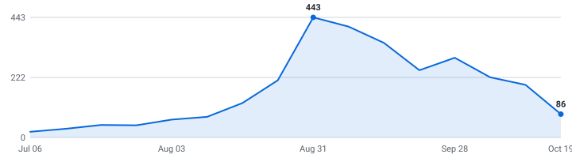

# 🎓 Summer 2027 Tech Internships

**A self-updating engine that tracks tech internships so you don't have to.**

&nbsp;&nbsp;&nbsp;

### 1388 open roles (617 listed below) · 184 new this week

4,694 employers tracked · updated Oct 18, 2026 at 05:44 UTC

_957 have a cycle the employer stated · 431 are recent postings whose cycle isn't stated (listed separately, never mixed in)._

**[🖥️ Live dashboard](https://heyinihere.github.io/Automated-List-Of-Summer-2027-and-Fall-2026-MechEng-Internships/)** · **[📡 RSS](https://heyinihere.github.io/Automated-List-Of-Summer-2027-and-Fall-2026-MechEng-Internships/feed.xml)** · **[⚙️ JSON API](https://heyinihere.github.io/Automated-List-Of-Summer-2027-and-Fall-2026-MechEng-Internships/api/jobs.json)** · **[✉️ Email alerts](https://heyinihere.github.io/Automated-List-Of-Summer-2027-and-Fall-2026-MechEng-Internships/#subscribe)**

> [!TIP]
> **⭐ Star this repo** to save it and get updates when new roles are added.

Instead of refreshing a dozen career pages by hand, it reads company hiring feeds directly and keeps one live list, newest roles on top, refreshed automatically throughout the day.

**🔔 New roles in your inbox:** [subscribe by email](https://heyinihere.github.io/Automated-List-Of-Summer-2027-and-Fall-2026-MechEng-Internships/#subscribe) - one email a day, only when new internships actually appeared, unsubscribe from any email in two clicks. (Prefer RSS-to-email? [Feedrabbit works too](https://feedrabbit.com/subscriptions/new?url=https%3A%2F%2Fraw.githubusercontent.com%2FHeyIniHere%2FAutomated-List-Of-Summer-2027-and-Fall-2026-MechEng-Internships%2Fmain%2Fdocs%2Ffeed.xml).)

---

## What this is

This is an engine, not a hand-kept list. It polls company career feeds several times a day, finds the internships, removes duplicates, and rebuilds this page on its own. Every link comes straight from the source, so it's real and current, not a stale list someone forgot to update (speed matters).

## What makes this different

- **📅 [Drop Radar](#drop-radar)** - a forecast of **what's coming**: each marquee company's typical opening window, replaced by the real drop date the moment the engine catches it live. Windows are estimates and labelled as such; only dates the engine observed itself are marked verified.
- **Visa intel, computed** - 🇺🇸 / 🛂 flags detected automatically from every job description, plus ✓ for employers with a real H-1B track record (official USCIS data, FY2022-23 - a history, not a promise). The big lists crowdsource this by hand; here it's code. Most postings say nothing either way, and those are shown as unknown rather than guessed.
- **A date on nearly every role** - taken from the job portal itself where the portal states one, so newest-first actually means newest. The exact coverage figure is printed at the bottom of this page every run.
- **Skill tags + pay, extracted** - every posting's text is scanned for the stack it wants (Python, C++, PyTorch, ...) and the pay it states - searchable on the [dashboard](https://heyinihere.github.io/Automated-List-Of-Summer-2027-and-Fall-2026-MechEng-Internships/), included in the CSV and API.
- **Alerts your way** - [email digests](https://heyinihere.github.io/Automated-List-Of-Summer-2027-and-Fall-2026-MechEng-Internships/#subscribe) or [RSS](https://heyinihere.github.io/Automated-List-Of-Summer-2027-and-Fall-2026-MechEng-Internships/feed.xml) (point any reader, or a Slack/Discord RSS integration, at it) - plus a [live dashboard](https://heyinihere.github.io/Automated-List-Of-Summer-2027-and-Fall-2026-MechEng-Internships/) with search, filters, and a saved-roles list that never leaves your browser.
- **An engine, not a spreadsheet** - 4,829 job-board endpoints (4,694 distinct employers; some run more than one board) polled every hour across 12 ATS platforms, full source and tests in this repo.

## Scope

| | |
|---|---|
| **Roles** | Software Engineering, Data Science & Machine Learning (and closely related technical internships) |
| **Region** | United States |
| **Cycles** | Summer 2027 and Fall 2026 |

## About

I'm an international student studying in the United States, so I built this for the search I'm doing myself. The list is US roles only for now - that's where I'm searching. Use it to spot roles early and apply before they fill up - being first genuinely helps.

## Where this is going

I'm building this in the open and adding to it as it grows. Recently shipped: **email alerts**, the **Drop Radar**, **auto-detected sponsorship flags**, and the **live dashboard**. Next up: personalized alerts (pick your categories), per-company hiring pages, and a ghost-posting detector. If it helps you, a star means a lot and tells me to keep going.

## How to use

<b>Reading the table — flags, dates, and the cycle split</b> (click to expand)

- Roles are grouped by cycle below - **newest posting on top, oldest at the bottom.**
- A cycle section holds only roles whose **employer stated that cycle** - in the title, or in the posting's own text. Postings that name no cycle anywhere are in *Recently posted — cycle not stated* further down, with **no cycle guessed for them**. Same quality bar, different amount of evidence.
- The **Posted** column is the date the company published the role.
- **Flags:** 🇺🇸 = requires U.S. citizenship or a security clearance · 🛂 = the posting says it won't sponsor a work visa · 🏠 = the location says remote · 🆕 = spotted in the last 48 hours. Sponsorship flags are detected automatically from each job description - treat them as a strong hint and confirm on the posting.
- **✓ after a company name** = a real H-1B track record: USCIS approved 10+ petitions for that employer in FY2022–2023 (matched automatically against the official [H-1B Employer Data Hub](https://www.uscis.gov/tools/reports-and-studies/h-1b-employer-data-hub)). No ✓ doesn't mean they won't sponsor - it means we can't prove they have.
- Track your applications with [`data/internships.csv`](data/internships.csv) (opens in Excel / Google Sheets).
- Missing a company? Adding one takes a single line, see [CONTRIBUTING.md](CONTRIBUTING.md).

---

## Summer 2027  (300 employer-stated)

| Company | Role | Category | Location | Posted | Apply |
|---|---|---|---|---|---|
| GlobalFoundries ✓ | Industrial Engineering Intern (Summer 2027) 🆕 | Hardware | USA - New York - Malta | Oct 16, 2026 | [Apply](https://globalfoundries.wd1.myworkdayjobs.com/External/job/USA---New-York---Malta/Industrial-Engineering-Intern--Summer-2027-_JR-2604575) |
| Northrop Grumman | 2027 Software Engineering Intern - Boulder CO 🇺🇸 🆕 | Software | United States-Colorado-Boulder | Oct 16, 2026 | [Apply](https://ngc.wd1.myworkdayjobs.com/Northrop_Grumman_External_Site/job/United-States-Colorado-Boulder/XMLNAME-2027-Software-Engineering-Intern---Boulder-CO_R10256077) |
| Ryan | Summer 2027 Intern, Software Development 🆕 | Software | Plano TX | Oct 16, 2026 | [Apply](https://ryan.wd1.myworkdayjobs.com/RyanCareers/job/Plano/Summer-2027-Intern--Software-Development_R0020822-1) |
| Ryan | Summer 2027 Intern, Software Engineering 🆕 | Software | Plano TX | Oct 16, 2026 | [Apply](https://ryan.wd1.myworkdayjobs.com/RyanCareers/job/Plano/Summer-2027-Intern--Software-Engineering_R0020843-1) |
| WSP | Mechanical Engineering Intern (Mission Critical/Data Center) - Summer 2027 🆕 | Data & ML/AI | Herndon, VA, United States | Oct 16, 2026 | [Apply](https://emit.fa.ca3.oraclecloud.com/hcmUI/CandidateExperience/en/sites/CX_2001/job/97070) |
| Northrop Grumman | 2027 Software Engineering Intern - Aurora CO 🇺🇸 🆕 | Software | United States-Colorado-Aurora | Oct 16, 2026 | [Apply](https://ngc.wd1.myworkdayjobs.com/Northrop_Grumman_External_Site/job/United-States-Colorado-Aurora/XMLNAME-2027-Software-Engineering-Intern---Aurora-CO_R10256243) |
| Northrop Grumman | 2027 Software Engineering Intern - Aurora CO 🇺🇸 🆕 | Software | United States-Colorado-Aurora | Oct 16, 2026 | [Apply](https://ngc.wd1.myworkdayjobs.com/Northrop_Grumman_External_Site/job/United-States-Colorado-Aurora/XMLNAME-2027-Software-Engineering-Intern---Aurora-CO_R10256393) |
| WSP | Civil/Structural Engineering Intern (Renewable Transmission Interconnections) - Summer 2027 🆕 | Hardware | Billings, MT, United States | Oct 16, 2026 | [Apply](https://emit.fa.ca3.oraclecloud.com/hcmUI/CandidateExperience/en/sites/CX_2001/job/96768) |
| Nissan ✓ | Robotics Programmer Intern - Summer 2027 - Smyrna, TN 🆕 | Hardware | Smyrna +1 more | Oct 16, 2026 | [Apply](https://alliance.wd3.myworkdayjobs.com/nissanjobs/job/Smyrna-Tennessee---United-States-of-America/Robotics-Programmer-Intern---Summer-2027---Smyrna--TN_R00214302) |
| CACI | Aerospace Engineer Intern - Summer 2027 🇺🇸 🆕 | Hardware | Aberdeen Proving Ground, MD, US | Oct 16, 2026 | [Apply](https://caci.wd1.myworkdayjobs.com/external/job/Aberdeen-Proving-Ground-MD-US/Aerospace-Engineer-Intern---Summer-2027_333570) |
| CACI | Aerospace Engineer Intern - Summer 2027 🇺🇸 🆕 | Hardware | Aberdeen Proving Ground, MD, US | Oct 16, 2026 | [Apply](https://caci.wd1.myworkdayjobs.com/external/job/Aberdeen-Proving-Ground-MD-US/Aerospace-Engineer-Intern---Summer-2027_333648) |
| Commonwealth Fusion Systems | Intern - Mechanical Engineer - Summer 2027 🆕 | Hardware | Milpitas, CA | Oct 15, 2026 | [Apply](https://jobs.lever.co/cfsenergy/9690a768-362f-4df8-86a1-554b896cbc76) |
| Inversion Space | Avionics Mechanical Engineer - Summer Internship 2027 🇺🇸 | Hardware | Playa Vista, California, United States | Oct 15, 2026 | [Apply](https://job-boards.greenhouse.io/inversionspace/jobs/4744390005) |
| Inversion Space | Avionics Embedded Software Engineer - Summer Internship 2027 🇺🇸 | Software | Playa Vista, California, United States | Oct 15, 2026 | [Apply](https://job-boards.greenhouse.io/inversionspace/jobs/4744391005) |
| General Matter | Summer 2027 Internship - Information Security Engineer | Security | Los Angeles, CA | Oct 15, 2026 | [Apply](https://job-boards.greenhouse.io/generalmatter/jobs/5448019008) |
| Clean Harbors ✓ | Mechanical Engineering Project Management Intern - Summer 2027 | Hardware | Norwell, MA, United States | Oct 15, 2026 | [Apply](https://epyc.fa.us2.oraclecloud.com/hcmUI/CandidateExperience/en/sites/CX_1001/job/167238) |
| Lawrence Livermore National Laboratory (LLNL) | Critical Infrastructure Analysis Graduate Intern - Cyber and Critical Infrastructure Summer Institute - Summer 2027 🇺🇸 | Security | Livermore, CA, United States | Oct 15, 2026 | [Apply](https://jobs.smartrecruiters.com/LLNL/3743990016164366) |
| Lawrence Livermore National Laboratory (LLNL) | Power Systems Undergraduate Intern - Cyber and Critical Infrastructure Summer Institute - Summer 2027 🇺🇸 | Security | Livermore, CA, United States | Oct 15, 2026 | [Apply](https://jobs.smartrecruiters.com/LLNL/3743990016164416) |
| Lawrence Livermore National Laboratory (LLNL) | Critical Infrastructure Analysis Undergraduate Intern - Cyber and Critical Infrastructure Summer Institute - Summer 2027 🇺🇸 | Security | Livermore, CA, United States | Oct 15, 2026 | [Apply](https://jobs.smartrecruiters.com/LLNL/3743990016165496) |
| RESPEC | Student Intern (Civil or Structural Engineering) | Hardware | Juneau, AK, United States | Oct 15, 2026 | [Apply](https://jobs.smartrecruiters.com/RESPECInc/744000155841680) |
| Adient ✓ | Lean Manufacturing Intern | Hardware | Plymouth, MI | Oct 15, 2026 | [Apply](https://adient.wd3.myworkdayjobs.com/External/job/Plymouth-MI/Lean-Manufacturing-Intern_R-29531) |
| Ardian | Data Scientist Intern - February 2027 / NYC | Data & ML/AI | New York | Oct 15, 2026 | [Apply](https://ardian.wd103.myworkdayjobs.com/ArdianCareers/job/New-York/Data-Scientist-Intern---February-2027---NYC_JR1002271) |
| General Motors ✓ | 2027 Summer Intern, AI Research, Embodied AI (Masters) | Data & ML/AI | Sunnyvale +2 more | Oct 15, 2026 | [Apply](https://generalmotors.wd5.myworkdayjobs.com/Careers_GM/job/Sunnyvale-California-United-States-of-America/XMLNAME-2027-Summer-Intern--AI-Research--Embodied-AI--Masters-_JR-202622535) |
| General Motors ✓ | 2027 Summer Intern, Onboard Autonomy, Embodied AI (Masters) | Data & ML/AI | Sunnyvale +2 more | Oct 15, 2026 | [Apply](https://generalmotors.wd5.myworkdayjobs.com/Careers_GM/job/Sunnyvale-California-United-States-of-America/XMLNAME-2027-Summer-Intern--Onboard-Autonomy--Embodied-AI--Masters-_JR-202622543) |
| General Motors ✓ | 2027 Summer Intern, SEAM, Embodied AI (Masters) | Data & ML/AI | Sunnyvale +2 more | Oct 15, 2026 | [Apply](https://generalmotors.wd5.myworkdayjobs.com/Careers_GM/job/Sunnyvale-California-United-States-of-America/XMLNAME-2027-Summer-Intern--SEAM--Embodied-AI--Masters-_JR-202622537) |
| The Federal Reserve System | 2027 Intern - Mac/Mobile | Software | Dallas, TX | Oct 15, 2026 | [Apply](https://rb.wd5.myworkdayjobs.com/FRS/job/Dallas-TX/XMLNAME-2027-Intern---Mac-Mobile_R-0000033714) |
| T-Mobile ✓ | Summer 2027 Software Engineering Intern | Software | Bellevue, Washington | Oct 15, 2026 | [Apply](https://tmobile.wd1.myworkdayjobs.com/External/job/Bellevue-Washington/Summer-2027-Software-Engineering-Intern_REQ368322) |
| The Toro Company | Manufacturing Engineering Intern - HammerHead 🛂 | Hardware | Lake Mills, WI | Oct 15, 2026 | [Apply](https://ttc.wd1.myworkdayjobs.com/Toro_External_Careers/job/Lake-Mills-WI/Manufacturing-Engineering-Intern---HammerHead_JR17635) |
| Muon Space | Ground Software Engineering Intern (Summer 2027) 🇺🇸 | Software | San Jose, CA | Oct 15, 2026 | [Apply](https://job-boards.greenhouse.io/muonspace/jobs/5266679007) |
| CACI | Software Development Intern - Summer 2027 🇺🇸 | Software | Ashburn, VA, US | Oct 15, 2026 | [Apply](https://caci.wd1.myworkdayjobs.com/external/job/Ashburn-VA-US/Software-Development-Intern---Summer-2027_333051) |
| RTX | Software Engineering Co-op (Spring/Summer 2027) 🇺🇸 | Software | US-IA-CEDAR RAPIDS-130 ~ 5350 C Ave NE… | Oct 15, 2026 | [Apply](https://globalhr.wd5.myworkdayjobs.com/rec_rtx_ext_gateway/job/US-IA-CEDAR-RAPIDS-130--5350-C-Ave-NE--BLDG-130/Software-Engineering-Co-op--Spring-Summer-2027-_01881996) |
| RTX | Software Engineering Co-op (Summer/Fall 2027) 🇺🇸 | Software | US-IA-CEDAR RAPIDS-130 ~ 5350 C Ave NE… | Oct 15, 2026 | [Apply](https://globalhr.wd5.myworkdayjobs.com/rec_rtx_ext_gateway/job/US-IA-CEDAR-RAPIDS-130--5350-C-Ave-NE--BLDG-130/Software-Engineering-Co-op--Summer-Fall-2027-_01882414) |
| Merck | 2027 Future Talent Program – Manufacturing and Reliability Engineering Co-Op | Hardware | USA - Pennsylvania - West Point | Oct 15, 2026 | [Apply](https://msd.wd5.myworkdayjobs.com/searchjobs/job/USA---Pennsylvania---West-Point/XMLNAME-2027-Future-Talent-Program---Manufacturing-and-Reliability-Engineering-Co-Op_R422487) |
| Merck | 2027 Future Talent Program – Vaccine Manufacturing Automation Co-op | Hardware | USA - Pennsylvania - West Point | Oct 15, 2026 | [Apply](https://msd.wd5.myworkdayjobs.com/searchjobs/job/USA---Pennsylvania---West-Point/XMLNAME-2027-Future-Talent-Program---Vaccine-Manufacturing-Automation-Co-op_R422480) |
| Merck | 2027 Future Talent Program - Vaccine Manufacturing Co-op | Hardware | USA - Pennsylvania - West Point | Oct 15, 2026 | [Apply](https://msd.wd5.myworkdayjobs.com/searchjobs/job/USA---Pennsylvania---West-Point/XMLNAME-2027-Future-Talent-Program---Vaccine-Manufacturing-Co-op_R422481) |
| Sierra Nevada Corporation | Software Engineer Intern - Summer 2027 (For SNC Summer 2026 Interns Only) 🇺🇸 | Software | Lone Tree, CO | Oct 15, 2026 | [Apply](https://snc.wd1.myworkdayjobs.com/snc_external_career_site/job/Lone-Tree-CO/Software-Engineer-Intern---Summer-2027--For-SNC-Summer-2026-Interns-Only-_R0031098) |
| Hitachi Energy ✓ | Mechanical Engineering Intern/Co-Op | Hardware | Ogden, Utah, United States | Oct 15, 2026 | [Apply](https://hitachi.wd1.myworkdayjobs.com/hitachi/job/Ogden-Utah-United-States/Mechanical-Engineering-Intern-Co-Op_R0146513) |
| Fortive | Mechanical Engineering Intern | Hardware | Irvine, CA, United States | Oct 15, 2026 | [Apply](https://ejta.fa.us6.oraclecloud.com/hcmUI/CandidateExperience/en/sites/CX_2001/job/10826) |
| Inversion Space | Mechanical Engineer - Summer Internship 2027 🇺🇸 | Hardware | Playa Vista, California, United States | Oct 14, 2026 | [Apply](https://job-boards.greenhouse.io/inversionspace/jobs/4743740005) |
| Stantec ✓ | Structural Engineering Intern - Buildings (Summer 2027) | Hardware | Los Angeles, CA, United States | Oct 14, 2026 | [Apply](https://hdhl.fa.us6.oraclecloud.com/hcmUI/CandidateExperience/en/sites/CX_1/job/1008287) |
| Stantec ✓ | Structural Engineering Intern - Buildings (Summer 2027) | Hardware | San Francisco, CA, United States | Oct 14, 2026 | [Apply](https://hdhl.fa.us6.oraclecloud.com/hcmUI/CandidateExperience/en/sites/CX_1/job/1008289) |
| Stantec ✓ | Structural Engineering Intern - Buildings (Summer 2027) | Hardware | Seattle, WA, United States | Oct 14, 2026 | [Apply](https://hdhl.fa.us6.oraclecloud.com/hcmUI/CandidateExperience/en/sites/CX_1/job/1008290) |
| AECOM ✓ | Structural Engineering Intern | Hardware | Raleigh, NC, United States | Oct 14, 2026 | [Apply](https://jobs.smartrecruiters.com/AECOM2/744000155592720) |
| AECOM ✓ | Structural Engineering Intern | Hardware | Cleveland, OH, United States | Oct 14, 2026 | [Apply](https://jobs.smartrecruiters.com/AECOM2/744000155595277) |
| AECOM ✓ | Structural Engineering Intern | Hardware | Columbus, OH, United States | Oct 14, 2026 | [Apply](https://jobs.smartrecruiters.com/AECOM2/744000155595329) |
| Charter Manufacturing | Mechanical Engineer Intern (Summer 2027) | Hardware | Charter Wire - Menomonee Valley - Milwaukee +1 more | Oct 14, 2026 | [Apply](https://chartermfg.wd5.myworkdayjobs.com/Charter_Careers/job/Charter-Wire---Menomonee-Valley---Milwaukee-WI/Mechanical-Engineer-Intern--Summer-2027-_R08115) |
| Haleon | 2027 Co-Op: Oak Hill Manufacturing Program (6 months, Jan. start) | Hardware | USA - New York - Oak Hill | Oct 14, 2026 | [Apply](https://gsknch.wd3.myworkdayjobs.com/GSKCareers/job/USA---New-York---Oak-Hill/XMLNAME-2027-Co-Op--Oak-Hill-Manufacturing-Program--6-months--Jan-start-_548918) |
| Howden | Underwriting Intern, Cyber | Security | New York – 1350 Avenue Of The Americas | Oct 14, 2026 | [Apply](https://hyperiongrp.wd3.myworkdayjobs.com/Hyperion_External/job/New-York--1350-Avenue-Of-The-Americas/Underwriting-Intern_R0019772-1) |
| ICF ✓ | 2027 Summer Intern, AI Engineer (Reston, VA) 🇺🇸 | Data & ML/AI | Reston, VA | Oct 14, 2026 | [Apply](https://icf.wd5.myworkdayjobs.com/ICFExternal_Career_Site/job/Reston-VA/XMLNAME-2027-Summer-Intern--AI-Engineer--Reston--VA-_R2603518) |
| ICF ✓ | 2027 Summer Intern, AI Engineer (Reston, VA) 🛂 | Data & ML/AI | Reston, VA | Oct 14, 2026 | [Apply](https://icf.wd5.myworkdayjobs.com/ICFExternal_Career_Site/job/Reston-VA/XMLNAME-2027-Summer-Intern--AI-Engineer--Reston--VA-_R2603521) |
| ICF ✓ | 2027 Summer Intern, Software Engineer (Reston, VA) 🇺🇸 | Software | Reston, VA | Oct 14, 2026 | [Apply](https://icf.wd5.myworkdayjobs.com/ICFExternal_Career_Site/job/Reston-VA/XMLNAME-2027-Summer-Intern--Software-Engineer--Reston--VA-_R2603522) |
| Plastipak | Manufacturing Operations (Engineering) Intern – Summer 2027 | Hardware | Plastipak - Pineville, LA | Oct 14, 2026 | [Apply](https://plastipak.wd1.myworkdayjobs.com/Plastipak/job/Plastipak---Pineville-LA/Manufacturing-Operations--Engineering--Intern---Summer-2027_REQ24668) |
| National Life ✓ | Data Science Intern – Summer 2027 🛂 | Data & ML/AI | Addison, TX; Montpelier, VT | Oct 14, 2026 | [Apply](https://job-boards.greenhouse.io/nationallifeinsurancecompany/jobs/4449670009) |
| Point7 | 2027 Summer Internship – Software Engineer | Software | New York, NY | Oct 14, 2026 | [Apply](https://boards.greenhouse.io/point72/jobs/8885733002?gh_jid=8885733002) |
| RTX | Industrial Engineering Co-Op (Summer/Fall 2027) 🇺🇸 | Hardware | US-IA-CEDAR RAPIDS-110 ~ 400 Collins Rd… | Oct 14, 2026 | [Apply](https://globalhr.wd5.myworkdayjobs.com/rec_rtx_ext_gateway/job/US-IA-CEDAR-RAPIDS-110--400-Collins-Rd-NE--BLDG-110/Industrial-Engineering-Co-Op--Summer-Fall-2027-_01882360) |
| LSEG | Intern - Software Engineer | Software | New York City, United States | Oct 14, 2026 | [Apply](https://lseg.wd3.myworkdayjobs.com/Graduate_Careers/job/New-York-City-United-States/Intern---Software-Engineer_R0124266-1) |
| Plastipak | Manufacturing Operations (Engineering) Intern – Summer 2027 | Hardware | Plastipak - Plant City, FL | Oct 14, 2026 | [Apply](https://plastipak.wd1.myworkdayjobs.com/Plastipak/job/Plastipak---Plant-City-FL/Manufacturing-Operations--Engineering--Intern---Summer-2027_REQ24669) |
| QTS | Summer 2027 Internship: Information Security Operations Analyst 🇺🇸 | Security | US GA Atlanta Suwanee 1 DC1 | Oct 14, 2026 | [Apply](https://qtsdatacenters.wd5.myworkdayjobs.com/qts/job/US-GA-Atlanta-Suwanee-1-DC1/Summer-2027-Internship--Information-Security-Operations-Analyst_R2026-2273) |
| Anduril | 2027 Firmware Engineer Intern | Hardware | Costa Mesa, California, United States | Oct 13, 2026 | [Apply](https://boards.greenhouse.io/andurilindustries/jobs/5265158007?gh_jid=5265158007) |
| Skydio ✓ | Software Engineer Intern - Summer 2027 | Software | San Mateo, California, United States | Oct 13, 2026 | [Apply](https://jobs.ashbyhq.com/skydio/79fdda46-4ff5-42c7-b208-55f2084cdb8c) |
| Skydio ✓ | Embedded Software Engineer Intern - Summer 2027 | Software | San Mateo, California, United States | Oct 13, 2026 | [Apply](https://jobs.ashbyhq.com/skydio/8994767e-fd53-4ca2-b0ef-fe0923c1e260) |
| Field AI | Robotics Research, Robot Learning & Manipulation Intern (Spring, Summer, & Fall 2027) | Hardware | Irvine, CA | Oct 13, 2026 | [Apply](https://jobs.lever.co/field-ai/b37569c3-d07f-4968-82dc-44020f34e54e) |
| Rhombus | Software Engineering Intern - Summer 2027 | Software | Sacramento, CA | Oct 13, 2026 | [Apply](https://jobs.lever.co/rhombus-systems/59e7a5f3-b457-491d-af08-b629ad35e380) |
| Field AI | Robotics Research, Embodied AI Intern (Spring & Summer 2027) | Data & ML/AI | Irvine, CA | Oct 13, 2026 | [Apply](https://jobs.lever.co/field-ai/ef35c537-b864-479f-9dbe-b30429ac7704) |
| Allison Transmission ✓ | Manufacturing Engineering Internship - Summer 2027 🇺🇸 | Hardware | Indianapolis, IN | Oct 13, 2026 | [Apply](https://allisontransmission.wd1.myworkdayjobs.com/ATI-External/job/Indianapolis-IN/Manufacturing-Engineering-Internship---Summer-2026_R008288) |
| Allison Transmission ✓ | Manufacturing Engineering Internship - Summer 2027 🇺🇸 | Hardware | Indianapolis, IN | Oct 13, 2026 | [Apply](https://allisontransmission.wd1.myworkdayjobs.com/ATI-External/job/Indianapolis-IN/Manufacturing-Engineering-Internship---Summer-2026_R008289) |
| Motorola ✓ | Mechanical Engineering Intern - Summer 2027 | Hardware | Plantation, FL | Oct 13, 2026 | [Apply](https://motorolasolutions.wd5.myworkdayjobs.com/Careers/job/Plantation-FL/Mechanical-Engineering-Intern---Summer-2027_R69030) |
| Watts Water | End User & Infrastructure Support Intern, Summer 2027 | Software | Andover, MA Federal Street | Oct 13, 2026 | [Apply](https://wattswater.wd5.myworkdayjobs.com/Intern-External/job/Andover-MA-Federal-Street/IT-Network-Intern--Summer-2027_10017567) |
| ADT ✓ | Data, Analytics & AI Internship 🛂 | Data & ML/AI | Boca Raton, FL, United States | Oct 13, 2026 | [Apply](https://fa-erqb-saasfaprod1.fa.ocs.oraclecloud.com/hcmUI/CandidateExperience/en/sites/CX_1/job/3022387) |
| Draper | Classified Cybersecurity/IT Internship (Summer 2027) 🇺🇸 | Security | Cambridge, MA | Oct 13, 2026 | [Apply](https://draper.wd5.myworkdayjobs.com/Draper_Careers/job/Cambridge-MA/Classified-Cybersecurity-IT-Internship--Summer-2027-_JR003021) |
| Jain Global | Quantitative Developer Intern (Summer 2027 - New York) | Quant | New York, New York | Oct 13, 2026 | [Apply](https://jainglobal.wd5.myworkdayjobs.com/ExternalSite/job/New-York-New-York/Quantitative-Developer-Intern--Summer-2027---New-York-_JR100608) |
| ABB ✓ | Manufacturing Engineering Intern - Summer 2027 🛂 🆕 | Hardware | USA, NC, Hickory | Oct 12, 2026 | [Apply](https://abb.wd3.myworkdayjobs.com/external_career_page/job/USA-NC-Hickory/Manufacturing-Engineering-Intern---Summer-2027_JR00047568) |
| ADT ✓ | Product Management & Product Operations Internship 🛂 | Software | Boca Raton, FL, United States | Oct 12, 2026 | [Apply](https://fa-erqb-saasfaprod1.fa.ocs.oraclecloud.com/hcmUI/CandidateExperience/en/sites/CX_1/job/3022393) |
| Bosch | Manufacturing Engineer Intern - Summer 2027 | Hardware | Lincolnshire, IL, United States | Oct 12, 2026 | [Apply](https://jobs.smartrecruiters.com/BoschGroup/744000155100809) |
| Nissan ✓ | Data Science Intern - Summer 2027 - Smyrna, TN | Data & ML/AI | Smyrna +1 more | Oct 12, 2026 | [Apply](https://alliance.wd3.myworkdayjobs.com/nissanjobs/job/Smyrna-Tennessee---United-States-of-America/Data-Science-Intern---Summer-2027---Smyrna--TN_R00215331) |
| Allison Transmission ✓ | Internship - Manufacturing Engineer 🇺🇸 | Hardware | Indianapolis, IN | Oct 12, 2026 | [Apply](https://allisontransmission.wd1.myworkdayjobs.com/ATI-External/job/Indianapolis-IN/Internship---Manufacturing-Engineer_R008319) |
| American Family Insurance Group | Summer 2027 Data Analyst Intern - Agency Performance, Insights and Operations | Data & ML/AI | WI Madison | Oct 12, 2026 | [Apply](https://amfam.wd1.myworkdayjobs.com/AmFamGroupInternCareers/job/WI-Madison/Summer-2027-Data-Analyst-Intern---Agency-Performance--Insights-and-Operations_R39513) |
| Verizon Communications | Verizon Consumer Group: Home & Mobile Value Prop Summer 2027 Internship | Software | Basking Ridge, New Jersey | Oct 12, 2026 | [Apply](https://verizon.wd12.myworkdayjobs.com/verizon-careers/job/Basking-Ridge-New-Jersey/Verizon-Consumer-Group--Home---Mobile-Value-Prop-Summer-2027-Internship_R-1102103) |
| Watts Water | Product Management Co-op, Jan-June 2027 | Software | Menomonee Falls, WI | Oct 12, 2026 | [Apply](https://wattswater.wd5.myworkdayjobs.com/Intern-External/job/Menomonee-Falls-WI/Product-Management-Co-op--Jan-June-2027_10017702) |
| RF-SMART | Software Support Engineer Internship (RFS for NetSuite) -Summer 2027 🛂 | Software | Jacksonville, Florida, United States | Oct 12, 2026 | [Apply](https://job-boards.greenhouse.io/rfsmart/jobs/5427723008) |
| CapTech Consulting | Consulting Internship: Software Engineering (Summer 2027) 🛂 | Software | Richmond, VA, United States | Oct 12, 2026 | [Apply](https://jobs.smartrecruiters.com/CapTechConsulting/744000155019115) |
| Nissan ✓ | Data Science Intern - Summer 2027 - Franklin, TN | Data & ML/AI | Franklin +1 more | Oct 12, 2026 | [Apply](https://alliance.wd3.myworkdayjobs.com/nissanjobs/job/Franklin-Tennessee---United-States-of-America/Data-Science-Intern---Summer-2027---Franklin--TN_R00214250) |
| General Dynamics Information Technology ✓ | Summer 2027 Software Development Internship 🇺🇸 | Software | USA VA Falls Church | Oct 12, 2026 | [Apply](https://gdit.wd5.myworkdayjobs.com/gdit_earlytalent/job/USA-VA-Falls-Church/Summer-2027-Software-Development-Internship_RQ228406-1) |
| AtkinsRéalis | Software Developer Intern - Summer 2027 | Software | US.CO.Denver | Oct 12, 2026 | [Apply](https://slihrms.wd3.myworkdayjobs.com/careers/job/USCODenver/Software-Developer-Intern---Summer-2027_R-161580-1) |
| Commonwealth Fusion Systems | Intern - Manufacturing Engineer - Spring or Summer 2027 🆕 | Hardware | Devens, MA | Oct 09, 2026 | [Apply](https://jobs.lever.co/cfsenergy/01ec2ee8-b8c9-4f32-9b66-3a2ce1ff704f) |
| Commonwealth Fusion Systems | Intern - Industrial Engineer - Spring or Summer 2027 🆕 | Hardware | Devens, MA | Oct 09, 2026 | [Apply](https://jobs.lever.co/cfsenergy/7ed4bf93-2b32-4096-9af3-2eb79e620039) |
| Itron ✓ | Intern - HR AI Data Science (Summer 2027) | Data & ML/AI | United States of America, Texas, Austin | Oct 09, 2026 | [Apply](https://itron.wd5.myworkdayjobs.com/Early_Careers/job/United-States-of-America-Texas-Austin/Intern---HR-AI-Data-Science--Summer-2027-_JR103034) |
| Workday ✓ | Cybersecurity Engineer Intern 🛂 | Security | USA, CA, Pleasanton | Oct 09, 2026 | [Apply](https://workday.wd5.myworkdayjobs.com/Workday_Early_Career/job/USA-CA-Pleasanton/Cybersecurity-Engineer-Intern_JR-0110809) |
| Workday ✓ | Machine Learning Engineer Intern 🛂 | Data & ML/AI | USA, CA, Pleasanton | Oct 09, 2026 | [Apply](https://workday.wd5.myworkdayjobs.com/Workday_Early_Career/job/USA-CA-Pleasanton/Machine-Learning-Engineer-Intern_JR-0110812) |
| Workday ✓ | Software Application Development Engineer Intern 🛂 | Software | USA, CA, Pleasanton | Oct 09, 2026 | [Apply](https://workday.wd5.myworkdayjobs.com/Workday_Early_Career/job/USA-CA-Pleasanton/Software-Application-Development-Engineer-Intern_JR-0110811) |
| American Family Insurance Group | Summer 2027 Intern - Data Analyst | Data & ML/AI | WI Madison | Oct 09, 2026 | [Apply](https://amfam.wd1.myworkdayjobs.com/AmFamGroupInternCareers/job/WI-Madison/Summer-2027-Intern---Data-Analyst_R39404) |
| GCM Grosvenor | 2027 Software Engineering Summer Intern | Software | Chicago, Illinois, United States | Oct 09, 2026 | [Apply](https://job-boards.greenhouse.io/gcmgrosvenor/jobs/8015792003) |
| DoorDash ✓ | Software Engineer, Intern - Labs (Summer 2027) | Software | San Francisco, CA; Sunnyvale, CA | Oct 08, 2026 | [Apply](https://job-boards.greenhouse.io/doordashusa/jobs/8263774) |
| IMC Trading | Machine Learning Engineer Intern - Summer 2027 | Data & ML/AI | New York, United States | Oct 08, 2026 | [Apply](https://job-boards.eu.greenhouse.io/imc/jobs/4962456101) |
| SharkNinja ✓ | Summer 2027: Mechanical Engineering Intern, Shark (May to August) | Hardware | Needham, MA, United States | Oct 08, 2026 | [Apply](https://job-boards.greenhouse.io/sharkninjaoperatingllc/jobs/4718812006) |
| Viget | Software Developer Intern (2027) 🛂 | Software | Boulder, CO | Oct 08, 2026 | [Apply](https://jobs.lever.co/viget/b18cc87d-fca2-485a-a0f2-ad6197db63f2) |
| Alcon ✓ | 2027 Spring/Summer Manufacturing Engineering Co-op | Hardware | Houston, Texas | Oct 08, 2026 | [Apply](https://alcon.wd5.myworkdayjobs.com/careers_alcon/job/Houston-Texas/XMLNAME-2027-Spring-Summer-Manufacturing-Engineering-Co-op_R-2026-50147) |
| Moog | Intern, Computer Science | Software | Torrance, CA | Oct 08, 2026 | [Apply](https://moog.wd5.myworkdayjobs.com/moog_external_career_site/job/Torrance-CA/Intern--Computer-Science_R-26-19819) |
| Plastipak | Manufacturing Operations (Engineering) Intern – Summer 2027 | Hardware | Plastipak - Havre de Grace, MD | Oct 08, 2026 | [Apply](https://plastipak.wd1.myworkdayjobs.com/Plastipak/job/Plastipak---Havre-de-Grace-MD/Manufacturing-Operations--Engineering--Intern---Summer-2027_REQ24670) |
| Sierra Space | Summer 2027 Manufacturing Engineer Intern 🇺🇸 | Hardware | Broomfield, CO | Oct 08, 2026 | [Apply](https://sierraspace.wd1.myworkdayjobs.com/Sierra_Space_External_Career_Site/job/Broomfield-CO/Summer-2027-Manufacturing-Engineer-Intern_R26389) |
| The Toro Company | Manufacturing Engineering Intern - The Toro Company 🛂 | Hardware | Shakopee, MN | Oct 08, 2026 | [Apply](https://ttc.wd1.myworkdayjobs.com/Toro_External_Careers/job/Shakopee-MN/Manufacturing-Engineering-Intern---The-Toro-Company_JR17581) |
| The Toro Company | Manufacturing Engineer Intern - The Toro Company 🛂 | Hardware | Windom, MN | Oct 08, 2026 | [Apply](https://ttc.wd1.myworkdayjobs.com/Toro_External_Careers/job/Windom-MN/Manufacturing-Engineer-Intern---The-Toro-Company_JR17578) |
| Rugged Robotics | Mechanical Engineering Intern/Co-op (Spring or Summer 2027) | Hardware | Houston, TX | Oct 08, 2026 | [Apply](https://job-boards.greenhouse.io/ruggedrobotics/jobs/4730900005) |
| Rugged Robotics | Robotic Software Intern/Co-op (Spring or Summer 2027) | Software | Houston, TX | Oct 08, 2026 | [Apply](https://job-boards.greenhouse.io/ruggedrobotics/jobs/4730908005) |
| Modernizing Medicine | Software Engineering Intern | Software | Boca Raton, FL | Oct 08, 2026 | [Apply](https://modmed.wd501.myworkdayjobs.com/ModMed12/job/Boca-Raton-FL/Software-Engineering-Intern_R5148) |
| Moog | Intern, Software Engineering | Software | Mineral Wells, TX | Oct 08, 2026 | [Apply](https://moog.wd5.myworkdayjobs.com/moog_external_career_site/job/Mineral-Wells-TX/Intern--Software-Engineering_R-26-19965) |
| Amazon ✓ | Software Development Engineer (Embedded Systems) Intern, Amazon Leo - Summer 2027 (USA) 🇺🇸 | Software | Redmond, Washington, USA | Oct 07, 2026 | [Apply](https://www.amazon.jobs/en/jobs/10571374/software-development-engineer-embedded-systems-intern-amazon-leo-summer-2027-usa) |
| Apple Bank | 2027 Summer Intern- Information Security 🛂 | Security | New York, NY | Oct 07, 2026 | [Apply](https://applebank.wd5.myworkdayjobs.com/applebankcareers/job/New-York-NY/XMLNAME-2027-Summer-Intern--Information-Security_2026-1416) |
| Arc | Mechanical Engineering Intern - Recreational | Hardware | Torrance, CA | Oct 07, 2026 | [Apply](https://job-boards.greenhouse.io/arcboatcompany/jobs/5445312008) |
| State Affairs | Software Engineer Intern (Summer 2027) | Software | Washington, DC | Oct 07, 2026 | [Apply](https://job-boards.greenhouse.io/stateaffairs/jobs/4437430009) |
| Elanco | Manufacturing Associate Intern – Winslow, Maine (Summer 2027) | Hardware | Winslow, ME | Oct 07, 2026 | [Apply](https://elanco.wd5.myworkdayjobs.com/External_Career/job/Winslow-ME/Manufacturing-Associate-Intern---Winslow--Maine--Summer-2027-_R0027460) |
| S&C Electric Company ✓ | Mechanical Engineer Intern - Franklin,WI | Hardware | Franklin, WI, United States | Oct 07, 2026 | [Apply](https://ejia.fa.us6.oraclecloud.com/hcmUI/CandidateExperience/en/sites/CX_1001/job/107361) |
| S&C Electric Company ✓ | Manufacturing Engineer Intern | Hardware | Chicago, IL, United States | Oct 07, 2026 | [Apply](https://ejia.fa.us6.oraclecloud.com/hcmUI/CandidateExperience/en/sites/CX_1001/job/107366) |
| S&C Electric Company ✓ | Mechanical Engineer Intern- Palatine,IL | Hardware | Palatine, IL, United States | Oct 07, 2026 | [Apply](https://ejia.fa.us6.oraclecloud.com/hcmUI/CandidateExperience/en/sites/CX_1001/job/107367) |
| Johnson & Johnson | GTO Manufacturing Engineering Co-op, Summer 2027 | Hardware | Cornelia +2 more | Oct 07, 2026 | [Apply](https://jj.wd5.myworkdayjobs.com/JJ/job/Cornelia-Georgia-United-States-of-America/GTO-Manufacturing-Engineering-Co-op--Summer-2027_R-103371) |
| Niantic Spatial | Software Engineering Intern (Summer 2027) | Software | San Francisco, CA | Oct 06, 2026 | [Apply](https://jobs.ashbyhq.com/niantic-spatial/898b2da7-03cd-486e-96e3-3430a148c8fd) |
| Sigma Computing ✓ | Software Engineering Intern (Summer 2027) 🛂 | Software | San Francisco, CA | Oct 06, 2026 | [Apply](https://job-boards.greenhouse.io/sigmacomputing/jobs/7850795003) |
| Sigma Computing ✓ | Software Engineering Intern (Summer 2027) 🛂 | Software | New York, NY | Oct 06, 2026 | [Apply](https://job-boards.greenhouse.io/sigmacomputing/jobs/8001295003) |
| Highmark Health ✓ | Summer 2027 Artificial Intelligence (Operations) Undergraduate Intern 🛂 | Data & ML/AI | Pittsburgh PA +3 more | Oct 06, 2026 | [Apply](https://highmarkhealth.wd1.myworkdayjobs.com/highmark/job/Pittsburgh-PA-15222-FAP-5th-Avenue-Place/Summer-2027-Artificial-Intelligence--Operations--Undergraduate-Intern_J287476) |
| Waymo ✓ | 2027 Summer Intern, BS, Waymo ML Ops & Automation | Data & ML/AI | Mountain View, CA, USA | Oct 06, 2026 | [Apply](https://careers.withwaymo.com/jobs?gh_jid=8257237) |
| Waymo ✓ | 2027 Summer Intern, BS, Software Engineer, Model Eval | Software | Mountain View, CA, USA | Oct 06, 2026 | [Apply](https://careers.withwaymo.com/jobs?gh_jid=8257660) |
| ABB ✓ | Manufacturing Quality Intern - Summer 2027 🛂 | Hardware | USA, NM, Albuquerque | Oct 06, 2026 | [Apply](https://abb.wd3.myworkdayjobs.com/external_career_page/job/USA-NM-Albuquerque/Manufacturing-Quality-Intern---Summer-2027_JR00048446) |
| Dmainc | Cybersecurity Intern - Summer 2027 | Security | Fort Wayne, IN | Oct 06, 2026 | [Apply](https://dmainc.wd5.myworkdayjobs.com/dma/job/Fort-Wayne-IN/Cybersecurity-Intern---Summer-2027_REQ742) |
| Courier Health | Software Engineering Intern (Summer 2027) | Software | New York, New York, United States | Oct 06, 2026 | [Apply](https://job-boards.greenhouse.io/courierhealth/jobs/5258913007) |
| MEMX | Information Security Intern, Summer 2027 (Hybrid, NYC) | Security | United States | Oct 06, 2026 | [Apply](https://job-boards.greenhouse.io/memx/jobs/5445236008) |
| Pure Storage ✓ | Software Engineer Intern (Summer 2027) | Software | Santa Clara, California | Oct 06, 2026 | [Apply](https://job-boards.greenhouse.io/purestorage/jobs/8249749) |
| Carpenter Technology | Maintenance Intern - Mechanical | Hardware | Reading, PA | Oct 06, 2026 | [Apply](https://cartech.wd5.myworkdayjobs.com/CTCExternal/job/Reading-PA/Maintenance-Intern---Mechanical_26885) |
| Marvell ✓ | Machine Learning Engineer Intern, BS/MS - Summer 2027 | Data & ML/AI | Santa Clara, CA | Oct 06, 2026 | [Apply](https://marvell.wd1.myworkdayjobs.com/marvellcareers2/job/Santa-Clara-CA/Machine-Learning-Engineer-Intern--BS-MS---Summer-2027_2604989) |
| Hudson River Trading ✓ | Data Scientist Intern - 2027 | Data & ML/AI | London +4 more | Oct 05, 2026 | [Apply](https://www.hudsonrivertrading.com/careers/job/?gh_jid=8257369) |
| Midland States Bank | Intern - IT Infrastructure | Software | Effingham, IL | Oct 05, 2026 | [Apply](https://midlandsb.wd1.myworkdayjobs.com/msbcareers/job/Effingham-IL/Intern---IT-Infrastructure_JR1471) |
| Arc | Mechanical Engineering Intern - Powertrain | Hardware | Torrance, CA | Oct 05, 2026 | [Apply](https://job-boards.greenhouse.io/arcboatcompany/jobs/5442958008) |
| WSP | Mechanical Engineering Co-op - Spring/Summer 2027 | Hardware | Philadelphia, PA, United States | Oct 05, 2026 | [Apply](https://emit.fa.ca3.oraclecloud.com/hcmUI/CandidateExperience/en/sites/CX_2001/job/95758) |
| ABB ✓ | Manufacturing Intern - Summer 2027 🛂 | Hardware | USA, NM, Albuquerque | Oct 05, 2026 | [Apply](https://abb.wd3.myworkdayjobs.com/external_career_page/job/USA-NM-Albuquerque/Manufacturing-Intern---Summer-2027_JR00047889) |
| Hitachi Energy ✓ | Mechanical Engineering Internship/Co-op | Hardware | Liberty, South Carolina, United States | Oct 05, 2026 | [Apply](https://hitachi.wd1.myworkdayjobs.com/hitachi/job/Liberty-South-Carolina-United-States/Mechanical-Engineering-Internship-Co-op_R0144979) |
| Jain Global | Data Engineer Intern | Data & ML/AI | New York, New York | Oct 05, 2026 | [Apply](https://jainglobal.wd5.myworkdayjobs.com/ExternalSite/job/New-York-New-York/Data-Engineer-Intern_JR100605-1) |
| LexisNexis Risk Solutions ✓ | Data Science Intern | Data & ML/AI | Alpharetta, GA (Alderman) | Oct 05, 2026 | [Apply](https://relx.wd3.myworkdayjobs.com/RiskSolutions/job/Alpharetta-GA-Alderman/Data-Science-Intern_R118955) |
| Hitachi Energy ✓ | Mechanical Engineering Internship/Co-op | Hardware | Auburn Hills, Michigan, United States | Oct 05, 2026 | [Apply](https://hitachi.wd1.myworkdayjobs.com/hitachi/job/Auburn-Hills-Michigan-United-States/Mechanical-Engineering-Internship-Co-op_R0143857) |
| Amazon ✓ | Software Development Engineer Intern (Embedded Systems) - Summer 2027 (USA) | Software | Seattle, Washington, USA | Oct 02, 2026 | [Apply](https://www.amazon.jobs/en/jobs/10567914/software-development-engineer-intern-embedded-systems-summer-2027-usa) |
| Anduril | 2027 Industrial Engineer Intern | Hardware | Ashville +5 more | Oct 02, 2026 | [Apply](https://boards.greenhouse.io/andurilindustries/jobs/5255593007?gh_jid=5255593007) |
| Affirm ✓ | Software Engineer (Machine Learning) Intern (Summer 2027) | Data & ML/AI | San Francisco, California, United States | Oct 02, 2026 | [Apply](https://job-boards.greenhouse.io/affirm/jobs/8008645003) |
| Affirm ✓ | Software Engineer Intern (Summer 2027) | Software | San Francisco, California, United States | Oct 02, 2026 | [Apply](https://job-boards.greenhouse.io/affirm/jobs/8011590003) |
| Harvey ✓ | Software Engineering Intern (Summer 2027) | Software | New York | Oct 02, 2026 | [Apply](https://jobs.ashbyhq.com/harvey/06d64648-b84b-48ae-94a2-d9c06dfdcb5d) |
| ispace ✓ | 2027 Summer Internship - Mechanical Test Engineer 🇺🇸 | Hardware | Englewood, Colorado | Oct 02, 2026 | [Apply](https://jobs.lever.co/ispace-inc/fa34bd91-bd23-460b-af53-4a7f2066d9f3) |
| Cox | Cybersecurity Intern - Summer 2027 | Security | Atlanta GA | Oct 02, 2026 | [Apply](https://cox.wd1.myworkdayjobs.com/Cox_External_Career_Site_1/job/Atlanta-GA/Cybersecurity-Intern---Summer-2027_R202683372) |
| Arc | Software Engineering Intern | Software | Torrance, CA | Oct 02, 2026 | [Apply](https://job-boards.greenhouse.io/arcboatcompany/jobs/5442881008) |
| Muon Space | Industrial Engineering Intern (Summer 2027) 🇺🇸 | Hardware | San Jose, CA | Oct 02, 2026 | [Apply](https://job-boards.greenhouse.io/muonspace/jobs/5256284007) |
| Bedrock Robotics | 2027 Internship Behavior ML Engineer, Learned Manipulation Policies | Data & ML/AI | San Francisco, CA | Oct 02, 2026 | [Apply](https://jobs.ashbyhq.com/bedrock-robotics/96a6423e-7439-4cb4-9109-117b14e47f7c) |
| xAI | Summer 2027 Software Engineering Internship/Co-op | Software | Palo Alto, CA | Oct 02, 2026 | [Apply](https://job-boards.greenhouse.io/xai/jobs/5255111007) |
| The Aerospace Corporation | 2027 Flight Loads Structural Dynamics Graduate Intern 🇺🇸 | Hardware | El Segundo, CA | Oct 02, 2026 | [Apply](https://aero.wd5.myworkdayjobs.com/external/job/El-Segundo-CA/XMLNAME-2027-Flight-Loads-Structural-Dynamics-Graduate-Intern_R016755) |
| Charter Manufacturing | Smart Manufacturing Engineer Intern (Summer 2027) | Hardware | Charter Steel - Saukville, WI | Oct 02, 2026 | [Apply](https://chartermfg.wd5.myworkdayjobs.com/Charter_Careers/job/Charter-Steel---Saukville-WI/Smart-Manufacturing-Engineer-Intern--Summer-2027-_R08133) |
| Nelnet ✓ | Intern - IT Software Engineer .NET (Summer 2027) | Software | Lincoln, NE | Oct 02, 2026 | [Apply](https://nelnet.wd1.myworkdayjobs.com/MyNelnet/job/Lincoln-NE/Intern---IT-Software-Engineer-NET--Summer-2027-_R23198) |
| Major League Baseball | Intern, Data Science | Data & ML/AI | Citi Field – Queens, New York | Oct 02, 2026 | [Apply](https://sterlingmets.wd5.myworkdayjobs.com/Mets/job/Citi-Field--Queens-New-York/Intern--Data-Science_R1508) |
| Pinterest ✓ | Software Engineer Intern 2027 (USA) 🏠 | Software | San Francisco, CA, US; Remote, US | Oct 01, 2026 | [Apply](https://www.pinterestcareers.com/jobs/?gh_jid=7838577) |
| Pinterest ✓ | Software Engineering Intern 2027 (Toronto) | Software | Toronto, ON, CA | Oct 01, 2026 | [Apply](https://www.pinterestcareers.com/jobs/?gh_jid=8138039) |
| Pinterest ✓ | Machine Learning Intern 2027 (Toronto) | Data & ML/AI | Toronto, ON, CA | Oct 01, 2026 | [Apply](https://www.pinterestcareers.com/jobs/?gh_jid=8138080) |
| Mach Industries | Summer 2027 Engineering Internship, Manufacturing 🇺🇸 | Hardware | Huntington Beach +5 more | Oct 01, 2026 | [Apply](https://job-boards.greenhouse.io/machindustries/jobs/4429928009) |
| Walleye Capital | Special Projects Developer Intern (Summer 2027) | Software | New York, New York | Oct 01, 2026 | [Apply](https://job-boards.greenhouse.io/walleyecapital-external-students/jobs/4716166006) |
| Datacor | Summer 2027 AI Engineer Intern 🏠 | Data & ML/AI | Remote, US | Oct 01, 2026 | [Apply](https://job-boards.greenhouse.io/datacor/jobs/5242412007) |
| ATC | Intern - Cyber Security Summer 2027 | Security | Pewaukee, WI | Oct 01, 2026 | [Apply](https://atcllc.wd5.myworkdayjobs.com/atcllc/job/Pewaukee-WI/Intern---Cyber-Security-Summer-2027_R0003307) |
| CoStar Group | Embedded Software Engineering Intern 🛂 | Software | Sunnyvale (US) | Oct 01, 2026 | [Apply](https://costar.wd1.myworkdayjobs.com/Costar_Campus/job/Sunnyvale-US/Embedded-Software-Engineering-Intern_R39950) |
| CoStar Group | Mechanical Engineering Intern 🛂 | Hardware | Sunnyvale (US) | Oct 01, 2026 | [Apply](https://costar.wd1.myworkdayjobs.com/Costar_Campus/job/Sunnyvale-US/Mechanical-Engineering-Intern_R39952) |
| Marvell ✓ | Firmware Engineer Intern, MS - Summer 2027 | Hardware | Santa Clara, CA | Oct 01, 2026 | [Apply](https://marvell.wd1.myworkdayjobs.com/marvellcareers2/job/Santa-Clara-CA/Firmware-Engineer-Intern--MS---Summer-2027_2604513-1) |
| The Federal Reserve System | TS - Application Security Intern - 2027 🇺🇸 | Security | Cleveland, OH | Oct 01, 2026 | [Apply](https://rb.wd5.myworkdayjobs.com/FRS/job/Cleveland-OH/TS---Application-Security-Intern---2027_R-0000033625) |
| Zekelman Industries | Intern, Manufacturing Engineer | Hardware | Niles, OH | Oct 01, 2026 | [Apply](https://zekelman.wd12.myworkdayjobs.com/Careers/job/Niles-OH/Intern--Manufacturing-Engineer_JR002843) |
| Varda Space | Cybersecurity Internship - Summer 2027 🇺🇸 | Security | El Segundo, California, United States | Oct 01, 2026 | [Apply](https://job-boards.greenhouse.io/vardaspace/jobs/8005821003) |
| Varda Space | Flight Software Internship - Summer 2027 🇺🇸 | Software | El Segundo, California, United States | Oct 01, 2026 | [Apply](https://job-boards.greenhouse.io/vardaspace/jobs/8010159003) |
| Varda Space | Manufacturing Engineering Internship - Summer 2027 🇺🇸 | Hardware | El Segundo, California, United States | Oct 01, 2026 | [Apply](https://job-boards.greenhouse.io/vardaspace/jobs/8010166003) |
| Generac ✓ | 2027 Summer Intern Digital Manufacturing Engineering | Hardware | Waukesha, WI - USA | Oct 01, 2026 | [Apply](https://generac.wd5.myworkdayjobs.com/external/job/Waukesha-WI---USA/XMLNAME-2027-Summer-Intern-Digital-Manufacturing-Engineering_JR16255) |
| Amazon ✓ | Software Development Engineer Intern, AWS Database - 2027 (US) | Software | Seattle, Washington, USA | Sep 30, 2026 | [Apply](https://www.amazon.jobs/en/jobs/10565667/software-development-engineer-intern-aws-database-2027-us) |
| Muon Space | Thermal Engineering Intern (Summer 2027) 🇺🇸 | Hardware | San Jose, CA | Sep 30, 2026 | [Apply](https://job-boards.greenhouse.io/muonspace/jobs/5253474007) |
| Helion Energy | Mechanical Engineering Summer 2027 Intern | Hardware | Everett, WA | Sep 30, 2026 | [Apply](https://jobs.ashbyhq.com/helion/b73602bd-b644-4a46-9188-fded4b2db606) |
| Allen Control Systems | Android Developer Intern, 2027 | Software | Austin, TX | Sep 30, 2026 | [Apply](https://jobs.ashbyhq.com/allen-control-systems/1cd2b432-9a01-4ae0-8eb2-6ebd9c278b94) |
| Dandy | Summer 2027 Internship - Software Engineering Intern | Software | USA - New York NY | Sep 30, 2026 | [Apply](https://jobs.ashbyhq.com/dandy/d43558e9-8e51-4980-b00d-39275063f099) |
| Waymo ✓ | 2027 Summer Intern, BS, Software Engineering, Labeling | Software | Mountain View, CA, USA | Sep 30, 2026 | [Apply](https://careers.withwaymo.com/jobs?gh_jid=8238525) |
| STV ✓ | Structural Engineering Intern - Summer 2027 🛂 | Hardware | Oklahoma City, Oklahoma | Sep 30, 2026 | [Apply](https://stvinc.wd5.myworkdayjobs.com/stv/job/Oklahoma-City-Oklahoma/Structural-Engineering-Intern---Summer-2027_JR6315) |
| Zekelman Industries | Intern, Manufacturing Engineer | Hardware | Rochelle, IL | Sep 30, 2026 | [Apply](https://zekelman.wd12.myworkdayjobs.com/Careers/job/Rochelle-IL/Intern--Manufacturing-Engineer_JR002824) |
| Helion Energy | Materials Engineering Summer 2027 Intern | Hardware | Everett, WA | Sep 29, 2026 | [Apply](https://jobs.ashbyhq.com/helion/56636c72-2c72-4f4f-8334-3b233a235c8d) |
| AMCA | Software Engineering Internship (Summer 2027) 🇺🇸 | Software | El Segundo, CA | Sep 29, 2026 | [Apply](https://job-boards.greenhouse.io/amca/jobs/4425120009) |
| Freeform | Manufacturing Engineering Intern, CNC Machining (Summer 2027) | Hardware | Los Angeles, CA (On-site) | Sep 29, 2026 | [Apply](https://job-boards.greenhouse.io/freeformfuturecorp/jobs/8004101003) |
| Insulet Corporation ✓ | Co-op, Software Development Engineer in Test: January - June 2027 (Hybrid) | Software | Acton, Massachusetts | Sep 29, 2026 | [Apply](https://insulet.wd5.myworkdayjobs.com/insuletcareers/job/Acton-Massachusetts/Co-op--Software-Development-Engineer-in-Test--January---June-2027--Hybrid-_REQ-2026-18026) |
| Insulet Corporation ✓ | Co-op, Manufacturing: January - June 2027 (Onsite) | Hardware | Irvine, California | Sep 29, 2026 | [Apply](https://insulet.wd5.myworkdayjobs.com/insuletcareers/job/Irvine-California/Co-op--Manufacturing--January---June-2027--Onsite-_REQ-2026-18119) |
| Perchwell | Software Engineering Intern | Software | New York Office | Sep 29, 2026 | [Apply](https://jobs.ashbyhq.com/perchwell/194eec78-26db-4d8e-850f-a99ea2733e9f) |
| Enova ✓ | Software Engineer Internship Summer 2027 (Hybrid) 🛂 | Software | Chicago, IL | Sep 29, 2026 | [Apply](https://job-boards.greenhouse.io/enova/jobs/8239619) |
| National Life ✓ | Digital & AI Experience Intern – Summer 2027 🛂 | Data & ML/AI | Addison, TX; Montpelier, VT | Sep 29, 2026 | [Apply](https://job-boards.greenhouse.io/nationallifeinsurancecompany/jobs/4403876009) |
| Marvell ✓ | AI-Native Development Platform Engineer Intern, MS - Summer 2027 | Data & ML/AI | Santa Clara, CA | Sep 29, 2026 | [Apply](https://marvell.wd1.myworkdayjobs.com/marvellcareers2/job/Santa-Clara-CA/AI-Native-Development-Platform-Engineer-Intern--MS---Summer-2027_2603848) |
| nVent | Manufacturing Automaton Intern (June - August 2027) 🛂 | Hardware | Anoka, MN, US | Sep 29, 2026 | [Apply](https://nvent.wd5.myworkdayjobs.com/nVent/job/Anoka-MN-US/Manufacturing-Automaton-Intern--June---August-2027-_R23865) |
| Q2 | 2027 Summer Internship - Data Science 🛂 | Data & ML/AI | Cary, North Carolina | Sep 29, 2026 | [Apply](https://q2ebanking.wd5.myworkdayjobs.com/Q2/job/Cary-North-Carolina/XMLNAME-2027-Summer-Internship---Data-Science_REQ-12799) |
| Q2 | 2027 Summer Internship - Machine Learning Engineer 🛂 | Data & ML/AI | Cary, North Carolina | Sep 29, 2026 | [Apply](https://q2ebanking.wd5.myworkdayjobs.com/Q2/job/Cary-North-Carolina/XMLNAME-2027-Summer-Internship---Machine-Learning-Engineer_REQ-12800) |
| Q2 | 2027 Summer Internship - Software Engineer 🛂 | Software | Cary, North Carolina | Sep 29, 2026 | [Apply](https://q2ebanking.wd5.myworkdayjobs.com/Q2/job/Cary-North-Carolina/XMLNAME-2027-Summer-Internship---Software-Engineer_REQ-12798) |
| Hermeus | Flight Software Engineering Intern (Simulation/Hardware-In-The-Loop) - Spring & Summer 2027 🇺🇸 | Hardware | Los Angeles, CA | Sep 29, 2026 | [Apply](https://jobs.lever.co/hermeus/78008094-ca81-4a0c-9a18-93b30f932acd) |
| Verizon Communications | Irving V Teamer for a Day: Verizon Data Science Summer 2027 Internship | Data & ML/AI | Irving, Texas | Sep 29, 2026 | [Apply](https://verizon.wd12.myworkdayjobs.com/verizon-careers/job/Irving-Texas/Irving-V-Teamer-for-a-Day--Verizon-Data-Science-Summer-2027-Internship_R-1101386) |
| Verizon Communications | Verizon Network and Technology: Data Science Summer 2027 Internship | Data & ML/AI | Irving, Texas | Sep 29, 2026 | [Apply](https://verizon.wd12.myworkdayjobs.com/verizon-careers/job/Irving-Texas/Verizon-Network-and-Technology--Data-Science-Summer-2027-Internship_R-1101384) |
| The Aerospace Corporation | 2027 Software Tools and Assurance Engineering Grad Intern 🇺🇸 | Software | El Segundo, CA | Sep 28, 2026 | [Apply](https://aero.wd5.myworkdayjobs.com/external/job/El-Segundo-CA/XMLNAME-2027-Software-Tools-and-Assurance-Engineering-Grad-Intern_R016753) |
| Zurn Elkay Water Solutions | Industrial Engineering Intern (Summer 2027) | Hardware | Freeport, IL | Sep 28, 2026 | [Apply](https://elkay.wd1.myworkdayjobs.com/Elkay_External/job/Freeport-IL/Industrial-Engineering-Intern--Summer-2027-_REQ-020072) |
| AtkinsRéalis | Structural Engineering Intern – Summer 2027 | Hardware | US.CO.Denver | Sep 28, 2026 | [Apply](https://slihrms.wd3.myworkdayjobs.com/careers/job/USCODenver/Structural-Engineering-Intern---Summer-2027_R-161182-1) |
| AtkinsRéalis | Structural Engineering Intern – Summer 2027 | Hardware | US.WA.Bothell | Sep 28, 2026 | [Apply](https://slihrms.wd3.myworkdayjobs.com/careers/job/USWABothell/Structural-Engineering-Intern---Summer-2027_R-162449-1) |
| Formlabsinternships | Desktop Software Intern (Summer 2027) | Software | Somerville, MA | Sep 28, 2026 | [Apply](https://job-boards.greenhouse.io/formlabsinternships/jobs/8223362) |
| Mars | Summer 2027 Mars Petcare Manufacturing Internship | Hardware | USA-Arkansas-Ft. Smith | Sep 28, 2026 | [Apply](https://mars.wd3.myworkdayjobs.com/external/job/USA-Arkansas-Ft-Smith/Summer-2027-Mars-Petcare-Manufacturing-Internship_R168212-1) |
| Veterans United ✓ | Intern - Software Engineer - Summer 2027 🏠 | Software | Remote MO | Sep 28, 2026 | [Apply](https://veteransunited.wd1.myworkdayjobs.com/VUHL/job/Remote-MO/Intern---Software-Engineer---Summer-2027_R6249) |
| General Dynamics Information Technology ✓ | GDIT Summer Internship Program – Summer 2027 AI/ML Data Science and Engineering Internship 🇺🇸 | Data & ML/AI | USA LA Bossier City | Sep 26, 2026 | [Apply](https://gdit.wd5.myworkdayjobs.com/gdit_earlytalent/job/USA-LA-Bossier-City/GDIT-Summer-Internship-Program---Summer-2027-AI-ML-Data-Science-and-Engineering-Internship_RQ228936) |
| General Dynamics Information Technology ✓ | GDIT Summer Internship Program – Summer 2027 AI/ML Software Development and Engineering Internship 🇺🇸 | Data & ML/AI | USA LA Bossier City | Sep 26, 2026 | [Apply](https://gdit.wd5.myworkdayjobs.com/gdit_earlytalent/job/USA-LA-Bossier-City/GDIT-Summer-Internship-Program---Summer-2027-AI-ML-Software-Development-and-Engineering-Internship_RQ228939) |
| Mach Industries | Summer 2027 Engineering Internship, Mechanical 🇺🇸 | Hardware | Huntington Beach +11 more | Sep 25, 2026 | [Apply](https://job-boards.greenhouse.io/machindustries/jobs/4420611009) |
| Mach Industries | Summer 2027 Engineering Internship, Software/GNC 🇺🇸 | Software | Huntington Beach +5 more | Sep 25, 2026 | [Apply](https://job-boards.greenhouse.io/machindustries/jobs/4420626009) |
| American Family Insurance Group | Summer 2027 Intern - Application Billing Center Developer | Software | WI Madison | Sep 25, 2026 | [Apply](https://amfam.wd1.myworkdayjobs.com/AmFamGroupInternCareers/job/WI-Madison/Intern---Application-Billing-Center-Developer_R39407) |
| Zurn Elkay Water Solutions | Embedded Firmware Intern (Summer 2027) | Hardware | Milwaukee, WI | Sep 25, 2026 | [Apply](https://elkay.wd1.myworkdayjobs.com/Elkay_External/job/Milwaukee-WI/Embedded-Firmware-Intern--Summer-2027-_REQ-020150-1) |
| Zurn Elkay Water Solutions | Embedded Hardware Intern (Summer 2027) | Hardware | Milwaukee, WI | Sep 25, 2026 | [Apply](https://elkay.wd1.myworkdayjobs.com/Elkay_External/job/Milwaukee-WI/Embedded-Hardware-Intern--Summer-2027-_REQ-020151) |
| Life Fitness ✓ | Manufacturing Quality Engineering Intern - Owatonna, MN | Hardware | Owatonna, MN | Sep 25, 2026 | [Apply](https://lifefitness.wd1.myworkdayjobs.com/searchLFN/job/Owatonna-MN/Manufacturing-Quality-Engineering-Intern---Owatonna--MN_JR-025245) |
| AbbVie ✓ | 2027 Business Technology Solutions Intern - Cybersecurity (Undergraduate) | Security | North Chicago, IL, United States | Sep 25, 2026 | [Apply](https://jobs.smartrecruiters.com/AbbVie/3743990015679246) |
| AbbVie ✓ | 2027 Business Technology Solutions Intern - Data & Software Engineering (Undergraduate) | Data & ML/AI | North Chicago, IL, United States | Sep 25, 2026 | [Apply](https://jobs.smartrecruiters.com/AbbVie/3743990015679386) |
| AbbVie ✓ | 2027 Business Technology Solutions Intern - Data & Software Engineering (Undergraduate) | Data & ML/AI | Irvine, CA, United States | Sep 25, 2026 | [Apply](https://jobs.smartrecruiters.com/AbbVie/3743990015684476) |
| iRhythm Technologies ✓ | Embedded SDET Co-Op Full Time Intern January-June 2027 | Software | San Francisco, CA | Sep 24, 2026 | [Apply](https://irhythmtech.wd5.myworkdayjobs.com/irhythm/job/San-Francisco-CA/Embedded-SDET-Co-Op-Full-Time-Intern-January-June-2027_JR1758) |
| iRhythm Technologies ✓ | Mechanical Engineering Co-op Full Time Intern Jan - June 2027 | Hardware | San Francisco, CA | Sep 24, 2026 | [Apply](https://irhythmtech.wd5.myworkdayjobs.com/irhythm/job/San-Francisco-CA/Mechanical-Engineering-Co-op-Full-Time-Intern-Jan---June-2027_JR1766) |
| Motorola ✓ | Software Engineering Intern - Summer 2027 🇺🇸 | Software | Plantation, FL | Sep 24, 2026 | [Apply](https://motorolasolutions.wd5.myworkdayjobs.com/Careers/job/Plantation-FL/Software-Engineering-Intern---Summer-2027_R69136) |
| ZOLL Medical Corporation | Mechanical Engineering Intern | Hardware | Chelmsford, MA | Sep 24, 2026 | [Apply](https://zoll.wd5.myworkdayjobs.com/ZOLLMedicalCorp/job/Chelmsford-MA/Mechanical-Engineering-Intern_R20310) |
| Figma ✓ | Data Engineer Intern (2027) | Data & ML/AI | San Francisco, CA • New York, NY | Sep 23, 2026 | [Apply](https://boards.greenhouse.io/figma/jobs/6178851004?gh_jid=6178851004) |
| DoorDash ✓ | Machine Learning Intern (Masters) - Summer 2027 | Data & ML/AI | San Francisco +7 more | Sep 23, 2026 | [Apply](https://job-boards.greenhouse.io/doordashusa/jobs/8204111) |
| Zekelman Industries | Industrial Engineer - Intern | Hardware | Killeen, TX | Sep 23, 2026 | [Apply](https://zekelman.wd12.myworkdayjobs.com/Careers/job/Killeen-TX/Industrial-Engineer---Intern_JR002772) |
| Klaviyo ✓ | AI Engineer Intern (Summer 2027) | Data & ML/AI | Boston, MA | Sep 23, 2026 | [Apply](https://job-boards.greenhouse.io/klaviyocampus/jobs/8003260003) |
| Continental | 2027 Internship - Manufacturing Engineer (Hoosier Racing Tire) | Hardware | Plymouth, IN, United States | Sep 23, 2026 | [Apply](https://jobs.smartrecruiters.com/Continental/744000151462939) |
| Insulet Corporation ✓ | Intern, DevOps Engineer: June-August 2027 (Onsite) | Software | San Diego, California | Sep 23, 2026 | [Apply](https://insulet.wd5.myworkdayjobs.com/insuletcareers/job/San-Diego-California/Intern--DevOps-Engineer--June-August-2027--Onsite-_REQ-2026-18202) |
| Klaviyo ✓ | Machine Learning Engineer Internship-Summer 2027 | Data & ML/AI | Palo Alto, CA | Sep 23, 2026 | [Apply](https://job-boards.greenhouse.io/klaviyocampus/jobs/7999274003) |
| Generac ✓ | Mechanical Engineering Intern - Transfer Switch - Summer 2027 | Hardware | Waukesha, WI - USA | Sep 23, 2026 | [Apply](https://generac.wd5.myworkdayjobs.com/external/job/Waukesha-WI---USA/Mechanical-Engineering-Intern---Transfer-Switch---Summer-2027_JR17048) |
| Grow Therapy | Software Engineering Intern (Summer 2027) | Software | New York City | Sep 22, 2026 | [Apply](https://jobs.ashbyhq.com/grow-therapy/92bfe88a-4c23-48c8-8f7b-4959ab6cd8d8) |
| Astranis | Software Engineer Backend Intern (Summer 2027) 🇺🇸 | Software | San Francisco, CA | Sep 22, 2026 | [Apply](https://job-boards.greenhouse.io/astranis/jobs/4705214006) |
| Astranis | Software Engineer - Enterprise Systems Intern (Summer 2027) 🇺🇸 | Software | San Francisco, CA | Sep 22, 2026 | [Apply](https://job-boards.greenhouse.io/astranis/jobs/4705610006) |
| The Aerospace Corporation | 2027 Software Tools and Assurance Intern 🇺🇸 | Software | El Segundo, CA | Sep 22, 2026 | [Apply](https://aero.wd5.myworkdayjobs.com/external/job/El-Segundo-CA/XMLNAME-2027-Software-Tools-and-Assurance-Intern_R016429) |
| Life Fitness ✓ | Manufacturing Engineering Intern - Ramsey, MN | Hardware | Ramsey, MN | Sep 22, 2026 | [Apply](https://lifefitness.wd1.myworkdayjobs.com/searchLFN/job/Ramsey-MN/Manufacturing-Engineering-Intern---Ramsey--MN_JR-025239) |
| Formlabsinternships | Mechanical Engineering Intern (Summer 2027) | Hardware | Somerville, MA | Sep 21, 2026 | [Apply](https://job-boards.greenhouse.io/formlabsinternships/jobs/8199928) |
| Formlabsinternships | Embedded Software Intern (Summer 2027) | Software | Somerville, MA | Sep 21, 2026 | [Apply](https://job-boards.greenhouse.io/formlabsinternships/jobs/8222268) |
| Cowboy Space | Intern, Software Engineering, 2027 🇺🇸 | Software | San Carlos, California | Sep 21, 2026 | [Apply](https://jobs.ashbyhq.com/cowboyspace/56d1d7e4-fa7e-4c25-aa8b-6828447fc64a) |
| Shield AI | Summer 2027 - Mechanical Engineering Intern | Hardware | Seattle, Washington | Sep 21, 2026 | [Apply](https://jobs.lever.co/shieldai/da54c482-fe62-4f60-98b1-55ac0b82b3bc) |
| Avav | Summer 2027 Autonomy & Robotics Engineering Intern 🇺🇸 | Hardware | Moorpark, CA | Sep 21, 2026 | [Apply](https://avav.wd1.myworkdayjobs.com/avav/job/Moorpark-CA/Summer-2027-Autonomy---Robotics-Engineering-Intern_8551) |
| Bracco | Quality Analyst Intern (Software) | Software | USA, Eden Prairie, Minnesota, 55344 | Sep 21, 2026 | [Apply](https://bracco.wd103.myworkdayjobs.com/braccocareers/job/USA-Eden-Prairie-Minnesota-55344/Quality-Analyst-Intern--Software-_JR100314) |
| Viking Global ✓ | Data Science Intern - Summer 2027 | Data & ML/AI | New York, NY | Sep 21, 2026 | [Apply](https://job-boards.greenhouse.io/vikingglobalinvestors/jobs/6202755004) |
| Charter Manufacturing | Mechanical Engineer Intern (Summer 2027) | Hardware | Charter Steel - Saukville, WI | Sep 21, 2026 | [Apply](https://chartermfg.wd5.myworkdayjobs.com/Charter_Careers/job/Charter-Steel---Saukville-WI/Mechanical-Engineering-Intern--Year-Round-_R08122) |
| Life Fitness ✓ | Mechanical Engineering Intern - Ramsey, MN | Hardware | Ramsey, MN | Sep 21, 2026 | [Apply](https://lifefitness.wd1.myworkdayjobs.com/searchLFN/job/Ramsey-MN/Mechanical-Engineering-Intern---Ramsey--MN_JR-025235) |
| Rocket Lab | Thermal Engineering Intern Summer 2027 🇺🇸 | Hardware | Long Beach, CA | Sep 21, 2026 | [Apply](https://job-boards.greenhouse.io/rocketlab/jobs/8000958003) |
| Brunswick ✓ | Mercury Marine: Intern Design Analysis Group-Fluid & Thermal | Hardware | Fond du Lac, WI | Sep 21, 2026 | [Apply](https://brunswick.wd1.myworkdayjobs.com/search/job/Fond-du-Lac-WI/Mercury-Marine--Intern-Design-Analysis-Group-Fluid---Thermal_JR-050977) |
| MetOx International | Data Science Co-Op/Intern (Spring/Summer 2027) | Data & ML/AI | Houston, TX | Sep 18, 2026 | [Apply](https://job-boards.greenhouse.io/metoxinternationalinc/jobs/5427064008) |
| Thrivent ✓ | Associate Software Engineer - Junior Intern Summer 2027 🛂 🏠 | Software | Remote-Minnesota | Sep 18, 2026 | [Apply](https://thrivent.wd5.myworkdayjobs.com/external/job/Remote-Minnesota/Associate-Software-Engineer---Junior-Intern-Summer-2027_REQ-48334) |
| Veolia | SAP & ServiceNow AI Automation Intern 🛂 | Data & ML/AI | Trevose, PA, United States | Sep 18, 2026 | [Apply](https://jobs.smartrecruiters.com/VeoliaEnvironnementSA/744000150460339) |
| Alcon ✓ | 2027 Spring/Summer Co-Op - Manufacturing Engineer 🛂 | Hardware | Fort Worth, Texas | Sep 18, 2026 | [Apply](https://alcon.wd5.myworkdayjobs.com/careers_alcon/job/Fort-Worth-Texas/XMLNAME-2027-Spring-Summer-Co-Op---Manufacturing-Engineer_R-2026-49587) |
| United Parcel Service (UPS) | 2027 Americas Region Industrial Engineering Summer Intern 🇺🇸 | Hardware | US - UPS CORPORATE OFFICES (GACOR) | Sep 18, 2026 | [Apply](https://hcmportal.wd5.myworkdayjobs.com/Search/job/US---UPS-CORPORATE-OFFICES-GACOR/XMLNAME-2027-Americas-Region-Industrial-Engineering-Summer-Intern_R26032989) |
| Philips | Co-op - Manufacturing Engineering - Latham, NY - January-August 2027 | Hardware | Latham, New York, United States | Sep 18, 2026 | [Apply](https://philips.wd3.myworkdayjobs.com/jobs-and-careers/job/Latham-New-York-United-States/Co-op---Manufacturing-Engineering---Latham--NY---January-August-2027_590906) |
| Watts Water | Manufacturing Quality Intern, Summer 2027 | Hardware | Fort Myers, FL | Sep 18, 2026 | [Apply](https://wattswater.wd5.myworkdayjobs.com/Intern-External/job/Fort-Myers-FL/Manufacturing-Quality-Intern--Summer-2027_10017584) |
| Rocket Lab | Manufacturing Engineering Intern Summer 2027 🇺🇸 | Hardware | Wallops Island, VA | Sep 17, 2026 | [Apply](https://job-boards.greenhouse.io/rocketlab/jobs/7996623003) |
| Honeywell ✓ | Software Engineer Co-Op - Spring/Summer 2027 🇺🇸 | Software | Pittsford, NY, United States | Sep 17, 2026 | [Apply](https://ibqbjb.fa.ocs.oraclecloud.com/hcmUI/CandidateExperience/en/sites/CX_1/job/158088) |
| Bosch | AI Engineering Intern (October 2026 - August 2027) | Data & ML/AI | Plymouth, MI, United States | Sep 17, 2026 | [Apply](https://jobs.smartrecruiters.com/BoschGroup/744000150217869) |
| Lowe's | Store Operations Industrial Engineering – Undergrad Internship – Summer 2027 | Hardware | Mooresville, NC (SSC) 1999 | Sep 17, 2026 | [Apply](https://lowes.wd5.myworkdayjobs.com/LWS_External_CS/job/Mooresville-NC-SSC-1999/Store-Operations-Industrial-Engineering---Undergrad-Internship---Summer-2027_JR-02651868-1) |
| X-energy | Mechanical Engineering Internship - Summer 2027 | Hardware | Rockville, MD | Sep 17, 2026 | [Apply](https://xenergy.wd5.myworkdayjobs.com/X-energyUS/job/Rockville-MD/Mechanical-Engineering-Internship---Summer-2027_R101319-1) |
| CoVar | Machine Learning Internship Summer 2027 | Data & ML/AI | Durham, NC | Sep 16, 2026 | [Apply](https://job-boards.greenhouse.io/covar/jobs/5240360007) |
| Nanopath | Software Development Co-op (Jan '27 Start) | Software | Cambridge, MA | Sep 16, 2026 | [Apply](https://job-boards.greenhouse.io/nanopathinc/jobs/4732881005) |
| Rocket Lab | Manufacturing Engineering Intern Summer 2027 🇺🇸 | Hardware | Long Beach, CA | Sep 16, 2026 | [Apply](https://job-boards.greenhouse.io/rocketlab/jobs/7984564003) |
| Bass Pro Shops | Advanced Manufacturing Intern Summer 2027 | Hardware | Springfield +1 more | Sep 16, 2026 | [Apply](https://basspro.wd1.myworkdayjobs.com/careers/job/Springfield-MO-Bass-Pro-Shops-Base-Camp/Advanced-Manufacturing-Intern-Summer-2027_R267458) |
| Sensata ✓ | Mechanical Engineer Intern (Aerospace) - Summer 2027 🇺🇸 | Hardware | Thousand Oaks, CA | Sep 16, 2026 | [Apply](https://sensata.wd1.myworkdayjobs.com/Sensata-Careers/job/Thousand-Oaks-CA/Mechanical-Engineer-Intern--Aerospace----Summer-2027_IRC98482) |
| Sensata ✓ | Mechanical Engineer Intern (Aerospace) - Summer 2027 🇺🇸 | Hardware | Vista, CA | Sep 16, 2026 | [Apply](https://sensata.wd1.myworkdayjobs.com/Sensata-Careers/job/Vista-CA/Mechanical-Engineer-Intern--Aerospace----Summer-2027_IRC98483) |
| Cartesian | IAP Software Engineering Intern 2027 | Software | Cambridge, MA | Sep 16, 2026 | [Apply](https://job-boards.greenhouse.io/cartesiansystems/jobs/4408204009) |
| Relay | Software Engineering Intern (Device Team) - Summer 2027 | Software | Raleigh, NC | Sep 16, 2026 | [Apply](https://job-boards.greenhouse.io/relaypro/jobs/8180836) |
| Rendezvous Robotics | Software Engineering Intern (Summer 2027) 🇺🇸 | Software | Golden, CO | Sep 16, 2026 | [Apply](https://job-boards.greenhouse.io/rendezvousrobotics/jobs/4408590009) |
| Rendezvous Robotics | Mechanical Engineering Intern (Summer 2027) 🇺🇸 | Hardware | Golden, CO | Sep 16, 2026 | [Apply](https://job-boards.greenhouse.io/rendezvousrobotics/jobs/4408601009) |
| Duracell | PS Manufacturing - Engineering Intern Spring/Summer 2027 | Hardware | Cleveland, TN, United States | Sep 16, 2026 | [Apply](https://fa-ewub-saasfaprod1.fa.ocs.oraclecloud.com/hcmUI/CandidateExperience/en/sites/CX_26/job/1399) |
| Duracell | PS Manufacturing -Engineering Co-Op-2027 | Hardware | Cleveland, TN, United States | Sep 16, 2026 | [Apply](https://fa-ewub-saasfaprod1.fa.ocs.oraclecloud.com/hcmUI/CandidateExperience/en/sites/CX_26/job/1400) |
| AspenTech | Software Development Intern - Digital Grid Management - Summer 2027 | Software | Medina, Minnesota | Sep 16, 2026 | [Apply](https://aspentech.wd5.myworkdayjobs.com/aspentech/job/Medina-Minnesota/Software-Development-Intern---Digital-Grid-Management---Summer-2027_R9456) |
| Avav | Summer 2027 Software Engineering Intern 🇺🇸 | Software | Melbourne, FL | Sep 16, 2026 | [Apply](https://avav.wd1.myworkdayjobs.com/avav/job/Melbourne-FL/Summer-2027-Software-Engineering-Intern_8550) |
| Johnson & Johnson | Systems & Simulation Engineering Intern - Robotics R&D | Hardware | Santa Clara +2 more | Sep 16, 2026 | [Apply](https://jj.wd5.myworkdayjobs.com/JJ/job/Santa-Clara-California-United-States-of-America/Systems---Simulation-Engineering-Intern---Robotics-R-D_R-100027) |
| Lonza ✓ | Summer 2027 Manufacturing, Science & Technology Internship | Hardware | US - Portsmouth, NH | Sep 16, 2026 | [Apply](https://lonza.wd3.myworkdayjobs.com/lonza_careers/job/US---Portsmouth-NH/Summer-2026-Manufacturing--Science---Technology-Internship_R79570) |
| Bedrock Robotics | 2027 Internship Software Engineer, Fleet Platform | Software | New York, NY | Sep 16, 2026 | [Apply](https://jobs.ashbyhq.com/bedrock-robotics/8927dd7e-a48d-49a2-92eb-09ec059432f4) |
| Gecko Robotics | Full Stack Software Engineering Intern | Software | New York City | Sep 16, 2026 | [Apply](https://jobs.ashbyhq.com/gecko-robotics/01138338-ff3c-4982-8ba3-5401386bf082) |
| Gecko Robotics | AI/Machine Learning Engineering Intern | Data & ML/AI | New York City | Sep 16, 2026 | [Apply](https://jobs.ashbyhq.com/gecko-robotics/c097505b-0a28-4a33-a917-268f463641e8) |
| Bass Pro Shops | Cybersecurity Intern Summer 2027 | Security | Springfield +1 more | Sep 16, 2026 | [Apply](https://basspro.wd1.myworkdayjobs.com/careers/job/Springfield-MO-Bass-Pro-Shops-Base-Camp/Cybersecurity-Intern-Summer-2027_R267444) |
| Bass Pro Shops | IT Developer Intern Summer 2027 | Software | Springfield +1 more | Sep 16, 2026 | [Apply](https://basspro.wd1.myworkdayjobs.com/careers/job/Springfield-MO-Bass-Pro-Shops-Base-Camp/IT-Developer-Intern-Summer-2027_R267441-1) |
| Anduril | 2027 Flight Software Engineer Intern | Software | Costa Mesa, California, United States | Sep 15, 2026 | [Apply](https://boards.greenhouse.io/andurilindustries/jobs/5239083007?gh_jid=5239083007) |
| RAVE Aerospace | Intern - Software Engineering (Summer 2027) | Software | Laramie, Wyoming, United States | Sep 15, 2026 | [Apply](https://apply.workable.com/raveaerospace/j/739753C003/) |
| Figma ✓ | Software Engineer Intern (Summer 2027) | Software | San Francisco, CA • New York, NY | Sep 14, 2026 | [Apply](https://boards.greenhouse.io/figma/jobs/6143238004?gh_jid=6143238004) |
| Figma ✓ | Data Science Intern (2027) | Data & ML/AI | San Francisco, CA • New York, NY | Sep 14, 2026 | [Apply](https://boards.greenhouse.io/figma/jobs/6178857004?gh_jid=6178857004) |
| DoorDash ✓ | Software Engineer, Intern (Summer 2027) - US | Software | New York +9 more | Sep 14, 2026 | [Apply](https://job-boards.greenhouse.io/doordashusa/jobs/8171041) |
| Lyft ✓ | Data Analyst Intern (Summer 2027) | Data & ML/AI | New York, NY | Sep 11, 2026 | [Apply](https://app.careerpuck.com/job-board/lyft/job/8802198002?gh_jid=8802198002) |
| Lyft ✓ | Data Science Intern, Algorithms (Summer 2027 - SF/NYC) | Data & ML/AI | San Francisco, CA | Sep 11, 2026 | [Apply](https://app.careerpuck.com/job-board/lyft/job/8767723002?gh_jid=8767723002) |
| Lyft ✓ | Software Engineer Intern, Backend (Summer 2027 - SF) | Software | San Francisco, CA | Sep 11, 2026 | [Apply](https://app.careerpuck.com/job-board/lyft/job/8767726002?gh_jid=8767726002) |
| Coinbase ✓ | Software Engineer Intern | Software | Hybrid - San Francisco, CA | Sep 08, 2026 | [Apply](https://www.coinbase.com/careers/positions/8168315?gh_jid=8168315) |
| Coinbase ✓ | Machine Learning Engineer Intern | Data & ML/AI | Hybrid - San Francisco, CA | Sep 08, 2026 | [Apply](https://www.coinbase.com/careers/positions/8175441?gh_jid=8175441) |
| Coinbase ✓ | Data Engineer Intern | Data & ML/AI | Hybrid - San Francisco, CA | Sep 08, 2026 | [Apply](https://www.coinbase.com/careers/positions/8175459?gh_jid=8175459) |
| Datadog ✓ | Software Engineering Intern (Summer) | Software | Boston +5 more | Sep 08, 2026 | [Apply](https://careers.datadoghq.com/detail/8052118/?gh_jid=8052118) |
| Scale AI ✓ | Software Engineering Intern (Summer 2027) | Software | San Francisco, CA | Sep 04, 2026 | [Apply](https://job-boards.greenhouse.io/scaleai/jobs/4730845005) |
| Skydio ✓ | Autonomy Engineer Intern, Computer Vision / Deep Learning, Summer 2027 | Data & ML/AI | San Mateo, California, United States | Sep 03, 2026 | [Apply](https://jobs.ashbyhq.com/skydio/ae4a6f7d-a240-4fa2-8c8e-04cc906e4ef9) |
| Roblox ✓ | [Summer 2027] Product Management Intern | Software | San Mateo, CA, United States | Sep 02, 2026 | [Apply](https://careers.roblox.com/jobs/8143981?gh_jid=8143981) |
| Notion ✓ | Software Engineer Intern (Summer 2027) | Software | San Francisco, California | Aug 14, 2026 | [Apply](https://jobs.ashbyhq.com/notion/3fba1c39-c5cb-47d7-9ad2-1cec4d7e9d0c) |
| Roblox ✓ | [Summer 2027] Software Engineer Intern | Software | San Mateo, CA, United States | Aug 05, 2026 | [Apply](https://careers.roblox.com/jobs/8072713?gh_jid=8072713) |
| Hudson River Trading ✓ | Software Engineering Internship (C++ or Python) – Summer 2027 | Software | Austin +11 more | Jul 13, 2026 | [Apply](https://www.hudsonrivertrading.com/careers/job/?gh_jid=8052083) |
| Akuna Capital ✓ | Software Engineer Intern - C++, Summer 2027 | Software | Chicago, IL | Jul 13, 2026 | [Apply](https://www.akunacapital.com/careers/job/8018847/?gh_jid=8018847) |
| Akuna Capital ✓ | Software Engineer Intern - Python, Summer 2027 | Software | Chicago, IL | Jul 13, 2026 | [Apply](https://www.akunacapital.com/careers/job/8018853/?gh_jid=8018853) |
| Akuna Capital ✓ | Platform Engineer Intern, Summer 2027 | Software | Chicago, IL | Jul 13, 2026 | [Apply](https://www.akunacapital.com/careers/job/8018856/?gh_jid=8018856) |
| IMC Trading | Software Engineer Intern - Summer 2027 | Software | Chicago, United States | Jul 01, 2026 | [Apply](https://job-boards.eu.greenhouse.io/imc/jobs/4823924101) |
| IMC Trading | Deep Learning Research Intern - Summer 2027 - New York | Data & ML/AI | New York, United States | Jul 01, 2026 | [Apply](https://job-boards.eu.greenhouse.io/imc/jobs/4907430101) |
| Glean ✓ | Software Engineer, Intern (Summer 2027) | Software | Mountain View, CA | Sep 03, 2025 | [Apply](https://job-boards.greenhouse.io/gleanwork/jobs/4595665005) |
| Databricks ✓ | Product Management Intern (Summer 2027) | Software | Bellevue +5 more | Aug 17, 2023 | [Apply](https://databricks.com/company/careers/open-positions/job?gh_jid=6883068002) |
| Databricks ✓ | Software Engineering Intern (2027) | Software | Bellevue +7 more | Aug 04, 2023 | [Apply](https://databricks.com/company/careers/open-positions/job?gh_jid=6865687002) |
| Rippling | Software Engineer Intern - Backend Focused - Summer 2027 | Software | Seattle, WA | — | [Apply](https://ats.rippling.com/rippling/jobs/a07e4e46-3721-4934-b57b-0d58412e22ba) |
| Rippling | Data Science Intern - Summer 2027 | Data & ML/AI | San Francisco, CA | — | [Apply](https://ats.rippling.com/rippling/jobs/f255bf03-9173-4c0a-8a18-7cc43c27ded8) |
| Rippling | Full Stack Software Engineer Intern - Summer 2027 | Software | New York, NY | — | [Apply](https://ats.rippling.com/rippling/jobs/f64b6158-9534-4bab-9457-45556166b262) |

## Fall 2026  (38 employer-stated)

| Company | Role | Category | Location | Posted | Apply |
|---|---|---|---|---|---|
| Sierra Nevada Corporation | Aerospace Engineer I (For 2026 Interns Only) 🇺🇸 | Hardware | Lone Tree, CO | Oct 06, 2026 | [Apply](https://snc.wd1.myworkdayjobs.com/snc_external_career_site/job/Lone-Tree-CO/Aerospace-Engineer-I--For-2026-Interns-Only-_R0030592) |
| Sierra Nevada Corporation | Software Engineer I (For 2026 Interns Only) 🇺🇸 | Software | Dayton, OH | Oct 06, 2026 | [Apply](https://snc.wd1.myworkdayjobs.com/snc_external_career_site/job/Dayton-OH/Software-Engineer-I--For-2026-Interns-Only-_R0030889) |
| Amgen ✓ | Undergrad Co-op – Interactive Developer / Immersive Course Programmer for Manufacturing | Hardware | US - Puerto Rico - Juncos | Oct 06, 2026 | [Apply](https://amgen.wd1.myworkdayjobs.com/careers/job/US---Puerto-Rico---Juncos/Undergrad-Co-op---Interactive-Developer---Immersive-Course-Programmer-for-Manufacturing_R-256886) |
| Sierra Nevada Corporation | Mechanical Engineer I (For 2026 Interns Only) 🇺🇸 | Hardware | Colorado Springs, CO | Oct 05, 2026 | [Apply](https://snc.wd1.myworkdayjobs.com/snc_external_career_site/job/Colorado-Springs-CO/Mechanical-Engineer-I--For-2026-Interns-Only-_R0030590) |
| RoboForce | Robotics Mechanical Engineering Intern (Fall/Winter 2026) | Hardware | Milpitas, CA | Oct 01, 2026 | [Apply](https://job-boards.greenhouse.io/roboforce/jobs/5441463008) |
| S&C Electric Company ✓ | Mechanical Engineer Co-Op | Hardware | Chicago, IL, United States | Sep 29, 2026 | [Apply](https://ejia.fa.us6.oraclecloud.com/hcmUI/CandidateExperience/en/sites/CX_1001/job/107299) |
| S&C Electric Company ✓ | Software Engineer Co-Op | Software | Chicago, IL, United States | Sep 29, 2026 | [Apply](https://ejia.fa.us6.oraclecloud.com/hcmUI/CandidateExperience/en/sites/CX_1001/job/107307) |
| Moog | Intern, Artificial Intelligence | Data & ML/AI | Buffalo, NY | Sep 29, 2026 | [Apply](https://moog.wd5.myworkdayjobs.com/moog_external_career_site/job/Buffalo-NY/Intern--Artificial-Intelligence_R-26-20288) |
| GITAI | Field-Deployed Software Engineering Intern – Fall 2026 / Spring 2027 🇺🇸 | Software | Los Angeles, California, United States | Sep 28, 2026 | [Apply](https://job-boards.greenhouse.io/gitai/jobs/5437128008) |
| QuEra Computing | Internship - Scientific Software and Compilation | Software | Boston, MA, USA | Sep 27, 2026 | [Apply](https://job-boards.greenhouse.io/queracomputinginc/jobs/5435902008) |
| American Century Investments | Software Developer Intern 🛂 | Software | Kansas City, Missouri | Sep 25, 2026 | [Apply](https://americancentury.wd5.myworkdayjobs.com/AmericanCenturyInvestments/job/Kansas-City-Missouri/Software-Developer-Intern_R0005749-1) |
| Mill | Computer Vision Intern, Fall/Winter 2026 🛂 | Data & ML/AI | San Bruno, California | Sep 24, 2026 | [Apply](https://job-boards.greenhouse.io/mill/jobs/4737741005) |
| Eurofins | 6-month paid internship - AI & Automation | Data & ML/AI | Barcelona, CT, ES | Sep 22, 2026 | [Apply](https://jobs.smartrecruiters.com/Eurofins/744000150986035) |
| G2 | Intern, AI Agent Evaluations | Data & ML/AI | San Francisco, CA | Sep 21, 2026 | [Apply](https://jobs.ashbyhq.com/g2/64dcc04a-a0e7-493b-b899-dd4c56e561fd) |
| Bot Auto | Intern, Software Engineer AI Agents (Fall/Winter 2026) | Data & ML/AI | Houston, TX | Sep 18, 2026 | [Apply](https://job-boards.greenhouse.io/botauto/jobs/5429357008) |
| Hunt Oil Company | AI Business Strategy & Transformation Intern - Fall 2026 | Data & ML/AI | Dallas, TX, United States | Sep 17, 2026 | [Apply](https://fa-eqcd-saasfaprod1.fa.ocs.oraclecloud.com/hcmUI/CandidateExperience/en/sites/CX_1/job/1067) |
| American Century Investments | Cybersecurity Intern 🛂 | Security | Kansas City, Missouri | Sep 16, 2026 | [Apply](https://americancentury.wd5.myworkdayjobs.com/AmericanCenturyInvestments/job/Kansas-City-Missouri/Cybersecurity-Intern_R0005729) |
| Contoro | Robotics Engineer Intern - Test & Validation (Fall 2026) | Hardware | Austin, TX | Sep 16, 2026 | [Apply](https://jobs.ashbyhq.com/contoro/cf7c8043-8fbe-4c7e-b91f-ee6db2a616c5) |
| Moog | Intern, Mechanical Engineering | Hardware | Torrance, CA | Sep 15, 2026 | [Apply](https://moog.wd5.myworkdayjobs.com/moog_external_career_site/job/Torrance-CA/Intern--Mechanical-Engineering_R-26-19918-1) |
| Axon ✓ | AfroTech 2026 Software Engineering Internship | Software | Seattle, Washington, United States | Sep 11, 2026 | [Apply](https://job-boards.greenhouse.io/axontalentcommunity/jobs/7993376003) |
| Moog | Intern, Embedded Design Engineering | Software | Blacksburg, VA | Sep 11, 2026 | [Apply](https://moog.wd5.myworkdayjobs.com/moog_external_career_site/job/Blacksburg-VA/Intern--Embedded-Design-Engineering_R-26-20053) |
| Eurofins | 6-month paid internship - AI & Automation | Data & ML/AI | Barcelona, CT, ES | Sep 10, 2026 | [Apply](https://jobs.smartrecruiters.com/Eurofins/744000148712379) |
| Eurofins | AI & Automation Intern | Data & ML/AI | Barcelona, CT, ES | Sep 09, 2026 | [Apply](https://jobs.smartrecruiters.com/Eurofins/744000148531473) |
| Re:Build Manufacturing | Manufacturing Engineer Intern Fall 2026 | Hardware | Merrimack, NH | Sep 02, 2026 | [Apply](https://job-boards.greenhouse.io/rebuildmanufacturing/jobs/4729848005) |
| Northrop Grumman | 2026 Part-Time Cyber Security Engineering Intern - Aurora CO 🇺🇸 | Security | United States-Colorado-Aurora | Aug 31, 2026 | [Apply](https://ngc.wd1.myworkdayjobs.com/Northrop_Grumman_External_Site/job/United-States-Colorado-Aurora/XMLNAME-2026-Part-Time-Cyber-Security-Engineering-Intern---Aurora-CO_R10248520) |
| Northrop Grumman | 2026 Part-Time Mechanical Engineering Intern - Chandler AZ 🇺🇸 | Hardware | United States-Arizona-Chandler | Aug 26, 2026 | [Apply](https://ngc.wd1.myworkdayjobs.com/Northrop_Grumman_External_Site/job/United-States-Arizona-Chandler/XMLNAME-2026-Part-Time-Mechanical-Engineering-Intern---Chandler-AZ_R10247965) |
| Johnson & Johnson | Software Engineer Coop | Software | Cincinnati +2 more | Aug 07, 2026 | [Apply](https://jj.wd5.myworkdayjobs.com/JJ/job/Cincinnati-Ohio-United-States-of-America/Software-Engineer-Coop_R-092820) |
| Phoenix Contact | Manufacturing Co-Op - High School Students | Hardware | Middletown, Pennsylvania | Aug 04, 2026 | [Apply](https://job-boards.greenhouse.io/phoenixcontact/jobs/7817228003) |
| Merck | 2026 Future Talent Program – Manufacturing and Reliability Engineering Co-Op | Hardware | USA - Pennsylvania - West Point | Aug 04, 2026 | [Apply](https://msd.wd5.myworkdayjobs.com/searchjobs/job/USA---Pennsylvania---West-Point/XMLNAME-2026-Future-Talent-Program---Manufacturing-and-Reliability-Engineering-Co-Op_R395901) |
| Merck | 2026 Future Talent Program - Vaccine Manufacturing Co-op | Hardware | USA - Pennsylvania - West Point | Aug 04, 2026 | [Apply](https://msd.wd5.myworkdayjobs.com/searchjobs/job/USA---Pennsylvania---West-Point/XMLNAME-2026-Future-Talent-Program---Vaccine-Manufacturing-Co-op_R395900) |
| Northrop Grumman | 2026 Fall Co-op Manufacturing Engineering - Baltimore MD 🇺🇸 | Hardware | United States-Maryland-Linthicum | Aug 03, 2026 | [Apply](https://ngc.wd1.myworkdayjobs.com/Northrop_Grumman_External_Site/job/United-States-Maryland-Linthicum/XMLNAME-2026-Fall-Co-op-Manufacturing-Engineering---Baltimore-MD_R10243390-1) |
| Skydio ✓ | Hardware Product Management Intern - Fall 2026/Winter 2027 | Hardware | San Mateo, California, United States | Jul 31, 2026 | [Apply](https://jobs.ashbyhq.com/skydio/1ec2fe3c-3fb2-4485-870d-764a3e5f5baf) |
| Beacon Software | Software Engineering Intern | Software | San Francisco, CA | Jun 02, 2026 | [Apply](https://jobs.ashbyhq.com/beaconsoftware/2452d342-a069-4eda-adbe-9df296808ca1) |
| RoboForce | Robotics Electrical Engineering Intern (Fall/Winter 2026) | Hardware | Milpitas, CA | Apr 14, 2026 | [Apply](https://job-boards.greenhouse.io/roboforce/jobs/5181214008) |
| Applied Materials ✓ | 2026 Fall Materials Engineering Co-op (TCAD Modeling) - Doctorate (Gloucester, MA) | Hardware | Gloucester,MA | Apr 01, 2026 | [Apply](https://amat.wd1.myworkdayjobs.com/External/job/GloucesterMA/XMLNAME-2026-Fall-Materials-Engineering-Co-op---Doctorate--Gloucester--MA-_R2611503) |
| Alloy Enterprises | Co-Op, Thermal Test Engineer, Fall 2026 (July-December) 🇺🇸 | Hardware | Burlington, MA | Mar 25, 2026 | [Apply](https://jobs.ashbyhq.com/alloyenterprises/946e7ae1-d2ac-4889-a72a-268b0aeda9bd) |
| Amazon ✓ | Robotics - Hardware Development Engineer Intern/Co-op - 2026 (Robotics, Mechanical, Electrical, Hardware Test, Reliability, Failure Analysis, Operations, and more) | Hardware | Westboro, Massachusetts, USA | Dec 17, 2025 | [Apply](https://www.amazon.jobs/en/jobs/3145033/robotics-hardware-development-engineer-intern-co-op-2026-robotics-mechanical-electrical-hardware-test-reliability-failure-analysis-operations-and-more) |
| Amazon ✓ | Robotics - Applied Scientist II Intern / Co-op - 2026 (Robotics, Manipulation, Perception, Motion Planning, Autonomous Mobile Robots, Computer Vision, Machine Learning, Controls, and more) | Data & ML/AI | North Reading, Massachusetts, USA | Oct 08, 2025 | [Apply](https://www.amazon.jobs/en/jobs/3104589/robotics-applied-scientist-ii-intern-co-op-2026-robotics-manipulation-perception-motion-planning-autonomous-mobile-robots-computer-vision-machine-learning-controls-and-more) |

## Recently posted — cycle not stated  (279 roles)

These postings never name a cycle — not in the title, not in the posting text — so neither do we. They're recent tech internships (posted within the last few weeks), often exactly the early drops worth applying to first; we just can't tell you which cycle they're for, and we'd rather say so than guess. The moment a posting's own text states a cycle, the role moves up into that section automatically.

| Company | Role | Category | Location | Posted | Apply |
|---|---|---|---|---|---|
| AgZen | Software Engineering Co-op 🆕 | Software | Somerville, MA | Oct 16, 2026 | [Apply](https://jobs.ashbyhq.com/agzen/4cff4edd-3e9a-4ea1-8138-80c7241a2d3a) |
| Avav | Software Engineering Intern 🇺🇸 🆕 | Software | Moorpark, CA | Oct 16, 2026 | [Apply](https://avav.wd1.myworkdayjobs.com/avav/job/Moorpark-CA/Software-Engineering-Intern_9094) |
| Gilead Sciences ✓ | Intern - Research - Clinical Virology - AI 🆕 | Data & ML/AI | United States - California - Foster City | Oct 16, 2026 | [Apply](https://gilead.wd1.myworkdayjobs.com/gileadcareers/job/United-States---California---Foster-City/Intern---Research---Clinical-Virology---AI_R0055526) |
| Rockwell Automation ✓ | Intern, Firmware Engineering 🛂 🆕 | Hardware | Milwaukee, Wisconsin, United States | Oct 16, 2026 | [Apply](https://rockwellautomation.wd1.myworkdayjobs.com/External_Rockwell_Automation/job/Milwaukee-Wisconsin-United-States/Intern--Firmware-Engineering_R26-7922-1) |
| Nokia ✓ | Mechanical Packaging Engineer Co-op 🆕 | Hardware | United States | Oct 16, 2026 | [Apply](https://fa-evmr-saasfaprod1.fa.ocs.oraclecloud.com/hcmUI/CandidateExperience/en/sites/CX_1/job/40850) |
| Booz Allen ✓ | University, Software Engineer Intern 🇺🇸 🆕 | Software | Fayetteville, NC | Oct 16, 2026 | [Apply](https://bah.wd1.myworkdayjobs.com/bah_jobs/job/Fayetteville-NC/University--Software-Engineer-Intern_R0251802) |
| Entrust | Mechanical CAD Designer  Internship 🆕 | Hardware | United States - Shakopee, MN (GHQ) | Oct 16, 2026 | [Apply](https://entrust.wd1.myworkdayjobs.com/entrustcareers/job/United-States---Shakopee-MN-GHQ/Mechanical-CAD-Designer--Internship_R004435) |
| Entrust | Mechanical Engineering Co-Op 🆕 | Hardware | United States - Shakopee, MN (GHQ) | Oct 16, 2026 | [Apply](https://entrust.wd1.myworkdayjobs.com/entrustcareers/job/United-States---Shakopee-MN-GHQ/Mechanical-Engineering-Co-Op_R004415) |
| Entrust | Software Engineering Co-op 🆕 | Software | United States - Shakopee, MN (GHQ) | Oct 16, 2026 | [Apply](https://entrust.wd1.myworkdayjobs.com/entrustcareers/job/United-States---Shakopee-MN-GHQ/Software-Engineering-Co-op_R004425) |
| Wellmark ✓ | Software Engineer Internship – Technology Health Plan 🆕 | Software | Des Moines, IA, United States | Oct 16, 2026 | [Apply](https://jobs.smartrecruiters.com/WellmarkInc/744000156043218) |
| KLA ✓ | Opto-Mechanical Intern 🆕 | Hardware | Ann Arbor, MI | Oct 16, 2026 | [Apply](https://kla.wd1.myworkdayjobs.com/Search/job/Ann-Arbor-MI/Opto-Mechanical-Intern_2641704) |
| Aidashinc | Software Engineering Intern, Backend 🆕 | Software | Palo Alto, California, United States | Oct 15, 2026 | [Apply](https://job-boards.greenhouse.io/aidashinc/jobs/4436057009) |
| Avav | Manufacturing Engineering Intern 🇺🇸 | Hardware | Pottstown, PA | Oct 15, 2026 | [Apply](https://avav.wd1.myworkdayjobs.com/avav/job/Pottstown-PA/Manufacturing-Engineering-Intern_9104) |
| Duolingo ✓ | Data Scientist, Intern | Data & ML/AI | New York, NY; Pittsburgh, PA | Oct 15, 2026 | [Apply](https://careers.duolingo.com/jobs/8888721002?gh_jid=8888721002) |
| Duolingo ✓ | Data Scientist, Intern | Data & ML/AI | Pittsburgh, PA; New York, NY | Oct 15, 2026 | [Apply](https://job-boards.greenhouse.io/duolingounirecruitment/jobs/8888785002) |
| Leidos ✓ | Performance Enablement AI/ML Intern 🇺🇸 🏠 | Data & ML/AI | 6314 Remote/Teleworker US | Oct 15, 2026 | [Apply](https://leidos.wd5.myworkdayjobs.com/External/job/6314-RemoteTeleworker-US/Performance-Enablement-AI-ML-Intern_R-00194656) |
| ROCKWOOL Group | Associate Product Management Intern | Software | Chicago, Illinois | Oct 15, 2026 | [Apply](https://rockwoolgroup.wd3.myworkdayjobs.com/ROCKWOOL/job/Chicago-Illinois/Associate-Product-Management-Intern_R0036805-2) |
| EMC Insurance | Cybersecurity Intern | Security | Iowa | Oct 15, 2026 | [Apply](https://emcins.wd5.myworkdayjobs.com/EMC_Careers/job/Iowa/Cybersecurity-Intern_R6590) |
| Nordson | Manufacturing Engineer Intern | Hardware | USA - South Carolina - Clinton | Oct 15, 2026 | [Apply](https://nordsonhcm.wd501.myworkdayjobs.com/nordsoncareers/job/USA---South-Carolina---Clinton/Manufacturing-Engineer-Intern_REQ53354) |
| Astreya | AI Infrastructure DC Design Intern 🏠 | Data & ML/AI | Remote, CA | Oct 14, 2026 | [Apply](https://astreya.wd5.myworkdayjobs.com/life-at-astreya-opportunities/job/Remote-CA/AI-Infrastructure-DC-Design-Intern_R0017927) |
| Astreya | AI Infrastructure DC Design Intern 🏠 | Data & ML/AI | Remote, CA | Oct 14, 2026 | [Apply](https://astreya.wd5.myworkdayjobs.com/life-at-astreya-opportunities/job/Remote-CA/AI-Infrastructure-DC-Design-Intern_R0017929) |
| Astreya | AI Infrastructure DC Design Intern 🏠 | Data & ML/AI | Remote, CA | Oct 14, 2026 | [Apply](https://astreya.wd5.myworkdayjobs.com/life-at-astreya-opportunities/job/Remote-CA/AI-Infrastructure-DC-Design-Intern_R0017930) |
| Weld County | Community Health Intern - Mobile Unit Evaluation | Software | Greeley, CO | Oct 14, 2026 | [Apply](https://weldgov.wd5.myworkdayjobs.com/WeldCountyCareers/job/Greeley-CO/Community-Health-Intern---Mobile-Unit-Evaluation_JR102729) |
| RESPEC | Student Engineering Intern (Structural) | Hardware | Anchorage, AK, United States | Oct 14, 2026 | [Apply](https://jobs.smartrecruiters.com/RESPECInc/744000155538719) |
| Wustl | Data Analyst - Emergency Management Intern (PRN) - Enterprise Physical Operations | Data & ML/AI | Washington University (North Campus) +2 more | Oct 14, 2026 | [Apply](https://wustl.wd1.myworkdayjobs.com/external/job/Washington-University-North-Campus-University-City-Missouri/Data-Analyst---Emergency-Management-Intern--PRN----Enterprise-Physical-Operations_JR98032-1) |
| Tenstorrent ✓ | Systems Intern - Validation, Software, Design, Architecture & Packaging (USA) | Software | Austin +5 more | Oct 14, 2026 | [Apply](https://job-boards.greenhouse.io/tenstorrentuniversity/jobs/5264424007) |
| Syska Hennessy Group | Mechanical Engineer Summer Intern | Hardware | Tampa, FL | Oct 13, 2026 | [Apply](https://job-boards.greenhouse.io/syskahennessy/jobs/8267624) |
| KLA ✓ | Computer Vision/Machine Learning Intern | Data & ML/AI | Milpitas, CA | Oct 13, 2026 | [Apply](https://kla.wd1.myworkdayjobs.com/Search/job/Milpitas-CA/Computer-Vision-Machine-Learning-Intern_2641921-1) |
| Bose ✓ | Audio Machine Learning Co-op | Data & ML/AI | US, MA - Framingham | Oct 13, 2026 | [Apply](https://boseallaboutme.wd503.myworkdayjobs.com/Bose_Careers/job/US-MA---Framingham/Audio-Machine-Learning-Co-op_R29274) |
| Bose ✓ | Embedded Audio ML Engineer Co-op | Data & ML/AI | US, MA - Framingham | Oct 13, 2026 | [Apply](https://boseallaboutme.wd503.myworkdayjobs.com/Bose_Careers/job/US-MA---Framingham/Audio-Machine-Learning-Engineer-Co-op_R28719) |
| KLA ✓ | Research Scientist Intern - Plasma Light Source Characterization | Data & ML/AI | Ann Arbor, MI | Oct 13, 2026 | [Apply](https://kla.wd1.myworkdayjobs.com/Search/job/Ann-Arbor-MI/Research-Scientist-Intern---Coating-Characterization_2642033-2) |
| Prologis | AI Product Management Intern | Data & ML/AI | Denver, Colorado | Oct 13, 2026 | [Apply](https://prologis.wd5.myworkdayjobs.com/Prologis_External_Careers/job/Denver-Colorado/AI-Product-Management-Intern_R6840) |
| Vestmark | Software Engineer Co-op | Software | Boston, MA | Oct 13, 2026 | [Apply](https://job-boards.greenhouse.io/vestmark/jobs/8204509) |
| Cboe ✓ | Software Engineer Intern (C++) 🛂 🆕 | Software | Kansas City, MO | Oct 12, 2026 | [Apply](https://cboe.wd1.myworkdayjobs.com/External_Career_CBOE/job/Kansas-City-MO/Software-Engineer-Intern--C---_R-4726) |
| Azul Systems | IT Intern, AI and Operations | Data & ML/AI | Sunnyvale, CA | Oct 12, 2026 | [Apply](https://jobs.lever.co/azul/8f41ceaf-8835-4fc7-ba57-9384487d59db) |
| Arcesium ✓ | Product Management Intern | Software | New York | Oct 12, 2026 | [Apply](https://job-boards.greenhouse.io/arcesiumllc/jobs/5257266007) |
| Astera Labs ✓ | CyberSecurity Engineer Intern | Security | San Jose, CA | Oct 12, 2026 | [Apply](https://job-boards.greenhouse.io/asteraearlycareer2027/jobs/4743021005) |
| Bosch | Information Security and Privacy Intern | Security | Farmington Hills, MI, United States | Oct 12, 2026 | [Apply](https://jobs.smartrecruiters.com/BoschGroup/744000155120934) |
| GAF | AI Intern | Data & ML/AI | Parsippany, NJ | Oct 12, 2026 | [Apply](https://gafsgi.wd5.myworkdayjobs.com/GAF_Careers/job/Parsippany-NJ/AI-Intern_26421) |
| Life Fitness ✓ | Product Management Intern | Software | Rosemont, IL | Oct 12, 2026 | [Apply](https://lifefitness.wd1.myworkdayjobs.com/searchLFN/job/Rosemont-IL/Product-Management-Intern_JR-025280) |
| Life Fitness ✓ | Android Software Intern | Software | Schaumburg, IL 60173 | Oct 12, 2026 | [Apply](https://lifefitness.wd1.myworkdayjobs.com/searchLFN/job/Schaumburg-IL-60173/Android-Software-Intern_JR-025277) |
| Life Fitness ✓ | Embedded Software Intern | Software | Schaumburg, IL 60173 | Oct 12, 2026 | [Apply](https://lifefitness.wd1.myworkdayjobs.com/searchLFN/job/Schaumburg-IL-60173/Embedded-Software-Intern_JR-025276) |
| Acron Aviation | Software Engineer Intern - Phoenix Site | Software | Phoenix, AZ | Oct 12, 2026 | [Apply](https://jobs.lever.co/acronaviation/17b5f12d-f590-432d-a421-d6f90274ae9a) |
| Niagara Bottling ✓ | Manufacturing Intern - Las Vegas | Hardware | Las Vegas - North Las Vegas, NV | Oct 12, 2026 | [Apply](https://niagarawater.wd5.myworkdayjobs.com/niagara/job/Las-Vegas---North-Las-Vegas-NV/Manufacturing-Intern---Las-Vegas_R56789) |
| Bosch | Robotics Research Intern | Hardware | Sunnyvale, CA, United States | Oct 12, 2026 | [Apply](https://jobs.smartrecruiters.com/BoschGroup/744000154911489) |
| Tencent ✓ | Data Science Intern | Data & ML/AI | US-California-Palo Alto | Oct 11, 2026 | [Apply](https://tencent.wd1.myworkdayjobs.com/Tencent_Careers/job/US-California-Palo-Alto/Data-Science-Intern_R108213) |
| C&S Wholesale Grocers ✓ | IS Internship - Data Analytics & Data Science | Data & ML/AI | Edison, NJ | Oct 11, 2026 | [Apply](https://cswg.wd1.myworkdayjobs.com/cs_careers/job/Edison-NJ/IS-Internship---Data-Analytics---Data-Science_R-268963) |
| Micron Technology ✓ | Intern - IT Software Engineer | Software | Boise, ID - Main Site | Oct 09, 2026 | [Apply](https://micron.wd1.myworkdayjobs.com/External/job/Boise-ID---Main-Site/Intern---IT-Software-Engineer_JR113941) |
| Arcesium ✓ | Software Engineer Intern | Software | New York | Oct 09, 2026 | [Apply](https://job-boards.greenhouse.io/arcesiumllc/jobs/5257176007) |
| Olsson | Structural Engineering Internship - Facilities | Hardware | Dallas, TX; Fort Worth, TX | Oct 09, 2026 | [Apply](https://job-boards.greenhouse.io/olsson/jobs/5441485008) |
| Syska Hennessy Group | Mechanical Engineer Summer Intern | Hardware | Tampa, FL | Oct 09, 2026 | [Apply](https://job-boards.greenhouse.io/syskahennessy/jobs/8267628) |
| Bosch | Information Security and Privacy Intern | Security | Farmington Hills, MI, United States | Oct 09, 2026 | [Apply](https://jobs.smartrecruiters.com/BoschGroup/744000154757409) |
| Alcon ✓ | Clinical Data Science Intern 🛂 | Data & ML/AI | Fort Worth, Texas | Oct 09, 2026 | [Apply](https://alcon.wd5.myworkdayjobs.com/careers_alcon/job/Fort-Worth-Texas/Clinical-Data-Science-Intern_R-2026-50204) |
| Micron Technology ✓ | Intern - SSD Firmware - CICD | Hardware | Longmont-MAX- Office, CO | Oct 09, 2026 | [Apply](https://micron.wd1.myworkdayjobs.com/External/job/Longmont-MAX--Office-CO/Intern---SSD-Firmware---CICD_JR114542) |
| Arcesium ✓ | Infrastructure Engineer Intern | Software | New York | Oct 09, 2026 | [Apply](https://job-boards.greenhouse.io/arcesiumllc/jobs/5257199007) |
| Perpay | Super Day - Data Science Internship | Data & ML/AI | Philadelphia +2 more | Oct 08, 2026 | [Apply](https://job-boards.greenhouse.io/perpay/jobs/5260960007) |
| Wabtec ✓ | Mechanical Engineer Intern - Production Operations | Hardware | Oak Creek, WI, United States | Oct 08, 2026 | [Apply](https://jobs.smartrecruiters.com/Wabtec/3743990016001786) |
| Wabtec ✓ | Mechanical Engineer Intern - New Product Development | Hardware | Oak Creek, WI, United States | Oct 08, 2026 | [Apply](https://jobs.smartrecruiters.com/Wabtec/3743990016001927) |
| Booz Allen ✓ | University, Applied AI Software Development Intern 🇺🇸 | Data & ML/AI | McLean, VA | Oct 08, 2026 | [Apply](https://bah.wd1.myworkdayjobs.com/bah_jobs/job/McLean-VA/University--Applied-AI-Software-Development-Intern_R0251314) |
| Johnson & Johnson | AI Excellence, Decision Enablement Intern | Data & ML/AI | Spring House +2 more | Oct 08, 2026 | [Apply](https://jj.wd5.myworkdayjobs.com/JJ/job/Spring-House-Pennsylvania-United-States-of-America/AI-Excellence--Decision-Enablement-Intern_R-102881) |
| Syska Hennessy Group | Mechanical Engineering Summer Intern | Hardware | Hamilton, NJ | Oct 08, 2026 | [Apply](https://job-boards.greenhouse.io/syskahennessy/jobs/8177728) |
| GenBio AI | Research Scientist Intern, AI Molecular Design | Data & ML/AI | Palo Alto, CA | Oct 08, 2026 | [Apply](https://jobs.lever.co/genbio/7d0b5764-48ce-4d06-93d2-431742d35604) |
| American Electric Power ✓ | Data Scientist Intern - Columbus, OH | Data & ML/AI | Columbus, OH | Oct 08, 2026 | [Apply](https://aep.wd1.myworkdayjobs.com/AEPCareerSite/job/Columbus-OH/Data-Scientist-Intern---Columbus--OH_R19884) |
| Badger Meter | Software Engineering Intern | Software | US  - CA - Escondido Facility | Oct 08, 2026 | [Apply](https://badgermeter.wd5.myworkdayjobs.com/US_CareerSite/job/US----CA---Escondido-Facility/Software-Engineering-Intern_4645) |
| Cox | Data Scientist Co-op | Data & ML/AI | Atlanta GA | Oct 08, 2026 | [Apply](https://cox.wd1.myworkdayjobs.com/Cox_External_Career_Site_1/job/Atlanta-GA/Data-Scientist-Co-op_R202683033) |
| Gordon Food Service ✓ | Software Engineer Intern (Transportation Routing ) | Software | Wyoming, Michigan | Oct 08, 2026 | [Apply](https://gfs.wd5.myworkdayjobs.com/usjobs-gen-gfs/job/Wyoming-Michigan/Software-Engineer-Intern--Transportation-Routing--_R-58374) |
| Leidos ✓ | Systems, Integration and Software Engineer Intern 🇺🇸 | Software | Atlantic City, NJ | Oct 08, 2026 | [Apply](https://leidos.wd5.myworkdayjobs.com/External/job/Atlantic-City-NJ/Systems--Integration-and-Software-Engineer-Intern_R-00194152) |
| Tranetechnologies | Mechanical Engineering Co-op | Hardware | Grand Rapids, Michigan | Oct 07, 2026 | [Apply](https://tranetechnologies.wd12.myworkdayjobs.com/trane_technologies_careers/job/Grand-Rapids-Michigan/Mechanical-Engineering-Co-op_JR-8957) |
| Axos Bank | AI Engineer Intern | Data & ML/AI | HQ - San Diego, CA | Oct 07, 2026 | [Apply](https://axos.wd5.myworkdayjobs.com/Axos/job/HQ---San-Diego-CA/AI-Engineer-Intern_JR5658) |
| Axos Bank | Software Development Intern | Software | HQ - San Diego, CA | Oct 07, 2026 | [Apply](https://axos.wd5.myworkdayjobs.com/Axos/job/HQ---San-Diego-CA/Software-Development-Intern_JR5647) |
| Avav | Mechanical Engineering Intern 🇺🇸 | Hardware | Petaluma, CA | Oct 07, 2026 | [Apply](https://avav.wd1.myworkdayjobs.com/avav/job/Petaluma-CA/Mechanical-Engineering-Intern_9038) |
| Northrop Grumman | San Diego Manufacturing Technician Intern - Fall 🇺🇸 | Hardware | United States-California-San Diego | Oct 07, 2026 | [Apply](https://ngc.wd1.myworkdayjobs.com/Northrop_Grumman_External_Site/job/United-States-California-San-Diego/San-Diego-Manufacturing-Technician-Intern---Fall_R10255107) |
| IMEG ✓ | Mechanical Co-op | Hardware | Raleigh, NC | Oct 07, 2026 | [Apply](https://wd1.myworkdaysite.com/recruiting/imeg/Imeg_Careers/job/Raleigh-NC/Mechanical-Co-op_R-16838) |
| Northrop Grumman | Chandler Manufacturing Technician Intern - Fall 🇺🇸 | Hardware | United States-Arizona-Chandler | Oct 07, 2026 | [Apply](https://ngc.wd1.myworkdayjobs.com/Northrop_Grumman_External_Site/job/United-States-Arizona-Chandler/Chandler-Manufacturing-Technician-Intern---Fall_R10250966) |
| Northrop Grumman | Chandler Manufacturing Technician Intern (2nd Shift) - Fall 🇺🇸 | Hardware | United States-Arizona-Chandler | Oct 07, 2026 | [Apply](https://ngc.wd1.myworkdayjobs.com/Northrop_Grumman_External_Site/job/United-States-Arizona-Chandler/Chandler-Manufacturing-Technician-Intern--2nd-Shift----Fall_R10254794) |
| Leidos ✓ | Business Systems AI Intern 🇺🇸 🏠 | Data & ML/AI | 6314 Remote/Teleworker US | Oct 07, 2026 | [Apply](https://leidos.wd5.myworkdayjobs.com/External/job/6314-RemoteTeleworker-US/Business-Systems-AI-Intern_R-00193769) |
| Moss & Associates ✓ | Mechanical Administrator Internship | Hardware | FORT LAUDERDALE, FL | Oct 07, 2026 | [Apply](https://mosscm.wd1.myworkdayjobs.com/moss_careers/job/FORT-LAUDERDALE-FL/Mechanical-Administrator-Internship_R-3031) |
| Tenstorrent ✓ | AI Software Intern - Cloud, Infrastructure & Data Centre Deployment (USA) | Data & ML/AI | Austin +5 more | Oct 07, 2026 | [Apply](https://job-boards.greenhouse.io/tenstorrentuniversity/jobs/5256686007) |
| Tenstorrent ✓ | Hardware Intern - Architecture, AI HW & SoC (USA) | Data & ML/AI | Austin +11 more | Oct 07, 2026 | [Apply](https://job-boards.greenhouse.io/tenstorrentuniversity/jobs/5256691007) |
| Tranetechnologies | Manufacturing Engineering Intern | Hardware | Grand Rapids, Michigan | Oct 06, 2026 | [Apply](https://tranetechnologies.wd12.myworkdayjobs.com/trane_technologies_careers/job/Grand-Rapids-Michigan/Manufacturing-Engineering-Intern_JR-11703) |
| Nokia ✓ | AI Engineering Co-op | Data & ML/AI | United States | Oct 06, 2026 | [Apply](https://fa-evmr-saasfaprod1.fa.ocs.oraclecloud.com/hcmUI/CandidateExperience/en/sites/CX_1/job/40566) |
| Badger Meter | Mechanical Engineering NPD Intern | Hardware | US - WI - Milwaukee HQ | Oct 06, 2026 | [Apply](https://badgermeter.wd5.myworkdayjobs.com/US_CareerSite/job/US---WI---Milwaukee-HQ/Mechanical-Engineering-NPD-Intern_4642) |
| Vantor | Summer Internship: Aerospace Modeling & Simulation 🇺🇸 | Hardware | Herndon, VA | Oct 06, 2026 | [Apply](https://maxar.wd1.myworkdayjobs.com/Vantor/job/Herndon-VA/Summer-Internship--Aerospace-Modeling---Simulation_R24758) |
| Axis Automation | GVSU Mechanical Engineering Intern Co-op | Hardware | Walker, Michigan, United States | Oct 06, 2026 | [Apply](https://job-boards.greenhouse.io/axiscompany/jobs/8871027002) |
| Allegion | Summer Intern - Product Management | Software | Carmel, IN | Oct 06, 2026 | [Apply](https://allegion.wd5.myworkdayjobs.com/careers/job/Carmel-IN/Summer-Intern---Product-Management_JR37369-1) |
| Kenco Management Services ✓ | Industrial Engineering Intern | Hardware | Wilmer, TX | Oct 06, 2026 | [Apply](https://kencogroup.wd12.myworkdayjobs.com/kenco/job/Wilmer-TX/SCS-Intern_JR106615) |
| Field AI | Mechanical Engineer, Robotics Hardware Intern | Hardware | Boston, MA | Oct 06, 2026 | [Apply](https://jobs.lever.co/field-ai/5ae428f8-ac13-49b2-a244-fb97d31bfc79) |
| Atoms | Manufacturing Intern | Hardware | San Francisco, CA | Oct 05, 2026 | [Apply](https://job-boards.greenhouse.io/atoms/jobs/8868917002) |
| Atoms | Machine Learning Engineer Intern | Data & ML/AI | San Francisco, CA | Oct 05, 2026 | [Apply](https://job-boards.greenhouse.io/atoms/jobs/8869105002) |
| Hewlett Packard Enterprise ✓ | Cloud Developer Intern | Software | San Jose +2 more | Oct 05, 2026 | [Apply](https://hpe.wd5.myworkdayjobs.com/Jobsathpe/job/San-Jose-California-United-States-of-America/Cloud-Developer-Intern_1214950) |
| TensorWave | Developer Community Engagement Intern | Software | Las Vegas, Nevada | Oct 05, 2026 | [Apply](https://jobs.ashbyhq.com/tensorwave/34dd183d-4423-40e3-bb6d-790b5dafc731) |
| TensorWave | Software Engineering Intern | Software | Las Vegas, Nevada | Oct 05, 2026 | [Apply](https://jobs.ashbyhq.com/tensorwave/39091eeb-13fc-46a7-b7e5-0d4584ac53ab) |
| TensorWave | Security Engineer Intern | Security | Las Vegas, Nevada | Oct 05, 2026 | [Apply](https://jobs.ashbyhq.com/tensorwave/8ec8b715-f9ad-48a7-869e-ed9d455119a5) |
| Atoms | Manufacturing Intern | Hardware | San Francisco, CA | Oct 05, 2026 | [Apply](https://job-boards.greenhouse.io/cssmerge/jobs/8868918002) |
| Found Energy | Data Engineer Co-op | Data & ML/AI | Cambridge, MA | Oct 05, 2026 | [Apply](https://job-boards.greenhouse.io/foundenergy/jobs/4719227006) |
| Graco | Cybersecurity Intern 🛂 | Security | Dayton, Minnesota, USA (French Lake) | Oct 05, 2026 | [Apply](https://graco.wd501.myworkdayjobs.com/Graco_Careers/job/Dayton-Minnesota-USA-French-Lake/Cybersecurity-Intern_R0023516) |
| Micron Technology ✓ | Intern - SMAI TD AI Engineering Team | Data & ML/AI | Boise, ID - Main Site | Oct 05, 2026 | [Apply](https://micron.wd1.myworkdayjobs.com/External/job/Boise-ID---Main-Site/Intern---SMAI-TD-AI-Engineering-Team_JR112991) |
| BorgWarner | Manufacturing Process Engineering Intern 🛂 | Hardware | Kokomo Technical Center - Indiana - USA | Oct 05, 2026 | [Apply](https://borgwarner.wd5.myworkdayjobs.com/BorgWarner_Careers/job/Kokomo-Technical-Center---Indiana---USA/Manufacturing-Process-Engineering-Intern_R2026-3943-1) |
| RTX | Co-Op - AI DSP Applied Research 🇺🇸 | Data & ML/AI | US-IA-CEDAR RAPIDS-108 ~ 400 Collins Rd… | Oct 03, 2026 | [Apply](https://globalhr.wd5.myworkdayjobs.com/rec_rtx_ext_gateway/job/US-IA-CEDAR-RAPIDS-108--400-Collins-Rd-NE--BLDG-108/Co-Op---AI-DSP-Applied-Research_01873016) |
| Wabtec ✓ | Transducer Manufacturing Engineering Co-Op | Hardware | Waltham, MA, United States | Oct 02, 2026 | [Apply](https://jobs.smartrecruiters.com/Wabtec/3743990015874986) |
| AECOM ✓ | Structural Engineering Co-Op - Buildings | Hardware | Boston, MA, United States | Oct 02, 2026 | [Apply](https://jobs.smartrecruiters.com/AECOM2/744000153254989) |
| Magna International | Humanoid Robotics Intern | Hardware | Troy, Michigan, US | Oct 02, 2026 | [Apply](https://magna.wd3.myworkdayjobs.com/Magna/job/Troy-Michigan-US/Humanoid-Robotics-Intern_R00264476) |
| Trimble ✓ | Agriculture Product Management Intern 🛂 | Software | US - CO, Westminster | Oct 02, 2026 | [Apply](https://trimble.wd1.myworkdayjobs.com/TrimbleCareers/job/US---CO-Westminster/Product-Management-Intern_R57893) |
| ShopBack | Software Engineer Intern | Software | San Francisco, California | Oct 02, 2026 | [Apply](https://jobs.lever.co/shopback-2/640ac3fb-dae5-4738-95b9-9cb80cc7ad15) |
| ShopBack | Software Engineer Intern | Software | New York City, New York | Oct 02, 2026 | [Apply](https://jobs.lever.co/shopback-2/e5f5e276-e7f7-43e0-a224-5259d242fe98) |
| The Toro Company | Mechatronics Engineering Co-Op | Hardware | Bloomington, MN | Oct 02, 2026 | [Apply](https://ttc.wd1.myworkdayjobs.com/Toro_External_Careers/job/Bloomington-MN/Mechatronics-Engineering-Co-Op_JR17153) |
| ZOLL Medical Corporation | Manufacturing Engineering Co-op | Hardware | Pawtucket, RI | Oct 02, 2026 | [Apply](https://zoll.wd5.myworkdayjobs.com/ZOLLMedicalCorp/job/Pawtucket-RI/Manufacturing-Engineering-Co-op_R20367) |
| Profluent | Intern, Software Engineering | Software | Emeryville, California, United States | Oct 02, 2026 | [Apply](https://job-boards.greenhouse.io/profluent/jobs/5441955008) |
| American Bankers Association | Intern, Cybersecurity Policy Analyst | Security | US DC Main Office | Oct 01, 2026 | [Apply](https://aba.wd1.myworkdayjobs.com/aba/job/US-DC-Main-Office/Intern--Cybersecurity-Policy-Analyst_R611) |
| Range | Software Engineering Intern | Software | McLean, VA | Oct 01, 2026 | [Apply](https://jobs.ashbyhq.com/range/5fe3697d-b5b3-4772-9de4-1551cb726718) |
| Nordson | Software Intern | Software | USA - Minnesota - Minneapolis - 5900 Go… | Oct 01, 2026 | [Apply](https://nordsonhcm.wd501.myworkdayjobs.com/nordsoncareers/job/USA---Minnesota---Minneapolis---5900-Golden-Hills-Drive/Software-Intern_REQ52945) |
| Nordson | Intern (Software Engineering) | Software | USA - Rhode Island - East Providence | Oct 01, 2026 | [Apply](https://nordsonhcm.wd501.myworkdayjobs.com/nordsoncareers/job/USA---Rhode-Island---East-Providence/Intern--Software-Engineering-_REQ53006) |
| Stripe ✓ | Data Analyst, Intern | Data & ML/AI | New York +2 more | Oct 01, 2026 | [Apply](https://stripe.com/jobs/search?gh_jid=8194291) |
| Nokia ✓ | AI R&D Engineer Co-op | Data & ML/AI | United States | Oct 01, 2026 | [Apply](https://fa-evmr-saasfaprod1.fa.ocs.oraclecloud.com/hcmUI/CandidateExperience/en/sites/CX_1/job/40702) |
| Cisco ✓ | Software Engineer I (Co-op) - United States | Software | Maynard, Massachusetts, US | Oct 01, 2026 | [Apply](https://cisco.wd5.myworkdayjobs.com/cisco_careers/job/Maynard-Massachusetts-US/Software-Engineer-I--Co-op----United-States_2026920) |
| Cisco ✓ | Software Engineer II (Co-op) - United States | Software | Maynard, Massachusetts, US | Oct 01, 2026 | [Apply](https://cisco.wd5.myworkdayjobs.com/cisco_careers/job/Maynard-Massachusetts-US/Software-Engineer-II--Co-op----United-States_2026923) |
| Cisco ✓ | Mechanical Engineer I (Intern) - United States | Hardware | San Jose, California, US | Oct 01, 2026 | [Apply](https://cisco.wd5.myworkdayjobs.com/cisco_careers/job/San-Jose-California-US/Mechanical-Engineer-I--Intern----United-States_2026028) |
| Hitachi Energy ✓ | Intern - Industrial Engineering | Hardware | Batesburg-Leesville +2 more | Oct 01, 2026 | [Apply](https://hitachi.wd1.myworkdayjobs.com/hitachi/job/Batesburg-Leesville-South-Carolina-United-States-of-America/Intern---Industrial-Engineering_R0144157) |
| Hitachi Energy ✓ | Intern - Manufacturing Planner | Hardware | Batesburg-Leesville +2 more | Oct 01, 2026 | [Apply](https://hitachi.wd1.myworkdayjobs.com/hitachi/job/Batesburg-Leesville-South-Carolina-United-States-of-America/Intern---Manufacturing-Planner_R0144125) |
| Polaris ✓ | Materials Engineering Intern 🛂 | Hardware | Wyoming, MN, USA | Oct 01, 2026 | [Apply](https://polaris.wd5.myworkdayjobs.com/PolarisJobs/job/Wyoming-MN-USA/Materials-Engineering-Intern_R31381) |
| Base Power | Mechanical Engineering Intern | Hardware | Austin, TX | Sep 30, 2026 | [Apply](https://jobs.ashbyhq.com/base-power/717274d7-09dc-4176-b307-07301074b87f) |
| GenScript ✓ | AI Intern, Enterprise Agent Development | Data & ML/AI | Piscataway, New Jersey, United States | Sep 30, 2026 | [Apply](https://job-boards.greenhouse.io/genscript/jobs/5253581007) |
| Allegion | Summer Intern - Software Engineering - Quality Assurance | Software | Golden, CO | Sep 30, 2026 | [Apply](https://allegion.wd5.myworkdayjobs.com/careers/job/Golden-CO/Summer-Intern---Summer-Intern---Software-Engineering---Quality-Assurance_JR37856-1) |
| Wellmark ✓ | Software Engineer Internship – Metadata Enablement Team | Software | Des Moines, IA, United States | Sep 30, 2026 | [Apply](https://jobs.smartrecruiters.com/WellmarkInc/744000152679699) |
| RTX | Manufacturing Engineer Intern - 1st shift - On site - Aeroestructuras | Hardware | MX-BCN-MEXICALI-238 ~ Blvd Venustiano Carranza #238 ~ BLDG 238 +1 more | Sep 30, 2026 | [Apply](https://globalhr.wd5.myworkdayjobs.com/rec_rtx_ext_gateway/job/MX-BCN-MEXICALI-238--Blvd-Venustiano-Carranza-238--BLDG-238-Desarrollo-Industrial-Colorado/Manufacturing-Engineer-Intern---1st-shift---On-site---Aeroestructuras_01872645) |
| Gilead Sciences ✓ | Intern - Research - Oncology Biomarker - AI 🆕 | Data & ML/AI | United States - California - Foster City | Sep 29, 2026 | [Apply](https://gilead.wd1.myworkdayjobs.com/gileadcareers/job/United-States---California---Foster-City/Intern---Research---Oncology-Biomarker_R0054812) |
| Gilead Sciences ✓ | Intern - Research - Protein Therapeutics, Computational Biologics Engineering - AI 🆕 | Data & ML/AI | United States - California - Foster City | Sep 29, 2026 | [Apply](https://gilead.wd1.myworkdayjobs.com/gileadcareers/job/United-States---California---Foster-City/Intern---Research---Protein-Therapeutics--Computational-Biologics-Engineering_R0054739) |
| Tranetechnologies | Mechanical Engineering Co-op 🛂 | Hardware | Minneapolis, Minnesota | Sep 29, 2026 | [Apply](https://tranetechnologies.wd12.myworkdayjobs.com/trane_technologies_careers/job/Minneapolis-Minnesota/Mechanical-Engineering-Co-op_JR-8960) |
| Clay | Software Engineering Intern | Software | New York | Sep 29, 2026 | [Apply](https://jobs.ashbyhq.com/claylabs/5b7eced2-36bd-4265-a2a8-da0f786e47aa) |
| Plot Technologies | Co-op -- Applied AI | Data & ML/AI | New York City | Sep 29, 2026 | [Apply](https://jobs.ashbyhq.com/plot/5f8cfeaa-c368-480f-aaa5-de52452a63d0) |
| Johnson & Johnson | Manufacturing Execution Systems Co-op | Hardware | Raritan +2 more | Sep 29, 2026 | [Apply](https://jj.wd5.myworkdayjobs.com/JJ/job/Raritan-New-Jersey-United-States-of-America/Manufacturing-Execution-Systems-Co-op_R-099373) |
| Moog | Intern, Software Engineering | Software | Torrance, CA | Sep 29, 2026 | [Apply](https://moog.wd5.myworkdayjobs.com/moog_external_career_site/job/Torrance-CA/Intern--Software-Engineering_R-26-19948) |
| Nike ✓ | NIKE, Inc. AI & Machine Learning, Innovation Graduate Internship | Data & ML/AI | Beaverton, Oregon | Sep 29, 2026 | [Apply](https://nike.wd1.myworkdayjobs.com/nke/job/Beaverton-Oregon/NIKE--Inc-AI---Machine-Learning--Innovation-Graduate-Internship_R-94412) |
| The Toro Company | Mechanical Design Engineer Co Op - BOSS Snowplow | Hardware | Iron Mountain, MI | Sep 29, 2026 | [Apply](https://ttc.wd1.myworkdayjobs.com/Toro_External_Careers/job/Iron-Mountain-MI/Mechanical-Design-Engineer-Co-Op---BOSS-Snowplow_JR17092) |
| Keenfinity | Software Engineering Intern | Software | Lincoln, NE, United States | Sep 28, 2026 | [Apply](https://jobs.smartrecruiters.com/Keenfinity/744000152241469) |
| BorgWarner | Mechanical Engineering Intern (Year Round) | Hardware | Auburn Hills - Michigan - USA | Sep 28, 2026 | [Apply](https://borgwarner.wd5.myworkdayjobs.com/BorgWarner_Careers/job/Auburn-Hills---Michigan---USA/Mechanical-Engineering-Intern--Year-Round-_R2026-3788) |
| Cummins ✓ | Structural, Dynamic and Acoustic Systems - Summer Internship Positions | Hardware | Columbus, IN, United States | Sep 28, 2026 | [Apply](https://fa-espx-saasfaprod1.fa.ocs.oraclecloud.com/hcmUI/CandidateExperience/en/sites/CX_1/job/2437307) |
| Cummins ✓ | Structural, Dynamic and Acoustic Systems - Co-Op Positions | Hardware | Columbus, IN, United States | Sep 28, 2026 | [Apply](https://fa-espx-saasfaprod1.fa.ocs.oraclecloud.com/hcmUI/CandidateExperience/en/sites/CX_1/job/2437754) |
| The Toro Company | Electrical/software Co-Op - BOSS Snowplow | Hardware | Iron Mountain, MI | Sep 28, 2026 | [Apply](https://ttc.wd1.myworkdayjobs.com/Toro_External_Careers/job/Iron-Mountain-MI/Electrical-software-Coop_JR17089) |
| Veolia | SAP & ServiceNow AI Automation Intern 🛂 | Data & ML/AI | Trevose, PA, United States | Sep 25, 2026 | [Apply](https://jobs.smartrecruiters.com/VeoliaEnvironnementSA/744000151947749) |
| American Family Insurance Group | ML Ops Intern | Data & ML/AI | WI Madison | Sep 25, 2026 | [Apply](https://amfam.wd1.myworkdayjobs.com/AmFamGroupInternCareers/job/WI-Madison/ML-Ops-Intern_R39493) |
| Zurn Elkay Water Solutions | Manufacturing Engineer Intern | Hardware | Sanford, NC | Sep 25, 2026 | [Apply](https://elkay.wd1.myworkdayjobs.com/Elkay_External/job/Sanford-NC/Manufacturing-Engineer-Intern_REQ-020175) |
| Michael Baker International ✓ | Mechanical Engineering Intern | Hardware | Baltimore, MD, United States | Sep 25, 2026 | [Apply](https://ebxs.fa.us2.oraclecloud.com/hcmUI/CandidateExperience/en/sites/CX_2/job/309935) |
| Allegion | Summer Intern - Software Engineering | Software | Golden, CO | Sep 25, 2026 | [Apply](https://allegion.wd5.myworkdayjobs.com/careers/job/Golden-CO/Summer-Intern---Software-Engineering_JR37795-1) |
| Analog Devices ✓ | Healthcare Mechanical Engineering Co-op (Spring) | Hardware | US, MA, Wilmington | Sep 25, 2026 | [Apply](https://analogdevices.wd1.myworkdayjobs.com/External/job/US-MA-Wilmington/Healthcare-Mechanical-Engineering-Co-op--Spring-_R266691) |
| Copart ✓ | Data & AI Intern | Data & ML/AI | Dallas, TX - Headquarters | Sep 25, 2026 | [Apply](https://copart.wd12.myworkdayjobs.com/copart/job/Dallas-TX---Headquarters/Data---AI-Intern_JR111596) |
| Heven AeroTech | Manufacturing Intern 🇺🇸 | Hardware | Winchester, Virginia | Sep 24, 2026 | [Apply](https://job-boards.greenhouse.io/hevenaerotech/jobs/4410446009) |
| Aevex Aerospace | Robotics Engineering Co-op 🇺🇸 | Hardware | Tampa, Florida, United States | Sep 24, 2026 | [Apply](https://job-boards.greenhouse.io/aevexaerospace/jobs/5415815008) |
| Reflect Orbital | Ground Software Engineering Intern | Software | Hawthorne, CA | Sep 24, 2026 | [Apply](https://jobs.ashbyhq.com/reflect-orbital/c394615d-26c6-4435-ad84-3ca3269c2952) |
| Biogen ✓ | Co-op, Data Science & AI Innovation 🏠 | Data & ML/AI | Remote, USA | Sep 24, 2026 | [Apply](https://biibhr.wd3.myworkdayjobs.com/external/job/Remote-USA/Co-op--Data-Science---AI-Innovation_REQ24209) |
| Johnson & Johnson | Software Engineering Co-Op | Software | Danvers +2 more | Sep 24, 2026 | [Apply](https://jj.wd5.myworkdayjobs.com/JJ/job/Danvers-Massachusetts-United-States-of-America/Software-Engineering-Co-Op_R-098277) |
| EQT Corporation | Water Infrastructure Engineering Intern | Software | Canonsburg, PA | Sep 24, 2026 | [Apply](https://job-boards.greenhouse.io/eqtcorporation/jobs/5424757008) |
| Michael Baker International ✓ | Mechanical Engineering Intern | Hardware | Salt Lake City, UT, United States | Sep 24, 2026 | [Apply](https://ebxs.fa.us2.oraclecloud.com/hcmUI/CandidateExperience/en/sites/CX_2/job/309936) |
| ZOLL Medical Corporation | Manufacturing Engineering Co-op | Hardware | Pawtucket, RI | Sep 24, 2026 | [Apply](https://zoll.wd5.myworkdayjobs.com/ZOLLMedicalCorp/job/Pawtucket-RI/Manufacturing-Engineering-Co-op_R20084) |
| Wurl | Data Science Intern 🏠 | Data & ML/AI | Remote - United States | Sep 24, 2026 | [Apply](https://job-boards.greenhouse.io/wurljobs/jobs/4716249006) |
| Ramp ✓ | Software Engineering Intern, Frontend | Software | New York, NY (HQ) | Sep 24, 2026 | [Apply](https://jobs.ashbyhq.com/ramp/a13ae586-f4cb-4385-8822-c42b9b54ed74) |
| Ramp ✓ | Software Engineering Intern, iOS | Software | New York, NY (HQ) | Sep 24, 2026 | [Apply](https://jobs.ashbyhq.com/ramp/b66be397-240b-41a6-9b05-493299b270a9) |
| Ramp ✓ | Software Engineering Intern, Android | Software | New York, NY (HQ) | Sep 24, 2026 | [Apply](https://jobs.ashbyhq.com/ramp/fcf118cc-521a-4a62-9d13-945e5b6e3cb8) |
| ZipRecruiter ✓ | Software Engineer - Intern | Software | Santa Monica, CA | Sep 23, 2026 | [Apply](https://job-boards.greenhouse.io/ziprecruiter/jobs/8180455) |
| AECOM ✓ | Structural Engineering Intern - Hiring Event with AECOM - Philadelphia | Hardware | Philadelphia, PA, United States | Sep 23, 2026 | [Apply](https://jobs.smartrecruiters.com/AECOM2/744000151439229) |
| ZOLL Medical Corporation | Manufacturing Engineering Co-Op | Hardware | Chelmsford, MA | Sep 23, 2026 | [Apply](https://zoll.wd5.myworkdayjobs.com/ZOLLMedicalCorp/job/Chelmsford-MA/Manufacturing-Engineering-Co-Op_R20300) |
| Keenfinity | Software Test Automation Co-Op | Software | Fairport, NY, United States | Sep 23, 2026 | [Apply](https://jobs.smartrecruiters.com/Keenfinity/744000151395769) |
| Amgen ✓ | Undergrad Co-op – MCS Manufacturing Associate | Hardware | US - California - Thousand Oaks | Sep 23, 2026 | [Apply](https://amgen.wd1.myworkdayjobs.com/careers/job/US---California---Thousand-Oaks/Undergrad-Co-op---MCS-Manufacturing-Associate_R-256774) |
| SWBC | Application Security Intern | Security | San Antonio, TX | Sep 23, 2026 | [Apply](https://swbc.wd1.myworkdayjobs.com/swbccareers/job/San-Antonio-TX/Application-Security-Intern_R0015572-2) |
| Haigroup | Software Development Intern | Software | Cheshire, CT | Sep 22, 2026 | [Apply](https://job-boards.greenhouse.io/haigroup/jobs/4409386009) |
| Vantor | AI Engineer Intern 🇺🇸 🏠 | Data & ML/AI | Remote (United States) | Sep 22, 2026 | [Apply](https://maxar.wd1.myworkdayjobs.com/Vantor/job/Remote-United-States/AI-Engineer-Intern_R24605) |
| EMC Insurance | Intern - Software Engineering | Software | Iowa | Sep 22, 2026 | [Apply](https://emcins.wd5.myworkdayjobs.com/EMC_Careers/job/Iowa/Intern---Software-Engineering_R6557-1) |
| Moog | Intern, Mechanical Analysis Engineering | Hardware | Buffalo, NY | Sep 22, 2026 | [Apply](https://moog.wd5.myworkdayjobs.com/moog_external_career_site/job/Buffalo-NY/Intern--Mechanical-Analysis-Engineering_R-26-20226) |
| Nightwing Intelligence Solutions | Mechanical Engineer Intern 🇺🇸 | Hardware | Springfield, VA | Sep 22, 2026 | [Apply](https://nwis.wd12.myworkdayjobs.com/NW/job/Springfield-VA/Mechanical-Engineer-Intern_JR102089-1) |
| Tencent ✓ | Site Reliability Engineer (SRE) Intern — AI Infrastructure | Data & ML/AI | US-California-Palo Alto | Sep 22, 2026 | [Apply](https://tencent.wd1.myworkdayjobs.com/Tencent_Careers/job/US-California-Palo-Alto/Site-Reliability-Engineer--SRE--Intern---AI-Infrastructure_R108158-1) |
| GuideStone | Summer Intern - Software Developer 🛂 | Software | Dallas, TX | Sep 22, 2026 | [Apply](https://guidestone.wd1.myworkdayjobs.com/guidestone/job/Dallas-TX/Summer-Intern---Software-Developer_R2129) |
| Gorbel | Mechanical Engineering Co-Op | Hardware | USA, New York, Henrietta | Sep 21, 2026 | [Apply](https://gorbel.wd501.myworkdayjobs.com/gorbelcareers/job/USA-New-York-Henrietta/Mechanical-Engineering-Co-Op_REQ-2026-2283-1) |
| SingleStore ✓ | MIT- Software Engineer Intern / Engine | Software | United States | Sep 21, 2026 | [Apply](https://job-boards.greenhouse.io/singlestore/jobs/8220919) |
| SingleStore ✓ | MIT- Software Engineer Intern / Helios | Software | United States | Sep 21, 2026 | [Apply](https://job-boards.greenhouse.io/singlestore/jobs/8220941) |
| Cambridge Investment Research | IT Operations Intern - Service Desk, Infrastructure, Prod Support | Software | Fairfield, IA | Sep 21, 2026 | [Apply](https://cir.wd108.myworkdayjobs.com/CIR_External_Career_Site/job/Fairfield-IA/IT-Operations-Intern---Service-Desk--Infrastructure--Prod-Support_R-2025-235) |
| Collinear AI | MTS - Research Scientist Internship | Data & ML/AI | Sunnyvale, California | Sep 21, 2026 | [Apply](https://jobs.ashbyhq.com/collinear-ai/ae85fd08-dfd8-42e5-9b3b-9921ba24742b) |
| Flagship Pioneering | Metaphore: Data Science Co-Op | Data & ML/AI | Cambridge, MA USA | Sep 21, 2026 | [Apply](https://job-boards.greenhouse.io/fspco-op012325/jobs/8796563002) |
| Gordon Food Service ✓ | Imports & Commodities - Data Analyst Internship | Data & ML/AI | Wyoming, Michigan | Sep 21, 2026 | [Apply](https://gfs.wd5.myworkdayjobs.com/usjobs-gen-gfs/job/Wyoming-Michigan/Imports---Commodities---Data-Analyst-Internship_R-57384) |
| CWAN | Product Management Intern | Software | Office - New York | Sep 19, 2026 | [Apply](https://clearwateranalytics.wd1.myworkdayjobs.com/Clearwater_Analytics_Careers/job/Office---New-York/Product-Management-Intern_R12287) |
| CWAN | Product Management Intern | Software | Office - New York | Sep 19, 2026 | [Apply](https://clearwateranalytics.wd1.myworkdayjobs.com/Clearwater_Analytics_Careers/job/Office---New-York/Product-Management-Intern_R12288) |
| CWAN | Product Management Intern | Software | Office - New York | Sep 18, 2026 | [Apply](https://clearwateranalytics.wd1.myworkdayjobs.com/Clearwater_Analytics_Careers/job/Office---New-York/Product-Management-Intern_R12285) |
| Acron Aviation | Software Engineer Intern - St. Pete Site | Software | St Petersburg, FL | Sep 18, 2026 | [Apply](https://jobs.lever.co/acronaviation/19dbac7d-b4fb-4d21-9247-dc610bf55fed) |
| Cambridge Investment Research | Consulting Services AI & Automation Intern | Data & ML/AI | Fairfield, IA | Sep 18, 2026 | [Apply](https://cir.wd108.myworkdayjobs.com/CIR_External_Career_Site/job/Fairfield-IA/Consulting-Services-AI---Automation-Intern_R-2025-223) |
| Gordon Food Service ✓ | Industrial / Mechanical / Electrical Engineer Internship | Hardware | Wyoming, Michigan | Sep 18, 2026 | [Apply](https://gfs.wd5.myworkdayjobs.com/usjobs-gen-gfs/job/Wyoming-Michigan/Industrial---Mechanical---Electrical-Engineer-Internship_R-57373) |
| Niagara Bottling ✓ | Manufacturing Intern - Milesburg | Hardware | Milesburg - Milesburg, PA | Sep 18, 2026 | [Apply](https://niagarawater.wd5.myworkdayjobs.com/niagara/job/Milesburg---Milesburg-PA/Manufacturing-Intern---Milesburg_R56065) |
| Analytical Mechanics Associates | Mechanical Engineering Intern 🇺🇸 | Hardware | Hampton, VA | Sep 18, 2026 | [Apply](https://amainc.wd12.myworkdayjobs.com/ama_careers/job/Hampton-VA/Mechanical-Engineering-Intern_R-100764) |
| GreatAmerica Financial Services | Platform Engineering Intern | Software | Cedar Rapids, IA | Sep 18, 2026 | [Apply](https://greatamerica.wd12.myworkdayjobs.com/greatamericacareers/job/Cedar-Rapids-IA/Platform-Engineering-Intern_JR1240-1) |
| Astera Labs ✓ | Firmware Engineer Intern (Leo) | Hardware | San Jose, CA | Sep 17, 2026 | [Apply](https://job-boards.greenhouse.io/asteraearlycareer2027/jobs/4731584005) |
| IEX | Data Engineer Intern | Data & ML/AI | New York | Sep 17, 2026 | [Apply](https://job-boards.greenhouse.io/iex-interns/jobs/8210998) |
| Ninjaholdings | Data Science Intern | Data & ML/AI | Chicago, IL | Sep 17, 2026 | [Apply](https://ninjaholdings.breezy.hr/p/85be8c78a2ba-data-science-intern) |
| XPENG Motors | AI Research Intern – Predictive World Model | Data & ML/AI | Santa Clara, CA | Sep 17, 2026 | [Apply](https://job-boards.greenhouse.io/xpengmotors/jobs/8819001002) |
| Insperity ✓ | Rotational AI Intern | Data & ML/AI | Kingwood, TX | Sep 17, 2026 | [Apply](https://insperity.wd12.myworkdayjobs.com/NSP/job/Kingwood-TX/Rotational-AI-Intern_JR103294) |
| LabCorp | Intern – Network Infrastructure & Automation Engineering 🛂 | Software | Durham NC | Sep 17, 2026 | [Apply](https://labcorp.wd1.myworkdayjobs.com/external/job/Durham-NC/Intern---Network-Infrastructure---Automation-Engineering_2632795) |
| SharkNinja ✓ | Mechanical Engineering Co-op Opportunities | Hardware | Needham, MA, United States | Sep 17, 2026 | [Apply](https://job-boards.greenhouse.io/sharkninjaoperatingllc/jobs/4713783006) |
| SharkNinja ✓ | Applied AI & Analytics Co-op Opportunities | Data & ML/AI | Miami +8 more | Sep 17, 2026 | [Apply](https://job-boards.greenhouse.io/sharkninjaoperatingllc/jobs/4713793006) |
| SharkNinja ✓ | Applied AI & Analytics Intern Opportunities | Data & ML/AI | Miami +5 more | Sep 17, 2026 | [Apply](https://job-boards.greenhouse.io/sharkninjaoperatingllc/jobs/4713808006) |
| Amperesand | Software Intern, Factory & Ops | Software | Reno, Nevada, United States | Sep 17, 2026 | [Apply](https://job-boards.greenhouse.io/amperesand/jobs/4409254009) |
| Legrand | Mechanical Engineering Co-op | Hardware | West Hartford, CT, United States | Sep 16, 2026 | [Apply](https://iadugs.fa.ocs.oraclecloud.com/hcmUI/CandidateExperience/en/sites/CX_1001/job/841) |
| Acron Aviation | Manufacturing Engineer Intern - Grand Rapids Site | Hardware | Grand Rapids, MI | Sep 16, 2026 | [Apply](https://jobs.lever.co/acronaviation/2893b51b-c93c-4875-9912-1292ab0f4926) |
| Kitware | AI Research Internship 🇺🇸 | Data & ML/AI | Clifton Park, New York | Sep 16, 2026 | [Apply](https://jobs.lever.co/kitware/ff25a349-a362-45d2-b1e4-2487c1df4f75) |
| Clockwork Systems | Software Engineer Intern | Software | Palo Alto, CA | Sep 16, 2026 | [Apply](https://job-boards.greenhouse.io/clockworksystems/jobs/6174230004) |
| Thermo Fisher Scientific ✓ | Manufacturing Engineering Co-op | Hardware | Marietta, Ohio, USA | Sep 16, 2026 | [Apply](https://thermofisher.wd5.myworkdayjobs.com/ThermoFisherCareers/job/Marietta-Ohio-USA/Manufacturing-Engineering-Co-op_R-01366628) |
| Internrecruiting | Software Engineer Co-op | Software | Boston, MA | Sep 15, 2026 | [Apply](https://job-boards.greenhouse.io/internrecruiting/jobs/8204511) |
| Brevium | Software Engineer Intern | Software | American Fork, UT | Sep 15, 2026 | [Apply](https://job-boards.greenhouse.io/brevium/jobs/4713683006) |
| PerkinElmer | Data Science Intern, Asset Intelligence 🏠 | Data & ML/AI | US Remote - NY | Sep 15, 2026 | [Apply](https://newperkinelmer.wd1.myworkdayjobs.com/External/job/US-Remote---NY/Data-Science-Intern--Asset-Intelligence_REQ-058421) |
| Interco | Paid Internship -- Software Development -- React 🛂 | Software | St. Louis, MO, United States | Sep 15, 2026 | [Apply](https://jobs.smartrecruiters.com/Interco/744000149591449) |
| CSC Generation | Software Engineer - Legacy Applications & Modernization - Intern/Part Time | Software | Houston, TX | Sep 14, 2026 | [Apply](https://jobs.lever.co/cscgeneration-2/3a04b45f-a2eb-438a-a8ac-b07324223813) |
| LabCorp | Intern - Mechanical Engineer 🛂 | Hardware | Bloomfield CT | Sep 14, 2026 | [Apply](https://labcorp.wd1.myworkdayjobs.com/external/job/Bloomfield-CT/Intern---Mechanical-Engineer_2632739-1) |
| RESPEC | Student Engineering Intern (Structural) | Hardware | Sioux Falls, SD, United States | Sep 14, 2026 | [Apply](https://jobs.smartrecruiters.com/RESPECInc/744000149447560) |
| LabCorp | Intern - Software Developer 🛂 | Software | Durham NC | Sep 14, 2026 | [Apply](https://labcorp.wd1.myworkdayjobs.com/external/job/Durham-NC/Intern---Software-Developer_2632330) |
| Base Power | Quantitative Developer Intern | Quant | Austin, TX | Sep 14, 2026 | [Apply](https://jobs.ashbyhq.com/base-power/b6b2332e-1226-4575-b2c9-9e5258f2540e) |
| RESPEC | Student Structural BIM Technician Intern (Rapid City) | Hardware | Rapid City, SD, United States | Sep 14, 2026 | [Apply](https://jobs.smartrecruiters.com/RESPECInc/744000149419399) |
| Base Power | Software Engineering Intern | Software | Austin, TX | Sep 14, 2026 | [Apply](https://jobs.ashbyhq.com/base-power/5353ea33-57d4-46fa-9a96-e392a3f841bc) |
| Flagship Pioneering | Flagship Pioneering: AI Automation Engineering Co-Op | Data & ML/AI | Cambridge, MA USA | Sep 14, 2026 | [Apply](https://job-boards.greenhouse.io/fspco-op012325/jobs/8796996002) |
| Lexington Medical | Mechanical Engineering Co-Op | Hardware | Bedford, MA | Sep 14, 2026 | [Apply](https://job-boards.greenhouse.io/lexingtonmedical/jobs/5423105008) |
| Autostore | Mechanical Engineer Co-op | Hardware | Atlanta, GA, USA | Sep 13, 2026 | [Apply](https://autostore.wd3.myworkdayjobs.com/autostore/job/Atlanta-GA-USA/Co-Op---Mechanical-Engineer_JR102694) |
| Autostore | Software Engineering Coop | Software | Atlanta, GA, USA | Sep 13, 2026 | [Apply](https://autostore.wd3.myworkdayjobs.com/autostore/job/Atlanta-GA-USA/Co-Op---Software-Engineering_JR102692) |
| Matrix Design Group | Manufacturing Internship | Hardware | Newburgh, IN | Sep 11, 2026 | [Apply](https://matrix-design-group.breezy.hr/p/c7625db5782d-manufacturing-internship) |
| Matrix Design Group | Software Engineering - Embedded Systems Intern | Software | Newburgh, IN | Sep 11, 2026 | [Apply](https://matrix-design-group.breezy.hr/p/f0fb9ea37c63-software-engineering-embedded-systems-intern) |
| Fortune Brands | Product Management Intern, B2B Security | Security | Deerfield, ILLINOIS, United States | Sep 11, 2026 | [Apply](https://jobs.smartrecruiters.com/FortuneBrands/744000149058098) |
| NewsBreak | Nearby AI Internship Program - Engineering Track | Data & ML/AI | Mountain View, California, United States | Sep 11, 2026 | [Apply](https://job-boards.greenhouse.io/newsbreak/jobs/4712896006) |
| Businessolver | Business Intelligence Analyst Internship (Innovation & Data Science) | Data & ML/AI | United States | Sep 11, 2026 | [Apply](https://job-boards.greenhouse.io/businessolverinvitationonly/jobs/8189738) |
| Thermo Fisher Scientific ✓ | Industrial Engineering Co-op | Hardware | Rochester, New York, USA | Sep 11, 2026 | [Apply](https://thermofisher.wd5.myworkdayjobs.com/ThermoFisherCareers/job/Rochester-New-York-USA/Industrial-Engineering-Co-op_R-01366625) |
| Thermo Fisher Scientific ✓ | Mechanical Engineering Co-op | Hardware | Rochester, New York, USA | Sep 11, 2026 | [Apply](https://thermofisher.wd5.myworkdayjobs.com/ThermoFisherCareers/job/Rochester-New-York-USA/Mechanical-Engineering-Co-op_R-01366623) |
| Crowe ✓ | MSFT AI Business Solutions Technical Intern | Data & ML/AI | Chicago IL USA | Sep 11, 2026 | [Apply](https://crowe.wd12.myworkdayjobs.com/external_careers/job/Chicago-IL-USA/D365-ERP-Technical-Intern_R-71039) |
| DigiKey | Product Management & Supplier Development Intern 🛂 | Software | Thief River Falls, MN | Sep 11, 2026 | [Apply](https://digikey.wd5.myworkdayjobs.com/digi-key/job/Thief-River-Falls-MN/Product-Management---Supplier-Development-Intern_R5829) |
| Direct Supply ✓ | AI Engineer Intern | Data & ML/AI | Milwaukee, WI | Sep 11, 2026 | [Apply](https://directsupply.wd501.myworkdayjobs.com/direct-supply-careers/job/Milwaukee-WI/AI-Engineer-Intern_REQ-2026-2553) |
| Moog | Intern, Mechanical Manufacturing Engineering | Hardware | Blacksburg, VA | Sep 11, 2026 | [Apply](https://moog.wd5.myworkdayjobs.com/moog_external_career_site/job/Blacksburg-VA/Intern--Mechanical-Manufacturing-Engineering_R-26-19925) |
| VAST | Emerging Talent - Mechanical/Aerospace Engineering Internship 🇺🇸 | Hardware | Long Beach, California, United States | Sep 10, 2026 | [Apply](https://boards.greenhouse.io/vast/jobs/4711400006?gh_jid=4711400006) |
| VAST | Emerging Talent - Manufacturing Engineering Internship 🇺🇸 | Hardware | Long Beach, California, United States | Sep 10, 2026 | [Apply](https://boards.greenhouse.io/vast/jobs/4711403006?gh_jid=4711403006) |
| Niagara Bottling ✓ | Manufacturing Internship - Plainfield | Hardware | Plainfield - Plainfield, IN | Sep 10, 2026 | [Apply](https://niagarawater.wd5.myworkdayjobs.com/niagara/job/Plainfield---Plainfield-IN/Manufacturing-Internship---Plainfield_R56553) |
| RTX | Co-Op, Software Engineer- Onsite 🇺🇸 | Software | US-IA-CEDAR RAPIDS-109 ~ 400 Collins Rd… | Sep 10, 2026 | [Apply](https://globalhr.wd5.myworkdayjobs.com/rec_rtx_ext_gateway/job/US-IA-CEDAR-RAPIDS-109--400-Collins-Rd-NE--BLDG-109/Co-Op--Software-Engineer--Onsite_01871298) |
| Graco | Mechanical Engineering Intern 🛂 | Hardware | Dayton, Minnesota, USA | Sep 10, 2026 | [Apply](https://graco.wd501.myworkdayjobs.com/Graco_Careers/job/Dayton-Minnesota-USA/Mechanical-Engineering-Intern_R0023603) |
| Graco | Mechanical Engineering Intern 🛂 | Hardware | Flagstaff, Arizona, USA | Sep 10, 2026 | [Apply](https://graco.wd501.myworkdayjobs.com/Graco_Careers/job/Flagstaff-Arizona-USA/Mechanical-Engineering-Intern_R0023604) |
| Ninjaholdings | Data Engineer Intern | Data & ML/AI | Chicago, IL | Sep 09, 2026 | [Apply](https://ninjaholdings.breezy.hr/p/12b3ed96c30c-data-engineer-intern) |
| Ninjaholdings | Software Engineer Intern | Software | Chicago, IL | Sep 09, 2026 | [Apply](https://ninjaholdings.breezy.hr/p/23a015fea536-software-engineer-intern) |
| Sequence Holdings | Software Engineer (Intern) | Software | New York City | Sep 09, 2026 | [Apply](https://jobs.ashbyhq.com/seqholdings/9dc9a7f3-198a-43c0-be75-a3aba228bf2c) |
| AECOM ✓ | Structural Engineering Intern 🇺🇸 | Hardware | Pittsburgh, PA, United States | Sep 09, 2026 | [Apply](https://jobs.smartrecruiters.com/AECOM2/744000148614879) |
| Internship | AI Labs Intern | Data & ML/AI | New York | Sep 09, 2026 | [Apply](https://jobs.ashbyhq.com/interplay/bdf67758-1f20-4a01-8bb3-ccebfa79e9ac) |
| Crest Industries | Developer Intern | Software | Pineville, Louisiana | Sep 09, 2026 | [Apply](https://jobs.lever.co/crestoperations/e012721c-e731-483d-a4e3-1a240c48bfbd) |
| IDEX | Mechanical Engineer-Intern | Hardware | Oklahoma City, Oklahoma | Sep 09, 2026 | [Apply](https://idexcorp.wd5.myworkdayjobs.com/idex_careers/job/Oklahoma-City-Oklahoma/Mechanical-Engineer-Intern_R-09824-1) |
| Astera Labs ✓ | Firmware Engineer Intern (SCO1) | Hardware | San Jose, CA | Sep 08, 2026 | [Apply](https://job-boards.greenhouse.io/asteraearlycareer2027/jobs/4731585005) |
| Syntiant | Machine Learning Intern - KWS/AED | Data & ML/AI | Redwood City, California, United States | Sep 08, 2026 | [Apply](https://apply.workable.com/syntiant/j/113F994B7B/) |
| ConductorAI | Software Engineer Intern 🇺🇸 | Software | New York City | Sep 08, 2026 | [Apply](https://jobs.ashbyhq.com/conductorai/d6a1b110-10ad-4b5e-83a0-88c5fd7bc891) |
| Coretek Services | AI & Automation Development Intern | Data & ML/AI | Farmington Hills +2 more | Sep 08, 2026 | [Apply](https://apply.workable.com/coretek-services/j/8D69C6C871/) |
| Buildertrend | Software Engineering Intern | Software | Omaha, NE | Sep 08, 2026 | [Apply](https://buildertrend.wd108.myworkdayjobs.com/External_Careers/job/Omaha-NE/Software-Engineering-Inter_JR-000467) |
| Eudia | AI Engineer Intern | Data & ML/AI | Palo Alto, CA | Sep 08, 2026 | [Apply](https://job-boards.greenhouse.io/eudia/jobs/4020078009) |
| TRUMPF | Smart Factory Robotics & Operations Intern | Hardware | Chicago, IL | Sep 08, 2026 | [Apply](https://trumpf.wd3.myworkdayjobs.com/TRUMPF_Students/job/Chicago-IL/Smart-Factory-Robotics---Operations-Intern_R00042570) |
| Flagship Pioneering | Pioneering Intelligence: Data Science Co-Op (Embedded Science Team) | Data & ML/AI | Cambridge, MA USA | Sep 08, 2026 | [Apply](https://job-boards.greenhouse.io/fspco-op012325/jobs/8783960002) |
| M3USA | AI Engineering Intern (Remote) 🏠 | Data & ML/AI | Fort Washington +2 more | Sep 08, 2026 | [Apply](https://jobs.smartrecruiters.com/M3USA/744000148244649) |
| Matic | Robotics Customer Success Intern | Hardware | Menlo Park, CA | Sep 08, 2026 | [Apply](https://jobs.ashbyhq.com/maticrobots/a0d77cc5-555f-46d8-89b1-e1df201a77dc) |
| Harbinger Motors | Intern, Powertrain Manufacturing | Hardware | Garden Grove, CA | Sep 05, 2026 | [Apply](https://job-boards.greenhouse.io/harbingermotors/jobs/5231838007) |
| Garner Health | Software Engineering Intern 🛂 | Software | New York City, New York | Sep 04, 2026 | [Apply](https://job-boards.greenhouse.io/garnerhealth/jobs/6164698004) |
| GenScript ✓ | mRNA Manufacturing Intern (Full Time) | Hardware | Redmond, Washington, United States | Sep 04, 2026 | [Apply](https://job-boards.greenhouse.io/genscript/jobs/5231601007) |
| Loram | Mechanical Engineering Intern | Hardware | Hamel, MN, United States | Sep 04, 2026 | [Apply](https://jobs.smartrecruiters.com/Loram1/3743990015079155) |
| Johnson Controls ✓ | Software/Controls Engineering Grad Intern (Fall Intern) | Software | Salem-Virginia-United States of America | Sep 04, 2026 | [Apply](https://jci.wd5.myworkdayjobs.com/JCI/job/Salem-Virginia-United-States-of-America/Software-Controls-Engineering-Grad-Intern_WD30278205-1) |
| NewsBreak | New Market Launch Intern (MBA), Nearby AI 🏠 | Data & ML/AI | Bellevue +9 more | Sep 03, 2026 | [Apply](https://job-boards.greenhouse.io/newsbreak/jobs/4711146006) |
| Premier ✓ | Data Science Intern | Data & ML/AI | Charlotte, NC | Sep 03, 2026 | [Apply](https://premierinc.wd1.myworkdayjobs.com/External_Professional/job/Charlotte-NC/Data-Science-Intern_R0008481) |
| Premier ✓ | Software Engineer Intern | Software | Charlotte, NC | Sep 03, 2026 | [Apply](https://premierinc.wd1.myworkdayjobs.com/External_Professional/job/Charlotte-NC/Software-Engineer-Intern_R0008480) |
| Winsupply ✓ | Data Analyst Intern | Data & ML/AI | Moraine, OH, United States | Sep 03, 2026 | [Apply](https://jobs.smartrecruiters.com/Winsupply1/3743990015046116) |
| Reflect Orbital | Mechanical Engineering Intern | Hardware | Hawthorne, CA | Sep 02, 2026 | [Apply](https://jobs.ashbyhq.com/reflect-orbital/ed0c926a-9a52-4c84-8488-2552b1f0cca6) |
| Axcelis Technologies, Inc. ✓ | Manufacturing Test Development Engineer Co-op | Hardware | Beverly, MA | Sep 02, 2026 | [Apply](https://axcelis.wd1.myworkdayjobs.com/axcelis/job/Beverly-MA/Manufacturing-Test-Development-Engineer-Co-op_12010) |
| Tencent ✓ | AI Business Analyst Intern | Data & ML/AI | US-California-Palo Alto | Sep 01, 2026 | [Apply](https://tencent.wd1.myworkdayjobs.com/Tencent_Careers/job/US-California-Palo-Alto/AI-Business-Analyst-Intern_R108039-1) |
| TRUMPF | CNC Programming Intern | Software | Farmington, CT | Sep 01, 2026 | [Apply](https://trumpf.wd3.myworkdayjobs.com/TRUMPF_Students/job/Farmington-CT/CNC-Programming-Intern_R00042595) |
| TRUMPF | Industrial Engineering Internship | Hardware | Farmington, CT | Sep 01, 2026 | [Apply](https://trumpf.wd3.myworkdayjobs.com/TRUMPF_Students/job/Farmington-CT/Industrial-Engineering-Internship_R00042497) |
| Emerson Electric | Firmware Engineer Co-Op | Hardware | Marshalltown, IA, United States | Sep 01, 2026 | [Apply](https://hdjq.fa.us2.oraclecloud.com/hcmUI/CandidateExperience/en/sites/CX_1/job/26008761) |
| Emerson Electric | Machine Learning R&D Co-Op | Data & ML/AI | Marshalltown, IA, United States | Sep 01, 2026 | [Apply](https://hdjq.fa.us2.oraclecloud.com/hcmUI/CandidateExperience/en/sites/CX_1/job/26008762) |
| Emerson Electric | Additive Manufacturing Co-op | Hardware | Marshalltown, IA, United States | Sep 01, 2026 | [Apply](https://hdjq.fa.us2.oraclecloud.com/hcmUI/CandidateExperience/en/sites/CX_1/job/26009196) |
| IGS Energy | Software Engineer Intern 🛂 🏠 | Software | Ohio Remote | Aug 31, 2026 | [Apply](https://igsenergy.wd1.myworkdayjobs.com/IGS/job/Ohio-Remote/Software-Engineer-Intern_R6263) |
| Nike ✓ | NIKE, Inc. Artificial Intelligence, Data, & Machine Learning Engineering Undergraduate Internship | Data & ML/AI | Beaverton, Oregon | Aug 31, 2026 | [Apply](https://nike.wd1.myworkdayjobs.com/nke/job/Beaverton-Oregon/NIKE--Inc-Artificial-Intelligence--Data----Machine-Learning-Engineering-Undergraduate-Internship_R-91110) |
| Chemours | AI & Data Science Intern 🏠 | Data & ML/AI | US - Remote | Aug 26, 2026 | [Apply](https://chemours.wd103.myworkdayjobs.com/Chemours/job/US---Remote/AI---Data-Science-Intern_JR15013) |
| Brunswick ✓ | Mercury Marine: G3 Software Engineering Intern | Software | Oshkosh, WI | Aug 25, 2026 | [Apply](https://brunswick.wd1.myworkdayjobs.com/search/job/Oshkosh-WI/Mercury-Marine--Software-Validation-Intern_JR-051160) |
| Monolithic Power Systems ✓ | AI Developer Intern | Data & ML/AI | San Jose - California | Aug 24, 2026 | [Apply](https://monolithicpower.wd12.myworkdayjobs.com/MPS_Careers/job/San-Jose---California/AI-Developer-Intern_R-1756) |
| Booz Allen ✓ | AI RAN Telecommunications Engineer Intern 🇺🇸 | Data & ML/AI | McLean, VA | Aug 11, 2026 | [Apply](https://bah.wd1.myworkdayjobs.com/bah_jobs/job/McLean-VA/AI-RAN-Telecommunications-Engineer-Intern_R0246869) |
| IDEXX ✓ | Security Operations (Cybersecurity) internship | Security | Westbrook, ME | Aug 03, 2026 | [Apply](https://idexx.wd1.myworkdayjobs.com/IDEXX/job/Westbrook-ME/Security-Operations--Cybersecurity--internship_J-053268) |
| Copart ✓ | Software Engineering Intern | Software | Dallas, TX - Headquarters | Jul 30, 2026 | [Apply](https://copart.wd12.myworkdayjobs.com/copart/job/Dallas-TX---Headquarters/Software-Engineering-Intern_JR109964) |
| Core & Main | Intern - AI Intern - Copilot-  Onsite - St. Louis | Data & ML/AI | Saint Louis, MO 63146 | Jul 24, 2026 | [Apply](https://coreandmain.wd1.myworkdayjobs.com/coreandmain/job/Saint-Louis-MO-63146/Intern---Data-Engineering----Corp_45804) |
| Pony.ai ✓ | Research Intern - Deep Learning | Data & ML/AI | Fremont, California, United States | Jul 22, 2026 | [Apply](https://apply.workable.com/pony-dot-ai/j/4C1F53EF5D/) |
| Manhattan Associates ✓ | A.I. Developer Co-Op (Boston, MA) | Software | US - Home Office | Jul 10, 2026 | [Apply](https://manh.wd5.myworkdayjobs.com/campus/job/US---Home-Office/AI-Developer-Co-Op--Boston--MA-_16931) |

## 📅 Drop Radar — when companies usually post for Summer 2027

Stop refreshing career pages. 🎯 = the employer's **own posted date**, read from their careers API. (We may have discovered the role after it went live — the date is the employer's, not our discovery time.) The rest are typical opening **months**, hand-checked against each company's careers page and public recruiting guides. ✅ = already live in the list above.

> **Heads up:** companies trend *earlier* every cycle, and "~Aug" is a month, not a day. Treat "expected" as when to **start watching**, and "rolling" companies as worth checking year-round.

| Company | Typical opening | Expected this cycle | Status |
|---|---|---|---|
| Citadel | ~Aug | ~Aug · any day now | ⏳ waiting |
| Citadel Securities | ~Aug | ~Aug · any day now | ⏳ waiting |
| DRW | ~Aug | ~Aug · any day now | ⏳ waiting |
| Google | ~Aug | ~Aug · any day now | ⏳ waiting |
| Jane Street | ~Aug | ~Aug · any day now | ⏳ waiting |
| Meta | ~Aug | ~Aug · any day now | ⏳ waiting |
| Salesforce | ~Aug | ~Aug · any day now | ⏳ waiting |
| SIG | ~Aug | ~Aug · any day now | ⏳ waiting |
| Snowflake | ~Aug | ~Aug · any day now | ⏳ waiting |
| Uber | ~Aug | ~Aug · any day now | ⏳ waiting |
| Adobe | ~Sep | ~Sep · any day now | ⏳ waiting |
| Airbnb | ~Sep | ~Sep · any day now | ⏳ waiting |
| Bloomberg | ~Sep | ~Sep · any day now | ⏳ waiting |
| Plaid | ~Sep | ~Sep · any day now | ⏳ waiting |
| Point72 | ~Sep | ~Sep · any day now | ⏳ waiting |
| Stripe | ~Sep | ~Sep · any day now | ⏳ waiting |
| D.E. Shaw | ~Oct | ~Oct · any day now | ⏳ waiting |
| Ramp | ~Dec | ~Dec · in ~44d | ⏳ waiting |
| Two Sigma | ~Dec | ~Dec · in ~44d | ⏳ waiting |
| Apple | rolling | year-round | ⏳ waiting |
| Jump Trading | rolling | year-round | ⏳ waiting |
| Microsoft | rolling | year-round | ⏳ waiting |
| Millennium | rolling | year-round | ⏳ waiting |
| NVIDIA | rolling | year-round | ⏳ waiting |
| Palantir | rolling | year-round | ⏳ waiting |
| 🎯 Databricks | Aug 04 | dropped Aug 04 | ✅ [open now](https://databricks.com/company/careers/open-positions/job?gh_jid=6865687002) |
| 🎯 Perpay | Sep 12 | dropped Sep 12 | ✅ [open now](https://job-boards.greenhouse.io/perpay/jobs/4076978007) |
| 🎯 Glean | Sep 03 | dropped Sep 03 | ✅ [open now](https://job-boards.greenhouse.io/gleanwork/jobs/4595665005) |
| 🎯 Field AI | Feb 17 | dropped Feb 17 | ✅ [open now](https://jobs.lever.co/field-ai/b37569c3-d07f-4968-82dc-44020f34e54e) |
| 🎯 Ellipsis Labs | Mar 26 | dropped Mar 26 | ✅ [open now](https://jobs.ashbyhq.com/ellipsislabs/02136b22-35b1-4b3d-8bef-567c3380a849) |

_386 companies on the [full radar](https://heyinihere.github.io/Automated-List-Of-Summer-2027-and-Fall-2026-MechEng-Internships/#radar). **361** dated from our own live observations 🎯 (this grows every cycle). "~Aug" = hand-verified typical month, not a promise of the day; "rolling" = posts year-round; "waiting" = not seen in our tracked feeds yet, not a guarantee it isn't out somewhere else._

<strong>Recently closed</strong> — 40 roles that left the list in the last 14 days

_Why each one left is in the last column, because the two reasons carry different evidence. **Gone from feed** = two consecutive complete reads of the employer's board no longer returned it (strong, but not the employer telling us directly). **Out of scope** = still posted, but it no longer passes our filters — our call, not theirs. **Not recorded** = closed before we started tracking the reason._

| Company | Role | Cycle | Closed | Why |
|---|---|---|---|---|
| First National Bank | Summer 2027 AI/ML Modeler Intern | Summer 2027 | 2026-10-17 | gone from feed |
| First National Bank | Summer 2027 AI and Innovation Intern - Pittsburgh, PA | Summer 2027 | 2026-10-17 | gone from feed |
| GlobalFoundries | Advanced Manufacturing Engineering Intern, Process & Equipment (Summer 2027) | Summer 2027 | 2026-10-17 | gone from feed |
| GlobalFoundries | Advanced Manufacturing Engineering Intern, Process & Equipment (Summer 2027) | Summer 2027 | 2026-10-17 | gone from feed |
| Meijer | Data Science Intern - Summer 2027 | Summer 2027 | 2026-10-17 | gone from feed |
| Stryker | Summer 2027 Internship -  Software Engineering, Commercial Operations - Texas | Summer 2027 | 2026-10-17 | gone from feed |
| Xcel Energy | Data Analyst Intern- TX | Summer 2027 | 2026-10-17 | gone from feed |
| Xcel Energy | AI & Automation Intern- CO | Summer 2027 | 2026-10-17 | gone from feed |
| Xcel Energy | Reliability Data Analyst Intern- CO | Summer 2027 | 2026-10-17 | gone from feed |
| Axon | 2027 US Mechanical Engineering Internship | Summer 2027 | 2026-10-17 | gone from feed |
| Commerce Bank | Intern - Data Science (Summer 2027) | Summer 2027 | 2026-10-17 | gone from feed |
| General Dynamics Information Technology | AI and Data Analytics Intern | Summer 2027 | 2026-10-17 | gone from feed |
| Axon | 2027 US Mechanical Engineering Internship | Summer 2027 | 2026-10-16 | gone from feed |
| Michael Baker International | Mechanical Engineering Intern- Summer 2027 | Summer 2027 | 2026-10-16 | out of scope |
| GM financial | Intern - Cybersecurity | Summer 2027 | 2026-10-16 | gone from feed |
| Booz Allen | University - 2027 Summer Games Cyber Security Intern - Charleston, SC | Summer 2027 | 2026-10-16 | gone from feed |
| Freddie Mac | Multifamily Software Development Intern – Summer 2027 | Summer 2027 | 2026-10-16 | gone from feed |
| GlobalFoundries | Advanced Manufacturing Engineering Intern, Process & Equipment (Summer 2027) | Summer 2027 | 2026-10-16 | gone from feed |
| WSP | Structural Engineering Intern- Summer 2027 | Summer 2027 | 2026-10-16 | gone from feed |
| onsemi | Summer 2027 - Manufacturing AI Intern | Summer 2027 | 2026-10-16 | gone from feed |
| Stantec | Structural Engineering Intern/Co-op – Infrastructure (Summer 2027) | Summer 2027 | 2026-10-16 | gone from feed |
| Stantec | Structural Engineering Intern - Buildings (Summer 2027) | Summer 2027 | 2026-10-16 | gone from feed |
| Stantec | Structural Engineering Intern - Buildings (Summer 2027) | Summer 2027 | 2026-10-16 | gone from feed |
| The Aerospace Corporation | 2027 Structural Dynamics Undergraduate Intern | Summer 2027 | 2026-10-16 | gone from feed |
| Nissan | Financial AI Engineering Intern - Summer 2027 - Franklin, TN | Summer 2027 | 2026-10-16 | gone from feed |
| Centene | AI Software Developer Intern (Undergraduate - Summer 2027) | Summer 2027 | 2026-10-16 | gone from feed |
| Freddie Mac | Single-Family Software Developer Intern- Summer 2027 | Summer 2027 | 2026-10-16 | gone from feed |
| The Federal Reserve System | Summer 2027 Intern-Computer Science and Software Engineering | Summer 2027 | 2026-10-16 | gone from feed |
| ABB | Mechanical Design Engineer Intern- Summer 2027 | Summer 2027 | 2026-10-16 | gone from feed |
| Conagra Brands | Cybersecurity Internship - Summer 2027 | Summer 2027 | 2026-10-16 | gone from feed |
| Mdtkangaroo | Software Engineering Intern Summer 2027 | Summer 2027 | 2026-10-16 | gone from feed |
| Ingredion | Mechanical Engineer Co-op 2027 (January - August) | Summer 2027 | 2026-10-16 | gone from feed |
| Mdtkangaroo | Graduate AI Engineer Intern Summer 2027  (Atlanta, Georgia) | Summer 2027 | 2026-10-16 | gone from feed |
| Field AI | Robotics Research Internship-Locomotion & Planning (2027) | Summer 2027 | 2026-10-16 | gone from feed |
| Blue Cross Blue Shield of Michigan | Summer 2027 Intern - Data Science / Biostatistician | Summer 2027 | 2026-10-16 | gone from feed |
| Booz Allen | University, 2027 Summer Games Cyber Security Intern - Rome, NY | Summer 2027 | 2026-10-16 | gone from feed |
| Booz Allen | University, 2027 Summer Games Software Developer Intern - Rome, NY | Summer 2027 | 2026-10-16 | gone from feed |
| Draper | Mechanical Engineering & System Packaging Intern (Summer 2027) | Summer 2027 | 2026-10-16 | gone from feed |
| General Dynamics Information Technology | Summer 2027 Software Development Internship | Summer 2027 | 2026-10-16 | gone from feed |
| General Dynamics Information Technology | Summer 2027 Software Development Internship | Summer 2027 | 2026-10-16 | gone from feed |

---

## Hiring timeline

Internships posted per week, from each role's real published date - redrawn automatically on every run. When this line takes off, recruiting season is open:

<picture>
  <source media="(prefers-color-scheme: dark)" srcset="docs/trends-dark.svg">
  
</picture>

## How it stays current

A small Python engine reads public company hiring feeds directly, keeps the roles that match the scope above, de-duplicates across sources, records each role's published date once (so it never shifts), and regenerates this page through GitHub Actions. It polls every company concurrently (async) with retry/backoff and per-host rate limits. The full source is in this repo.

_Engine (last run): 4,357 of 4,829 registered boards returned successfully across 12 ATS platforms (97% of boards attempted, 90% of the full registry) · completed in 474.6s · 101 board(s) returned a capped result set, so their roles were not eligible to be closed this run · employer or source-derived date on 99% of open roles._

## How this list is built

[METHODOLOGY.md](METHODOLOGY.md) documents exactly what every label claims — what separates a stated cycle from an inferred one, what the ✓ H-1B badge does and doesn't mean, how a role gets closed, and which limitations are known. Anything on this page that doesn't match the code is a bug worth reporting.

## Contributing

Adding a company takes one line, see [CONTRIBUTING.md](CONTRIBUTING.md), or just [open a request](../../issues/new?template=add-company.yml) with the board URL. **Spotted something wrong?** [Report the exact field](../../issues/new?template=wrong-data.yml) — wrong country, wrong cycle, closed role, bad sponsorship flag. Those reports usually fix a rule, which fixes every other role too.

Also here: [PRIVACY.md](PRIVACY.md) (what the email list stores — an address and nothing else) · [SECURITY.md](SECURITY.md) · [ARCHITECTURE.md](ARCHITECTURE.md) · [MIT licensed](LICENSE).

Built by one student with AI assistance, in the open. The part that matters isn't who typed it — it's that the rules, the tests, and every run's output are all public and checkable.

## Note on dates

The **Posted** column shows when a role was published, with the newest at the top. I pull the posting date straight from each job portal, but a lot of them don't expose one publicly, so those rows show a dash (—) for now instead of a guessed date. The ones that do publish a date are dated. Know the real date for a dashed role? Open a PR and I'll merge it.

Roles can close at any time, so always confirm on the company's own site before applying.
